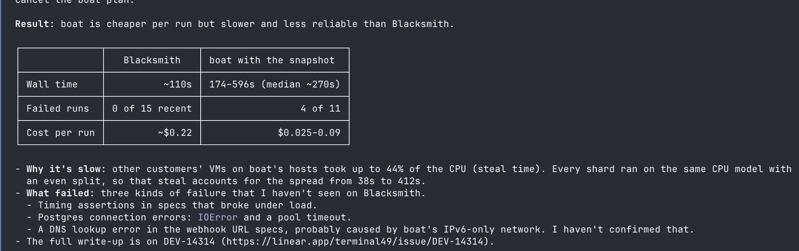

# Agent-first CI wishlist (@dodeja)

Source: [@dodeja on X, 3 Nov 2026 05:59 UTC](https://x.com/dodeja/status/2117496870889214233) (CEO of @terminal49). Full text via `note_tweet` (54 items). Quotes his earlier spend post: [@dodeja, 3 Nov 2026 01:44 UTC](https://x.com/dodeja/status/2117432695659831532).

The chart is his own write-up of a Terminal49 comparison (Linear `DEV-14314`). Headline: boat is cheaper per run but slower and less reliable than Blacksmith. Wall time about 110s on Blacksmith versus 174 to 596s on boat (median about 270s). Failed runs 0 of 15 recent on Blacksmith versus 4 of 11 on boat. Cost per run about $0.22 versus $0.025 to $0.09. He blames boat steal time (other customers' VMs taking up to 44% CPU) for the spread, and lists timing-assertion flakes, Postgres pool timeouts, and a DNS lookup failure he suspects is IPv6-only networking. Treat as one team's self-report, not a benchmark.

## Why this note sits here

`ai-friendly-environments/` is about turning agent work into deterministic paths. An agent-first CI surface is the same idea one layer up: failures come back as structured data, spend and secrets are capped, and a red build is something an agent can reproduce and fix without a human scrolling logs.

## Grouped wishlist (agent-relevant picks)

Do not treat the full 54 as a shopping list. Grouped below; speed, price and infra items are summarised once at the end.

### Agent interface

- CLI, API and MCP for everything (not a human UI with an API bolted on).
- JSON failures, not log dumps; logs that agents can query.
- Wait-until-done (no polling loop).
- Agents that fix red builds.
- Run CI on uncommitted changes.
- CI boxes as agent dev environments.
- Drop-in for GitHub Actions / one-line migration (vendor claim; not checked).

### Safety and spend

- Scoped, short-lived agent tokens.
- Spend caps per agent; cost per PR, team and agent.
- Secrets safe from fork PRs.
- Egress controls.
- SOC 2, SSO, audit logs (enterprise hygiene; not agent-specific).

### Debugging and repro

- Reproduce any failure in a sandbox.
- SSH into any job.
- Auto-bisect.
- Per-step CPU and memory graphs.
- Fail fast; test selection; shards split by test duration.

### Test health

- Flaky test quarantine.
- (From replies) flake rate with an owner; pass-rate history so a green retry is not treated as a fix; screenshot and DOM of a failing browser step; show which tests got slower; a run that checked nothing must not end green.

### Speed, price and infra (rest of the list)

Sub-5s starts, no peak queues, no start caps, machine sizes from 2 to 64+ vCPU, Arm / GPU / macOS / Windows, desktop-class CPUs, local NVMe, no noisy neighbours, same speed every run, per-second billing, no charge for queue or skipped jobs, host Docker layer cache, unlimited and remote build caches, snapshots (including with services, rebuild on lockfile change), fresh microVM per job, provider-caused failures at zero, network like GitHub's, spot with silent retry, built-in merge queue, preview envs per PR, bring-your-own cloud and overflow from own hardware, zero-config Rails/Node/Python, public benchmarks with variance, pricing without a sales call, engineer support in minutes. Mostly runner economics; useful as a scorecard against Actions larger runners and third-party runners, not as factory design.

## Useful replies

Treat vendor plugs as claims.

- @cyberogz: scoped short-lived tokens plus per-agent spend caps are the two that actually limit damage (token dies with the job; cap stops a retry loop).
- @srcbuild: still want a kill switch for an agent looping on the same red build.
- @valuecm: every failure should ship the exact repro command with commit and cache key pinned (agents burn tokens re-guessing the environment).
- @ShahidHelal1: flake rate per test over last 50 runs with an owner; keep screenshot and DOM of the failing browser step.
- @mptielemans: a run that checked nothing should not end green (his mac check said "no engine fits this commit" and GitHub marked success).
- @h_v_raj: an agent should be able to sign up and get to a first green run itself.
- @Sam4Jef: spend caps plus cost-per-agent so the agent sees what it already burned before it retries; JSON failures are underrated AX for CI.
- @hecodesforme: show which tests got slower, not only which failed.
- @Tesults: structured failures with pass-rate history across runs so agents do not treat a green retry as a fix (plugs their MCP; the point stands without the product).
- @SmallFounder: AMW (Preview) permits with budget, expiry and max_calls_per_tool (vendor claim).
- @mattgapp / @usejog: "32 of 54" (vendor claim).
- @anaganath / @PeakInfra: plug (vendor claim).
- @nateberkopec asks what Buildkite cannot already do; @grok replies that most of it is there (Buildkite claim; not independently verified here).

## What GitHub Actions and Copilot already offer

Checked against primary docs (Nov 2026). Flag unverified where noted.

| Wishlist idea | Actions / Copilot today |
|---|---|
| Agents that fix red builds; read Actions logs | **Yes.** Copilot coding agent and Copilot CLI can diagnose failing checks (`/pr fix ci`, "Fix failing checks" in the Copilot app). Docs: [Managing PRs with `/pr`](https://docs.github.com/en/copilot/how-tos/copilot-cli/use-copilot-cli/manage-pull-requests), [Diagnosing CI test failures](https://docs.github.com/en/copilot/tutorials/copilot-cookbook/debug-errors/diagnose-ci-test-failures). |
| MCP for Actions (query runs / logs) | **Yes, with the Actions toolset enabled.** GitHub MCP tools named in docs include `list_workflow_runs`, `summarize_job_log_failures`, `get_job_logs`, `get_workflow_run_logs`. See [Adding agent skills](https://docs.github.com/en/copilot/how-tos/copilot-cli/customize-copilot/add-skills) and [MCP toolsets](https://docs.github.com/en/copilot/how-tos/copilot-in-your-ide/customize-copilot/extend-copilot-with-tools-and-context/configure-toolsets). `summarize_job_log_failures` is a log summary, not a native JSON failure schema from the job itself. |
| Wait-until-done, no polling | **Partial.** `gh run watch` blocks until a run completes ([manual](https://cli.github.com/manual/gh_run_watch)). That is CLI wait, not an event-driven MCP subscription. |
| Scoped short-lived tokens | **Partial.** Job-scoped `GITHUB_TOKEN` with `permissions:` least privilege ([automatic token authentication](https://docs.github.com/en/actions/security-for-github-actions/security-guides/automatic-token-authentication)); OIDC JWTs for cloud roles ([OIDC reference](https://docs.github.com/en/actions/reference/security/oidc)). Not a first-class "agent identity" token with per-agent spend. |
| Spend caps per agent; cost per agent | **No native per-agent spend cap found.** Org/repo Actions minutes and Copilot premium request budgets exist at coarser grain. Unverified whether any preview ties spend to a coding-agent session id. |
| Secrets safe from fork PRs | **Yes by default.** Secrets are not passed to workflows triggered by a PR from a fork; `GITHUB_TOKEN` is read-only. See [secret types](https://docs.github.com/en/code-security/reference/secret-security/secret-types) and [securely using `pull_request_target`](https://docs.github.com/en/actions/reference/security/securely-using-pull_request_target). |
| Egress controls | **Yes for the coding agent.** Default firewall with allowlist; customisable or disableable ([customize the agent firewall](https://docs.github.com/en/copilot/how-tos/use-copilot-agents/coding-agent/customize-the-agent-firewall)). Actions jobs themselves do not get the same built-in allowlist unless you add your own. |
| CI boxes as agent dev environments | **Yes.** `.github/workflows/copilot-setup-steps.yml` preinstalls tools on the coding agent's Actions environment; can target larger or self-hosted runners ([customize the agent environment](https://docs.github.com/en/copilot/how-tos/use-copilot-agents/coding-agent/customize-the-agent-environment)). |
| Larger runners, Arm, GPU, macOS, Windows | **Yes (paid).** Larger runners cover 2 to 96 vCPU, arm64 and x64, macOS, Windows, and a Tesla T4 GPU SKU ([larger runners reference](https://docs.github.com/en/actions/reference/runners/larger-runners)). Not per-second billing; Actions still rounds job minutes up ([billing](https://docs.github.com/en/billing/reference/actions-runner-pricing)). |
| Built-in merge queue | **Yes.** Repo merge queue plus `merge_group` workflow trigger ([managing a merge queue](https://docs.github.com/en/repositories/configuring-branches-and-merges-in-your-repository/configuring-pull-request-merges/managing-a-merge-queue)). |
| Flaky test quarantine; auto-bisect; JSON failure schema; SSH into any job; run CI on uncommitted changes | **No native product for these.** Third-party actions and `tmate`/debug patterns exist in the wild; not first-party. Unverified whether any GitHub preview covers them. |
| Queryable structured failure ledger / pass-rate history | **Not native.** Actions metrics cover job failure rates and run times at workflow/job grain ([Actions metrics](https://docs.github.com/en/actions/concepts/metrics)), not per-test flake ownership. |

## GHCP mapping for Sam's factory

**Free (or already on the path) from Actions and the Copilot coding agent**

- Coding agent / `/pr fix ci` / "Fix failing checks" for red builds.
- GitHub MCP Actions toolset for listing runs and pulling or summarising job logs.
- `gh run watch` when a human or local agent needs wait-until-done.
- Fork-PR secret withholding and least-privilege `GITHUB_TOKEN` / OIDC.
- Coding agent firewall as egress control for agent sessions.
- `copilot-setup-steps.yml` as the agent "CI box" / pre-warmed env.
- Larger runners (Arm / GPU where needed) and the merge queue.

**Build on top (Agentic Workflows, skills, or small Actions steps)**

- A JSON failure summariser step (or an Agentic Workflow that posts structured failures: test name, file, assertion, commit SHA, cache key, suggested repro command). Prefer this over letting agents ingest raw logs.
- An Agentic Workflow that triages red builds with a hard retry cap or kill switch (the @srcbuild point), and that refuses another attempt once spend or attempt count for that check is exhausted.
- A flaky test ledger: flake rate over last N runs, owner, quarantine flag; feed it to the agent so a green retry is not treated as a fix (@Tesults / @ShahidHelal1).
- A "skipped means not green" check (@mptielemans): fail the job if the suite selected zero tests or the matrix skipped every leg.
- Emit a pinned repro command on every failure (@valuecm).
- Surface "what this agent already spent" before a retry (@Sam4Jef); until GitHub ships per-agent caps, approximate with workflow `concurrency`, attempt limits, and budget comments the triage agent must read.
- Optional: keep Playwright failure screenshot and DOM beside the log for browser steps.

## Unverified / do not overclaim

- Vendor "we do N of 54" posts (@usejog, @PeakInfra, @SmallFounder AMW, @grok on Buildkite).
- Whether GitHub has any preview of per-agent spend caps or a native flaky quarantine product.
- That boat's IPv6 theory is the real DNS cause (his suspicion only).
- Exact MCP tool names may drift; re-check `github/github-mcp-server` when wiring skills.
