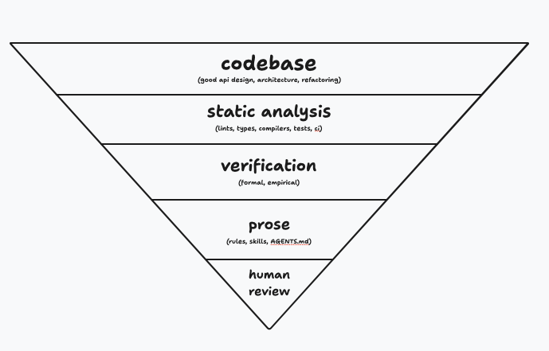

# Deterministic engineering over "software factory" (@poteto)

Source: [@poteto on X, 6 Nov 2026 07:54 UTC](https://x.com/poteto/status/2118613050462728659). Quotes [@thdxr](https://x.com/thdxr/status/2118604739428426223) ("all the companies selling you a software factory produce a shockingly tiny amount of software"). One PNG attached (saved next to this note).

**Original image:** `2026-11-06-poteto-deterministic-engineering.png` (689x441 RGBA PNG, 47,983 bytes, SHA256 `d556a16f609a9a31ab09d78c1fd7cd3804d1eae064fe1bbc4fb5eceaf154916a`). Bytes copied from the X media URL with `name=orig`; not re-encoded.

## What the image shows

Hand-drawn style **inverted pyramid** on white, five bands from widest (top) to point (bottom):

1. **codebase** (good api design, architecture, refactoring)
2. **static analysis** (lints, types, compilers, tests, ci)
3. **verification** (formal, empirical)
4. **prose** (rules, skills, AGENTS.md)
5. **human review**

"ci" and "AGENTS.md" show red squiggly underlines (editor spell-check look).

## What @poteto says (opinion)

In the post, @poteto says they do not love the term "software factory" and call it marketing; you need good software engineering and to invest tokens in the right places; **more deterministic is better and more token-efficient**.

Useful follow-up to @jamonholmgren / @aphumphreys: ["i dont know what a factory is atp lol, it's like web 2.0 but for agents"](https://x.com/poteto/status/2118615601019265100).

No new throughput or cost numbers in this post. Treat the pyramid order and the anti-marketing stance as @poteto's opinion, not measured claims.

## GHCP mapping (proposed application)

Prefer cheap deterministic gates before spending tokens: tests, types, lints and CI as required checks; keep skills / `AGENTS.md` / review for ambiguous work. That is a proposed mapping onto GitHub Copilot and Actions, not a claim that GHCP ships this pyramid as a product feature.
