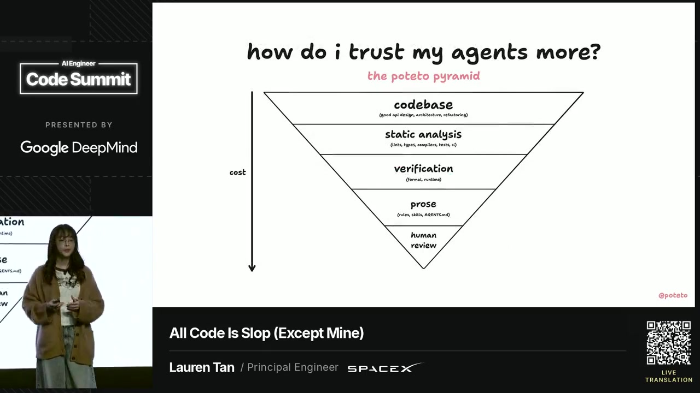
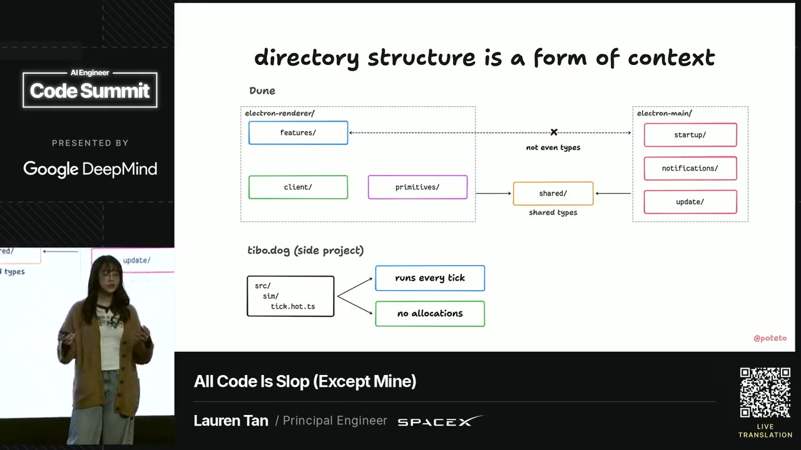
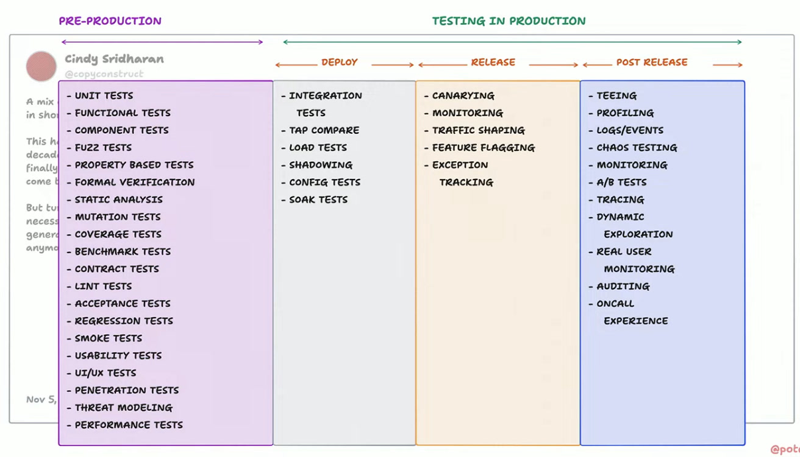
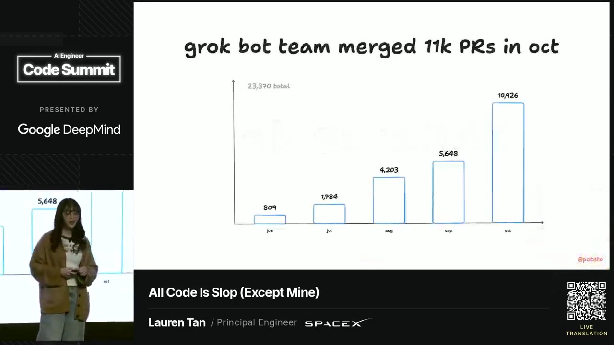
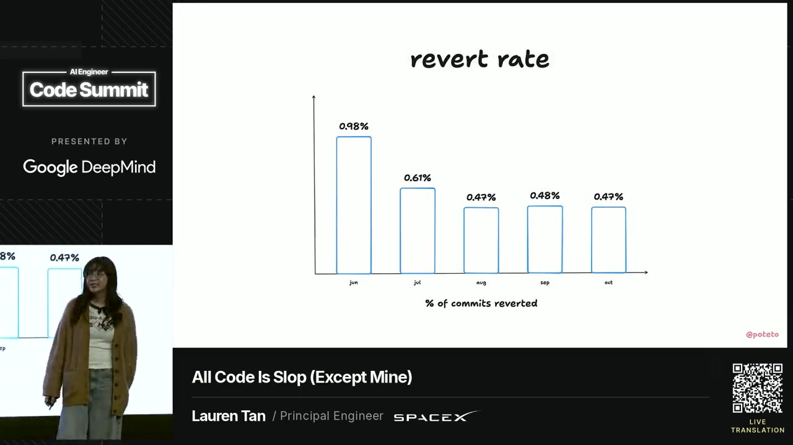
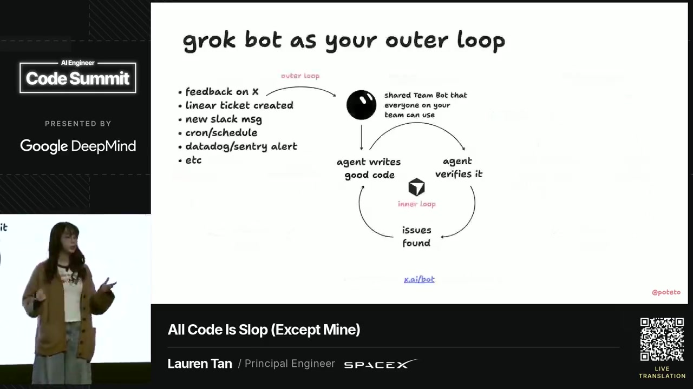

# All code is slop (except mine) (@poteto)

Source: [@poteto, "All Code Is Slop (Except Mine)", AI Engineer Code Summit, 11 Nov 2026, 18:00 to 18:19 UTC / Europe/London](https://www.youtube.com/watch?v=ZZ19zhYnDKY&t=3630s). The talk is on the [AI Engineer](https://www.youtube.com/@aiDotEngineer) livestream; official listing was 10:10 to 10:30 PT, and the morning ran about ten minutes early.

This note is taken from a local speech-to-text transcript of that stream, plus a video-model analysis of the slides that was then checked against stills. Every number below was read from a still. The video model's figures were unverified, and several were wrong, so any figure I could not confirm on a still is omitted. Handles only: @poteto and @copyconstruct. Team results are self-reported from her slides and talk.

Stills are from the 720p encode (1280x720). The taxonomy image is Sam's own screenshot, converted to JPEG; that screenshot is the authoritative reading of the chart, because the video model misread its items.

## Slop, trust and the pyramid

@poteto's opening joke is that "our" agent output looks like craft and "their" agent output looks like slop, even when both are a long pull request from the same kind of agent. The serious claim is that you can turn slop into gold by investing in the agent's environment, so the default change is good.

A personal chart titled "i shipped 3,000 PRs to prod last month" shows monthly bars from March to October: 68, 254, 352, 685, 1,113, 2,401, 2,732 and 3,127, with a printed total of 10,732. October is the 3,127 bar; "3,000" on the title is rounded. She said volume used to matter only for rare "coding machines", and that with agents anyone can be one. The new meta, in her words, is maintaining or improving quality while massively increasing productivity. Some people call that a software factory; she prefers to talk about trust, "not blind trust", built by investing in the environment. She said it took her six months to reach a point where she could ship thousands of pull requests, "a lot of them, in my sleep."

A trust curve plots trust against number of agents, marked 1, 1 to 5, 5 to 10, 10 to 20, hundreds and thousands, with "frontier" at thousands. Low trust is a loop where the agent writes slop and a human verifies it. High trust is a loop where the agent writes good code and the agent verifies it. Both loops still find issues; the difference is who does the checking.

The inverse pyramid, labelled "the poteto pyramid" and "how do i trust my agents more?", is how she decides where to spend that effort. A "cost" arrow points down, so the wide top is cheaper than the point. From cheapest to dearest:

1. **codebase** (good API design, architecture, refactoring)
2. **static analysis** (lints, types, compilers, tests, CI)
3. **verification** (formal, runtime)
4. **prose** (rules, skills, AGENTS.md)
5. **human review**

The first two layers are deterministic. Used together, they "constrain what agents can do and force them to do the right thing by default." Verification, runtime and formal, finds bugs and checks whether the agent understood the goals. Prose is for judgement, and should come after the cheaper layers, not instead of them. This is the same order as her earlier [deterministic engineering](2026-11-06-poteto-deterministic-engineering.md) post, with "runtime" on this talk's verification band rather than "empirical". See also that note for her scepticism of "software factory" as marketing.

## Organic architecture, Dune and directory structure

Because the codebase is one of the largest inputs, "code is memory": workarounds, anti-patterns and stale comments get copied by the next agent and start to look like the established pattern. A slide titled "each copy makes the next copy more likely" shows one workaround becoming "the pattern" after a few copies. Her garden analogy is that constraints and guardrails are the foundations that new agent code grows around. Review volume, she said, has gone from a handful of colleague pull requests in 2024 to more like 300, because "every engineer is now a team of hundreds or even thousands of agents."

Dune is the client framework they built for Grok Bot to make that idea concrete. She described it as "Next.js for Electron apps." The interesting part is the constraints. A slide "dune: a framework for agents" is an app framework (navigation, rendering, IPC) plus three rules: one folder per feature, strict import bans, and no comments in code. "Nuance tends to lead to slop," so they would rather design a better API than teach the nuance. The worked example is React `useEffect`, which they have banned in product code and allow only inside some Dune APIs, so reviewers never have to catch that misuse again.

Directory structure is treated as context. `electron-renderer/` holds `features/`, `client/` and `primitives/`. `electron-main/` holds `startup/`, `notifications/` and `update/`. Both sides may import a central `shared/` folder for shared types. A crossed-out link between renderer and main is labelled "not even types": imports between those two trees are forbidden by a dependency-graph analyser and lint rules. The same slide shows a tight side project, tibo.dog, with `src/sim/tick.hot.ts` annotated "runs every tick" and "no allocations": a filename that already tells the agent how the file is allowed to behave.

A related failure mode is unsolicited markdown. Agents use documentation, comments, rules and skills as a place to justify not doing the right thing, or they over-rotate on a small correction and treat it as an unbreakable law.

## Quick fixes, comments and "correct once, then lint"

The "quick fixes considered harmful" slide is a concrete case of a copied workaround. On 9 September an agent landed a `setTimeout(..., 0)` "fixes a flicker" patch, with a comment "release later, in case it comes back", and said "it would be a larger change." On 3 October the same pattern was copied into a shared module. By 17 October the slide reads **183 timers**. She said this was papering over an architecture clash between VS Code's imperative style and React's declarative style, and that rapidly created and destroyed timers caused garbage-collection jank. The comments in red were part of the problem: they justified the shortcut, so the next agent copied it.

They then banned most comments, because comments go stale, humans rarely read "comment slop", and a comment is an unenforceable escape hatch. A chart titled "comments are liabilities" shows **65,824** comments on 31 July and **1,227** "today." The slide points at [`/no-comments`](https://github.com/cursor/plugins/tree/main/pstack/skills/no-comments) in [pstack](https://github.com/cursor/plugins/tree/main/pstack) (`github.com/cursor/plugins`). That path exists on `main`. In the talk she said they now ban "99%" of comments; the chart is the figure to trust.

The general rule, on a slide titled "whenever you correct your agent," is: **lint against it, or categorically eliminate the problem** (better API or architecture). A step chart of cumulative lint rules, from 1 July to 1 November, reads **7, 17, 38, 90, 139, 149, 157, 167**. Do this often enough, she said, and there is "nothing left to review," so agents can merge most of their own pull requests.

## Verification

"Verification is the most important step," overlaid on the pyramid. Code review, she said, has shrunk to looking at artefacts: videos, screenshots, diagrams and formal results.

**Runtime verification** is giving the agent a way to run the real app and use ordinary debugging tools, including the Chrome DevTools protocol. A feature map is a sitemap of features from the user's point of view: what features exist, how users reach them, and what proves they work, so the agent is not guessing when you say "the thingy in the left sidebar." Custom CLIs in the skills (the slide shows commands such as driving the app and taking a snapshot) let the agent reuse a testable driver and cut token use. The slide points at [`/create-verification-skill`](https://github.com/cursor/plugins/tree/main/pstack/skills/create-verification-skill) in pstack, which exists on `main`.

**Formal verification** is still experimental in her telling, "another layer," not a silver bullet, though she said they have already found bugs with it. The slide splits the work as: TLA+ to "model a state machine" and "check that its rules hold" / "check that all states are correctly handled"; Lean to "write proofs about code" and "check implementation for bugs." In the talk she mentioned TLA+ on major user flows such as notifications across devices, and Lean on a custom virtualisation library to check for flicker or jitter. The slide points at [`/create-formal-verification-skill`](https://github.com/cursor/plugins/tree/main/pstack/skills/create-formal-verification-skill) in pstack, which also exists on `main`. See the earlier note on [formal-verification and statechart skills](2026-11-08-poteto-formal-verification-statecharts.md).

**UI property-based testing** uses [Bombadil](https://github.com/antithesishq/bombadil) (`github.com/antithesishq/bombadil` is the URL on the slide, and that repository exists: "Property-based testing for web and terminal UIs"). She said it has already caught a few UI bugs for them.

[`/statechart`](https://github.com/cursor/plugins/tree/main/pstack/skills/statechart) in pstack, also confirmed on `main`, is a skill she made to visualise state machines from the user's point of view, which she finds easier to review alongside videos and screenshots. The slide gives the plugin URL `github.com/cursor/plugins/tree/main/pstack`.

## The testing taxonomy for the factory

She then showed two posts from @copyconstruct. A 15 May post, quoted on the slide, said that multiple AI-generated pull requests with subtle bugs had been merged and needed days of manual verification, so "velocity" was not really going up. The 5 November follow-up, highlighted on the same slide, reads:

> What was missing in my setup 6 months ago was the verification process I now use.
>
> 70% of my daily token spend goes into verifying patches, and only ~20-30% into creating them.

@poteto said that tracks with her own usage: most of her tokens also go to verification.

The taxonomy slide (Sam's screenshot, on screen from about 01:13:45 to 01:14:20 in the stream) is labelled as a chart from that 5 November tweet, redrawn. A wider version of the same slide includes @copyconstruct's commentary: this mix of techniques had been her dream for nearly a decade, and with agents she can finally see it "partially" come true; it is "what I necessarily require to trust agent generated code. It's not optional anymore, imo."

@poteto's own line, over this chart, is the one Sam flagged as gold:

> none of these things here are new or novel techniques that we've never had before. These are just good software engineering tools, but ones that might have been prohibitively expensive to use before as they were hard to understand or maintain. But agents drastically cut this cost down. And really, we're entering a golden age of software testing and verification because agents let us test everything to a much greater degree than used to be economical.

The columns, taken from Sam's screenshot, and a suggested mapping onto a Python and TypeScript repo:

- **Pre-production** (unit, functional, component, fuzz, property-based, formal verification, static analysis, mutation, coverage, benchmark, contract, lint, acceptance, regression, smoke, usability, UI/UX, penetration, threat modelling, performance). This is the cheap inner loop. An agent can now author and keep current pytest and vitest tests, Hypothesis and fast-check properties, ruff, ESLint, mypy or pyright, `tsc --strict`, coverage and mutation jobs, Playwright smoke and acceptance tests, and lint rules that encode review lessons. Formal checks and statecharts belong here too, as skills, not as a substitute for those gates. Fuzzing and contract tests fit parsers, APIs and schema boundaries.

- **Deploy** (integration, tap compare, load, shadowing, config, soak). Agents can write the integration and config tests, a tap-compare or shadow check of old versus new responses, and load or soak jobs (for example k6 or Locust) that run in CI or staging before a full release. This is still deterministic work, just closer to the real system.

- **Release** (canarying, monitoring, traffic shaping, feature flagging, exception tracking). These are the shipping controls. An agent can propose a flag, a canary, or a dashboard, but the canary and the flag are what make a bad change cheap to undo. Do not treat a green unit run as a release decision.

- **Post release** (teeing, profiling, logs and events, chaos, monitoring, A/B, tracing, dynamic exploration, real user monitoring, auditing, oncall experience). This is the outer loop's input, not the first line of defence. Agents can watch Sentry, traces, RUM and on-call pain and open fix pull requests, and they can help run chaos or audit checks, but only once the inner loop already produces good default changes.

## Results (self-reported)

These figures are from her own slides. They have not been independently measured here.

- Team pull requests, title "grok bot team merged 11k PRs in oct": June 809, July 1,784, August 4,203, September 5,648, October 10,926, printed total **23,370**.
- Desktop app releases a month: 41 in total. August 7 from launch, median 44 hours between releases; September 19, 25 hours; October 15, 28 hours. In the talk she said they cut a new stable version about once a day.
- Contributors ("everyone is more productive"): June 15, July 48, August 95 (launch marked 11 August), September 163, October **227** people with at least one pull request. The October bar is stacked by volume (core, casual, drive-by). She said the core team is shipping more, and there are more casual contributors without much context.
- Revert rate, labelled "% of commits reverted": June 0.98%, July 0.61%, August 0.47%, September 0.48%, October 0.47%. In the talk she said the revert rate has got lower on a relative basis and is "steady at about half a percent," despite the rising volume.

A "velocity without compromise" table compares May with "now" for the Electron desktop client. Several interaction metrics improved, for example cold launch 2,304 ms to 1,395 ms (minus 39%), short-chat typing median 3.8 ms to 2.8 ms (minus 26%), and switching to a short chat 88 ms to 49 ms (minus 44%). Some resource figures went the other way: idle memory 488 MiB to 545 MiB (plus 12%), idle CPU 0.40% to 0.80%, and JS plus CSS at startup 2.0 MB to 9.7 MB. The slide's footer is: "there is a ceiling, but electron apps can be decently fast (i am however toying with the idea of a rust rewrite)." Treat the whole table as self-reported telemetry, not as a claim that every number improved.

## Don't automate a bad loop

Before building a "software factory," she said, correct the agent by improving the codebase first: add a lint rule, clean up the old pattern, and make the verification story strong. "If your inner coding loop produces slop, then automating that loop just produces more slop," and you burn more tokens. That is close to @andrestaltz's warning against premature automation in [Lessons from running a software factory](../reading-notes/2026-11-10-andrestaltz-software-factory-lessons.md).

The "don't automate a bad loop" slide restates low trust (human verifies slop) versus high trust ("after the poteto pyramid," the agent verifies good code), then a third loop labelled "factory" / "trust enables scale," entered by an "automated trigger." The caption is "improve your loop before automating!"

Once the foundations exist, she offers Grok Bot as that outer loop: connectors and routines that kick off Cursor, cloud agents and projects. Triggers on the slide are feedback on X, a Linear ticket, a new Slack message, cron or schedule, a Datadog or Sentry alert, and so on, landing on a "shared Team Bot that everyone on your team can use." The inner loop on the same slide is still "agent writes good code" and "agent verifies it." The example: when they cut a release, Grok Bot spins up a Cursor project that fuzzes the build by using the app like a real user, then opens fix pull requests and auto-merges them, "as crazy as that sounds," because "pull requests tend to just be good by default." She also showed a Slack thread of one such fuzz run. That screenshot is demo output from their own bot; this note does not repeat names from it, and it is not treated as independent evidence.

Close: "when you have solid foundations and good organic architecture, you can turn slop into gold," and "ship with high velocity without compromising on quality."

## GHCP mapping

This is a proposed port onto GitHub Copilot for a Python and TypeScript factory, not a feature of the talk.

Use the pyramid as the investment order. Put lints, types (mypy or pyright, and `tsc --strict`), import-ban rules ([import-linter](https://import-linter.readthedocs.io/), ESLint `no-restricted-imports`, or dependency-cruiser), and a no-comments lint in CI, and make them **required checks**, before pouring more energy into `.github/copilot-instructions.md` prose. Skills and instructions still matter for judgement; they should not be the first or only control.

Encode "correct once, then lint" as a [custom agent](https://docs.github.com/en/copilot/how-tos/copilot-on-github/customize-copilot/customize-cloud-agent/create-custom-agents) or a skill that turns a review comment into a lint rule (and, where possible, deletes the foot-gun in the API). Prefer a deterministic check over another line of markdown.

For runtime verification, give the coding agent a way to drive the real app: install Playwright (or the repo's existing browser driver) in [`.github/workflows/copilot-setup-steps.yml`](https://docs.github.com/en/copilot/how-tos/copilot-on-github/customize-copilot/customize-cloud-agent/customize-the-agent-environment), keep a feature map in the repo, and require the same checks in Actions. Add property-based tests with Hypothesis and fast-check. Port the formal-verification and statechart skills into [`.github/skills`](https://docs.github.com/en/copilot/how-tos/copilot-on-github/customize-copilot/customize-cloud-agent/add-skills), as already sketched in the [statecharts note](2026-11-08-poteto-formal-verification-statecharts.md), with models and reports stored in the repo and replayed in CI.

The done-gate should be deterministic. Pair required checks with an `agentStop` hook that will not let the turn end on a failed or skipped verify script. Copilot hooks can block a turn with a JSON decision; do not ship a stub that always succeeds. See [Folder setup that is meant to stop lazy "fixed" claims (@bebuu_ai)](../reading-notes/2026-11-11-bebuu_ai-claude-harness.md).

The outer loop is [GitHub Agentic Workflows](https://docs.github.com/en/copilot/concepts/agent-capabilities/agent-powered-workflows-and-operations/about-github-agentic-workflows) or Actions triggers (an issue, a schedule, a Sentry webhook) that assign the Copilot coding agent, once the inner loop is already high trust. The production columns, canaries, feature flags and monitoring, stay the safety net around that automation, not a reason to skip the pyramid.

## Related notes

Confirmed in `pySam1459/software-factory-notes`: [deterministic engineering](2026-11-06-poteto-deterministic-engineering.md), [formal-verification and statechart skills](2026-11-08-poteto-formal-verification-statecharts.md), [Lessons from running a software factory (@andrestaltz)](../reading-notes/2026-11-10-andrestaltz-software-factory-lessons.md), and the [@bebuu_ai harness note](../reading-notes/2026-11-11-bebuu_ai-claude-harness.md). The older [workshop note](../reading-notes/2026-10-28-poteto-agent-team-workshop.md) covers the trust curve, verification skills and Dune constraints in an earlier talk.
