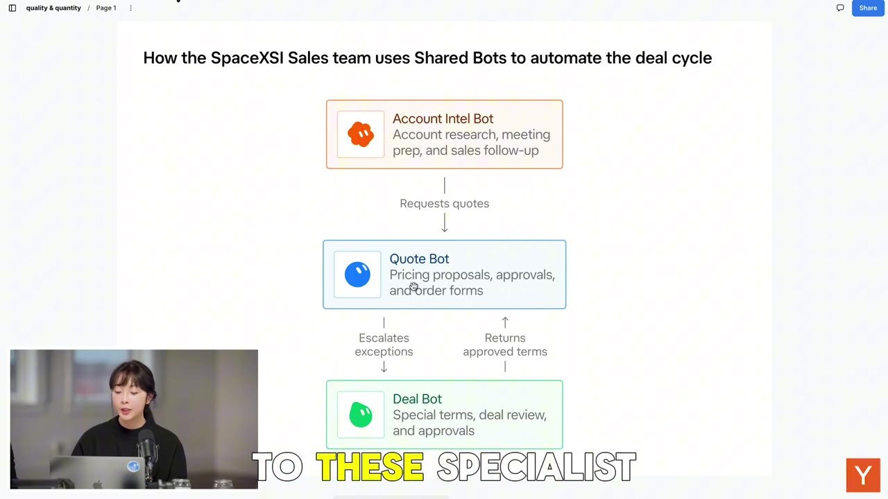
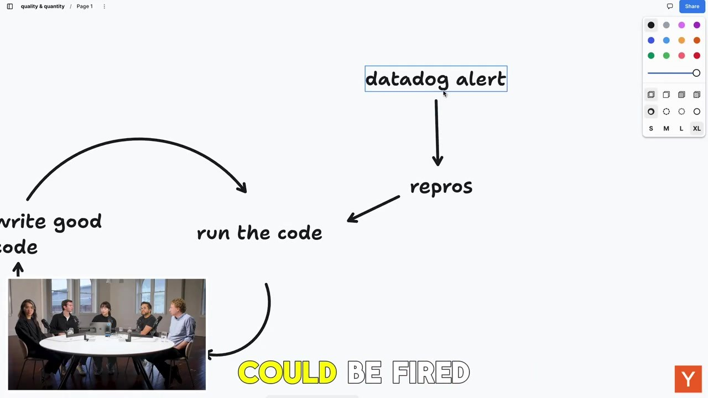
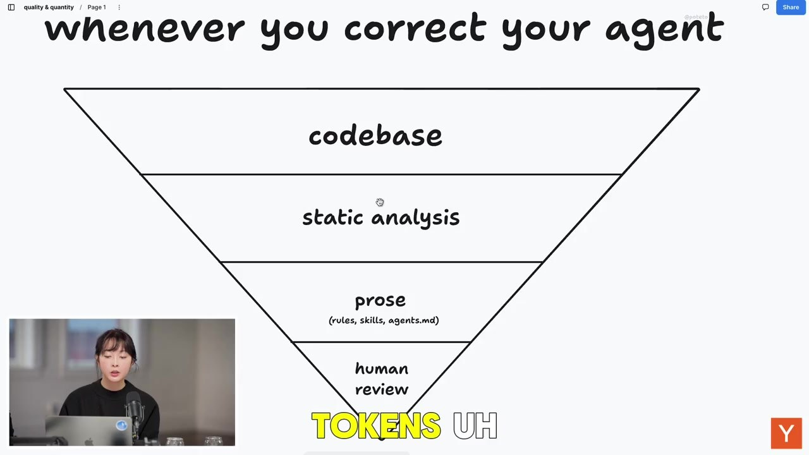

# The Rise Of AI Coworkers, Lightcone episode (@poteto)

Source: [Y Combinator Lightcone, "The Rise Of AI Coworkers", uploaded 14 Nov 2026](https://www.youtube.com/watch?v=y1-9yeYLJUo) (60 min 6 s). @poteto and a co-guest from the Grok Bot team talk with Lightcone hosts about AI teammates, trust, and a software factory. Sam found the episode through [@k1rallik's greentext post](https://x.com/k1rallik/status/2122461737450643877) (16 Nov 2026, 22:48 Europe/London), which attached a slightly shorter copy (54 min 56 s) and quoted @k1rallik's own article. The career claims in that greentext, including that Cursor was bought by SpaceX, are not verified. Slide and diagram descriptions below come from a video-model analysis of the X copy, checked against the YouTube auto-captions, which are the primary source for what was said.

## The claim

Trust is built in stages. A co-guest described starting small and read-only, with no real access to tools, until you see the bot do the work as you would expect. Step two is that it can take action and take on a task end to end. Step three is owning a whole job, judged on outcomes, which they said organisations are still quite far from. Their Data Bot is the step-one example: read access to a database, no actions beyond answering questions in Slack.

@poteto prefers specialised bots, each caring about one problem, over one bot that cares about a hundred things. Shared "team bots" encode a team's best practice so not everyone keeps a private copy. She showed a sales slide, "How the SpaceXSI Sales team uses Shared Bots to automate the deal cycle": Account Intel Bot (account research, meeting prep, and sales follow-up) requests quotes from Quote Bot (pricing proposals, approvals, and order forms), which escalates exceptions to Deal Bot (special terms, deal review, and approvals) and gets approved terms back. The same idea, she said, exists for engineering bots that carry shared principles and skills.

On identity and permissions, the co-guest's rule was: do what you would do for a human. Treat bots like employees, with their own computer, their own credentials, and access scoped by role and seniority, widened as trust grows. A host mentioned an open-source project called Quartermaster in which a bot inherits the access of the user it assists. That project and behaviour were not checked here, and should be treated as unverified.

Bots talk to each other in the product and in Slack. @poteto has told a lead engineer bot to supervise other engineer bots in a thread. She also asks her personal bot to go and get data from a specialist data bot.

Her own feature workflow now lives in Slack (and sometimes X). She drops in a link or a request, and the bot scopes the work before anyone writes product code: in this episode it spawned a Cursor cloud agent, which has its own virtual machine, ran the Grok Bot app, and came back with screenshots and videos. The video-model analysis of that thread screen (not reproduced here, because it shows real people's names) adds that the cloud agent compared approaches such as React Server Components, a sandboxed iframe, an agent-emitted component schema, or an inline canvas, then posted a recommendation. Auto-captions confirm the spawn, the VM, and the prototypes. She and colleagues then built a whole feature in that one public thread, about 200 messages, without opening the IDE. She said this kind of trust does not happen overnight: it needs investment in skills, codebase guardrails and constraints, so time once spent on human review is encoded as static analysis and tools. Once those systems are in place, she has "gotten to a point where I essentially have my agents merge their own pull requests," and in that thread they looked at the artefacts rather than reading the PR.

The smallest useful loop, on her whiteboard, is write code, run the code, find issues with code. She crossed out "good" on purpose: a loop can make the result correct without making the code good. The missing piece is teaching the agent to run the code empirically: take CPU traces and performance metrics, and use the application like a real user, so it can check its own work. Once that inner loop is solid, an outer trigger can feed it: a Datadog-style alert goes to "repros," which then enters "run the code." The still below is the completed board from the video-model analysis, checked against the captions. The picture-in-picture covers the bottom "find issues with code" label, which she had already written on the same board.

On review, a host described an adversarial `/ship` skill that walks every line, aims to catch about 30 bug classes, and burns tens of millions of tokens (the host also mentioned trying to cut a review from 50 million tokens to 10 million). @poteto has pulled back from heavy multi-model review in pstack, including an "interrogate" skill, because it overfits: the reviewer lacks product judgement, does not know the wider goals, and will flag issues in code that is about to be replaced. She would rather encode each correction into the inverted pyramid she titled "whenever you correct your agent": most investment goes into the codebase and static analysis, then a thinner layer of prose (rules, skills, agents.md, pstack updates), and only a little human review, kept for critical infrastructure, databases and deploys. Her example was the Grok Bot desktop app on Electron: the renderer thread is sensitive to long tasks if you want 60 FPS (a 16 ms or 8 ms budget), so they forbade heavy imports onto that thread with a lint rule and a dependency-graph checker in CI, instead of catching it in review.

Execution is getting cheap. The scarce skill, they argued, is translating intent: what to build, what "good" looks like, and what to refuse. The co-guest's warning was a Frankenstein product, assembled from every ready-made side project because someone already has a PR. @poteto said that even with this velocity she still wants intentional care in software built for humans, and she turns her own factories more toward maintenance and quality than toward unbounded feature work.

A host sketched an AI-native organisation in three roles, kept brief here: ICs who ship, DRIs who own outcomes, and AI player-coaches who teach the rest. The co-guest added that shared team bots already triage a large volume of customer messages and escalate to the right DRI.

## What checks out

The YouTube auto-captions support the staged trust model, specialised and shared bots, employee-like credentials, the Slack-thread workflow, agents merging their own PRs in her setup, the write/run/find loop plus empirical execution, the inverted pyramid, the renderer-thread lint, and the pushback on token-heavy review. Slide titles and board labels match the video-model analysis. Quartermaster was a host aside and is unverified.

PR counts are self-reported or second-hand. A host said she had gone from about 2,000 PRs a month to over 4,000. The co-guest later repeated "putting up 4,000 PRs a month." Treat both as claims, not audited totals, in line with earlier notes. The 3 am unattended deploys are also second-hand: the co-guest described a maintenance bot that takes in thousands of pieces of customer feedback and, for small bugs, "repros, fixes, merges, no one thinks about it," and a host added that "it goes out automatically at 3:00 in the morning."

[@david1989_zhu](https://x.com/david1989_zhu/status/2122648164851495178), on the greentext post, was right to ask for a reliable announcement before treating "Cursor gets bought by SpaceX" as fact. [@wolenczakowy](https://x.com/wolenczakowy/status/2122596408762962070) still wanted to know what was actually shipped with those thousands of merged PRs. That question is not answered by a count alone.

@k1rallik later recapped his own quoted article as ["SPACEX JUST DROPPED AN 8-CHAPTER GUIDE"](https://x.com/k1rallik/status/2122786288042410144). That is a misleading plug of his guide, not a SpaceX publication and not this episode.

## Related notes

The inverted pyramid is the same shape as [All code is slop (except mine)](2026-11-11-poteto-all-code-is-slop.md) and [Deterministic engineering](2026-11-06-poteto-deterministic-engineering.md): put weight on the codebase and checks, not on prose and human review. Encoding a review lesson as a lint or dependency rule is also the theme of [state machines and statecharts](2026-11-08-poteto-formal-verification-statecharts.md) and the earlier [workshop on trust and hard constraints](../reading-notes/2026-10-28-poteto-agent-team-workshop.md). pstack and "bring your own knives" sit with the [Grok Bot team guide](2026-10-31-grok-bot-team-guide.md), [/_nogu66 on /automate-me](2026-11-03-_nogu66-pstack-automate-me.md), and the compilations of [core principles](compilation/core-principles.md), [tooling](compilation/tooling.md) and the [multi-bot setup](compilation/multi-bot-setup.md).

Staged access and bot identity overlap [always-on agents (@TekonBurns)](../reading-notes/2026-11-13-TekonBurns-always-on-agents.md) and [one account per agent (@berman66)](../reading-notes/2026-11-11-berman66-agent-identity.md). The review pushback, that a thorough agent review can lack product judgement, sits next to [three review levers (@BHolmesDev)](../reading-notes/2026-11-13-BHolmesDev-three-review-levers.md) and [cheap code, precious trust](../reading-notes/2026-10-26-cheap-code-precious-trust.md). The factory-around-the-agent framing, and the vendor test, are in [what a software factory actually is (@mardehaym)](../reading-notes/2026-11-16-mardehaym-software-factory-10-parts.md).

## Copilot mapping

This is a proposed port onto Sam's GitHub Copilot factory (Python backend, TypeScript frontend, Actions, pstack), not a claim that GitHub ships the Lightcone setup.

**Pyramid, then prose, then review.** Encode corrections first as checks in Actions: [Ruff](https://docs.astral.sh/ruff/linter/) and [Pyright](https://microsoft.github.io/pyright/) on the Python side, ESLint (including import restrictions) on the TypeScript side, plus a dependency-graph check such as [import-linter](https://import-linter.readthedocs.io/). That is the renderer-thread lesson: a 16 ms budget becomes a forbidden import, not a review comment. Keep [`.github/copilot-instructions.md`](https://docs.github.com/en/copilot/concepts/prompting-and-context/custom-instructions), `AGENTS.md` and skills as the thinner prose layer. Use [Copilot code review](https://docs.github.com/en/copilot/how-tos/use-copilot-agents/use-code-review) last, and remember that by default it leaves a comment review that does not count toward required approvals. Do not spend tens of millions of tokens on an adversarial `/ship` pass as the main gate.

**Trust stages.** GitHub does not ship a three-step read-only, then actions, then own-the-job product. You can approximate it with tighter [tool permissions](https://docs.github.com/en/copilot/how-tos/use-copilot-agents/cloud-agent/use-cloud-agent-on-github) and a narrow [firewall allowlist](https://docs.github.com/en/copilot/how-tos/use-copilot-agents/coding-agent/customize-the-agent-firewall) at first, [branch rulesets](https://docs.github.com/en/repositories/configuring-branches-and-merges-in-your-repository/managing-rulesets/available-rules-for-rulesets) that require checks and reviews, and a later loosening once the checks hold. That is a policy you design, not a built-in ladder.

**Specialised and shared bots.** Custom agents live in [`.github/agents/`](https://docs.github.com/en/copilot/how-tos/copilot-on-github/customize-copilot/customize-cloud-agent/create-custom-agents) as `*.agent.md` profiles, which you can also share at organisation level. Use them for specialist jobs (a data-read agent, a review agent, an engineering agent with pstack skills), not one monolith prompt.

**The loop.** Put install and test bootstrapping in [`.github/workflows/copilot-setup-steps.yml`](https://docs.github.com/en/copilot/how-tos/copilot-on-github/customize-copilot/customize-cloud-agent/customize-the-agent-environment) so the coding agent, when it runs on Actions, can install dependencies and run the app and tests. That is the "run the code empirically" hook as far as the docs go; they do not promise CPU traces for you. A [GitHub Agentic Workflow](https://docs.github.com/en/copilot/how-tos/github-agentic-workflows/creating-github-agentic-workflows) can turn an alert into a repro issue: `create-issue` is a documented `safe-outputs` action. I did not find a documented safe-output that then assigns that issue to Copilot automatically, so treat assignment as a [manual (or otherwise separate) step](https://docs.github.com/en/copilot/how-tos/copilot-on-github/use-copilot-agents/kick-off-a-task).

**The Slack-thread workflow.** The closest documented analogue is [Copilot cloud agent in Microsoft Teams](https://docs.github.com/en/copilot/how-tos/copilot-integrations/integrate-cloud-agent-with-teams), where `@GitHub` can start a session from a conversation and can create issues from the thread, plus ordinary GitHub issue and pull request threads where you assign Copilot or mention it. That is not Slack, and assigning an issue still always opens a pull request.

**Agents merging their own PRs.** This is her self-described Cursor and Slack setup, not current GitHub behaviour. Docs are explicit that the [cloud coding agent cannot mark a PR ready, cannot approve it, and cannot merge it](https://docs.github.com/en/copilot/concepts/security-governance-and-network-settings/risks-and-mitigations); a human must review and merge, and the person who asked for the PR cannot be the approving review. [Auto-merge](https://docs.github.com/en/pull-requests/collaborating-with-pull-requests/incorporating-changes-from-a-pull-request/automatically-merging-a-pull-request) can be turned on by someone with write access, and GitHub then merges once required reviews and status checks pass. [Agent Merge](https://docs.github.com/en/copilot/how-tos/copilot-on-github/use-copilot-agents/watch-and-fix-pull-requests) can fix failing checks and conflicts to keep a PR ready, but it does not replace review or itself enable auto-merge. Use required checks as the hard gate; do not claim the coding agent can merge unattended the way she described.
