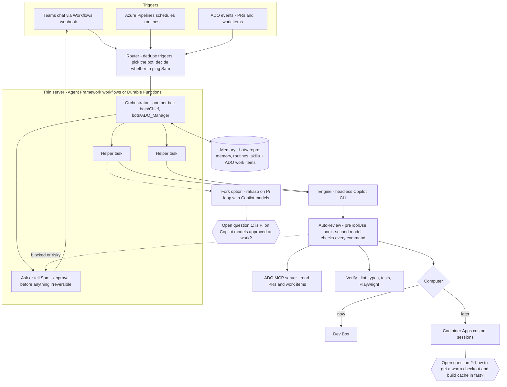

# Applying it at Microsoft (Copilot, ADO, large legacy codebase)

**Context:** Sam is on the Microsoft Copilot team. He works mostly on the React/TypeScript frontend, with some backend. GitHub Copilot is the required agent. The repos are on Azure DevOps (ADO), and they are huge and legacy.

Most of this file is **[Chief]**: Chief's mapping of poteto's ideas onto that setup, worked out in conversation with Sam. Where an idea is hers (or Minsky's), the text says so and links to the source. The concrete config lives in the companion repo `../../ai-friendly-environments/`.

## 1. What carries over directly

poteto's ladder doesn't depend on any one tool. From the [inverse pyramid](https://x.com/poteto/status/2111133080526495985), most effort goes on codebase improvements, then static analysis, then prose, with human review last. She also says big companies are at an advantage here: brownfield apps at big companies already have guardrails, so they are "in a pretty good spot" (live session). And ([5 Oct](https://x.com/poteto/status/2106916667599278365)): "big company problems are now everyone's problems".

So, for Sam's repos **[Chief]**:

1. **Verification first.** Give Copilot a way to run and drive the UI. Use Playwright for repeatable checks in CI, and the Chrome DevTools MCP for traces and debugging. Then add a feature map for your area, as in [core-principles §7](core-principles.md#7-feature-maps).
2. **Codebase as memory, in folders you own.** Tighten types and delete old patterns there, so agents copy the good example.
3. **Stop the bleeding.** Add lint rules with an ESLint bulk-suppressions baseline, so old violations are recorded and only new ones fail. Then run migration PRs.
4. **Prose last.** Keep a short scoped instructions file holding the rule table, plus a few skills.
5. **Measure readiness.** Track her metrics per month: % of agent PRs merged, revert/rework rate, and human messages per accepted PR.

## 2. Scope to the folders Sam owns

In a huge shared repo you can't ban `useEffect` everywhere or rewrite the root ESLint config. Everything here is scoped instead **[Chief]**:

- **List the owned folders** in one file, e.g. `.github/correct-scope.txt`. The scripts, ESLint `files` globs and pipeline variables all read from it or mirror it.
- **Lint**: use a flat-config block with `files: ['src/features/my-area/**/*.{ts,tsx}']`. See `examples/eslint.config.mjs`. If the root config is owned by someone else, run a separate config in your own pipeline step.
- **Types**: use a stricter `tsconfig` that extends the root one and `include`s only your folders (`examples/tsconfig.strict.json`).
- **Instructions**: put them in `.github/instructions/my-area.instructions.md` with `applyTo` set to your globs. Don't add to the repo-wide `copilot-instructions.md`.
- **Checks**: `check-agent-gaming.mjs --scope src/features/my-area`. It reports deleted tests, `.skip` and `.only`, new `as any` and `@ts-ignore`, and new suppressions.
- **CI**: a separate pipeline, added as a build validation policy filtered to your paths (the policy's path filter). That way it only runs on PRs that touch your area.

**Growing the scope**: once your area's readiness metrics are good, take the same setup to the owners of neighbouring folders. "Look, here's the data" persuades better than a proposal.

## 3. Copilot equivalents of the pstack pieces

| poteto / pstack | GitHub Copilot equivalent **[Chief]** |
|---|---|
| Skills (`SKILL.md`, saved prompts, evaluated) | Agent skills in `.github/skills/<name>/SKILL.md` (repo) or `~/.copilot/skills/` (personal). The Copilot port of `/correct` is in `ai-friendly-environments/copilot-skills/correct/`. Keep them 10–20 lines where you can, as she does. |
| `disable-model-invocation: true` | Copilot decides from a skill's `description` when to load it, so write narrow descriptions. VS Code prompt files (`.github/prompts/*.prompt.md`) are explicit `/commands` only. |
| `AGENTS.md` / rules | `.github/copilot-instructions.md` (repo-wide, not yours), `.github/instructions/*.instructions.md` with `applyTo` (yours), `AGENTS.md` |
| Rule table from `/correct` | A table in your `.instructions.md`: rule, then what enforces it (lint rule, type, test, CI step) |
| Auto-review / guardrails | **Hooks**: `.github/hooks/*.json` with a `preToolUse` command that can deny. See `examples/copilot/agent-guard.json` and `scripts/copilot-pretooluse-guard.mjs`. The cloud agent runs only the `bash` entry. |
| Control skill / feature map | Playwright tests and scripts, the Chrome DevTools MCP, and a `feature-map.md` in a skill folder, kept current by a scheduled run |
| Cloud agents / Projects | Headless Copilot CLI (`copilot -p`) in a worktree on the Dev Box, or a sandbox. See §5. Also the Copilot cloud agent, where the org allows it for ADO repos. Check this, because it is GitHub-centric. |
| Bugbot / risk-assessed review | Copilot code review where available, plus a pipeline step that asks for a risk rating. poteto merges low/medium risk without human review ([8 Oct](https://x.com/poteto/status/2108283057581195413)). At Microsoft, branch policies will still require human reviewers, so use the rating to decide *how closely* to review. |
| `/recall` (past chats as context) | Copilot CLI session history (`--resume`/`--continue`), your past PR comments in ADO (through the ADO MCP server), and Teams. |

### preToolUse as a second-model review

The diagram below has an "Auto-review" step. Copilot's `preToolUse` hook can only allow, deny or ask. A **[Chief]** design:

1. **A deterministic guard first.** `copilot-pretooluse-guard.mjs` denies `--no-verify`, force pushes, edits to the guard's own config, and so on. It is fast and free.
2. **Optional second model.** For shell commands the guard doesn't recognise, the hook script can call a cheaper model, for example a second `copilot -p` call with `--model`, a tight prompt and no tools. That model returns allow or deny. It adds latency and cost to every command, so use an allowlist of known-safe commands (`npm test`, `git status`) that skip it.
3. **Headless runs have no human for "ask"**, so anything risky is `deny`. The agent then reports what it wanted to do, and the orchestrator asks Sam.

## 4. The ADO MCP server

Microsoft's MCP server for Azure DevOps (<https://github.com/microsoft/azure-devops-mcp>) has two forms:

- **Remote (recommended, preview)**: `https://mcp.dev.azure.com/{organization}` with Entra ID OAuth. Toolsets are restricted with the `X-MCP-Toolsets` header (e.g. `repos,wit`), and `X-MCP-Readonly: "true"` makes it read-only. This suits interactive VS Code use:

  ```json
  {
    "servers": {
      "ado-remote-mcp": {
        "url": "https://mcp.dev.azure.com/{organization}",
        "type": "http",
        "headers": { "X-MCP-Toolsets": "repos,wit,pipelines", "X-MCP-Readonly": "true" }
      }
    }
  }
  ```

- **Local (stdio)**: `npx -y @azure-devops/mcp {organization}`. Use `-d` to pick domains (`core`, `work`, `work-items`, `search`, `repositories`, `wiki`, `pipelines`, …; always include `core`) and `-a` for auth (`interactive`, `azcli`, `env`, `envvar`, `pat`). This suits headless runs: `envvar` reads a bearer token from `ADO_MCP_AUTH_TOKEN`, which in a pipeline can be `$(System.AccessToken)`. For the Copilot CLI it goes in `~/.copilot/mcp-config.json`, or you pass it per run with `--additional-mcp-config @file.json`:

  ```json
  {
    "mcpServers": {
      "ado": {
        "command": "npx",
        "args": ["-y", "@azure-devops/mcp", "{organization}", "-d", "core", "repositories", "work-items", "-a", "envvar"],
        "tools": ["*"]
      }
    }
  }
  ```

**[Chief]**: start read-only. Only reading PRs, work items and pipeline runs is needed for the first slice. Leave writes such as PR comments and work item updates until the hook and approval flow are trusted. Only enable the domains a task needs, because each tool adds its description to every request.

## 5. Headless Copilot CLI on a schedule (the first slice)

**Goal of the first slice [Chief]**: a nightly or weekday-morning pipeline on the Dev Box runs the Copilot CLI. The CLI reads ADO (PRs waiting on Sam, failing builds in his area, new bugs tagged to his area) and posts a short summary to Teams. It is read-only and has no code changes, so it is safe to try now.

Facts this relies on, from the GitHub docs, which should be checked again before use:

- **Programmatic mode**: `copilot -p "<prompt>"`.
- **Flags**:
  - `-s` (silent): print only the answer
  - `--no-ask-user`: never stop for questions
  - `--allow-tool` and `--deny-tool`: e.g. `'shell(npm:*)'`, `'shell(git push)'`, `write`, or an MCP server name
  - `--allow-all-tools`: only in a sandbox
- **Auth**: one of `COPILOT_GITHUB_TOKEN`, `GH_TOKEN` or `GITHUB_TOKEN`, in that order of precedence. Use a fine-grained PAT with the **Copilot Requests** permission. It must be user-owned, and whether a Microsoft-managed account can create one is a policy question to check first.
- **Pipeline schedules**:
  - `cron` is in **UTC**
  - `always: true` makes a schedule run even when nothing has changed
  - secret variables have to be mapped into `env:` explicitly

`azure-pipelines/routines/morning-brief.yml` **[Chief]**, a sketch that has not been run:

```yaml
trigger: none
pr: none

schedules:
  - cron: '30 6 * * 1-5'
    displayName: Weekday morning brief
    branches:
      include: [main]
    always: true

pool:
  name: SamDevBox

variables:
  - group: chief-secrets

steps:
  - checkout: none

  - pwsh: |
      @{
        mcpServers = @{
          ado = @{
            command = 'npx'
            args = @('-y', '@azure-devops/mcp', 'my-org', '-d', 'core', 'repositories', 'work-items', 'pipelines', '-a', 'envvar')
            tools = @('*')
          }
        }
      } | ConvertTo-Json -Depth 5 | Out-File -Encoding utf8 "$(Agent.TempDirectory)/ado-mcp.json"
    displayName: Write ADO MCP config

  - pwsh: |
      $prompt = @'
      Read-only task. Using the ado MCP server:
      1. List active PRs where I am a reviewer or author, with age and status.
      2. List failed pipeline runs in the last 24h that touch src/features/my-area.
      3. List new bugs in the last 24h with area path MyProduct\MyArea.
      Reply in under 15 lines of Markdown, most urgent first, each line with a link.
      Do not change anything in ADO.
      '@
      copilot -p $prompt -s --no-ask-user `
        --additional-mcp-config "@$(Agent.TempDirectory)/ado-mcp.json" `
        --allow-tool 'ado' `
        --deny-tool 'shell' --deny-tool 'write' `
        | Out-File -Encoding utf8 brief.md
    displayName: Copilot CLI brief
    env:
      COPILOT_GITHUB_TOKEN: $(COPILOT_GITHUB_TOKEN)
      ADO_MCP_AUTH_TOKEN: $(System.AccessToken)

  - pwsh: |
      $text = Get-Content brief.md -Raw
      $card = @{
        type = 'message'
        attachments = @(@{
          contentType = 'application/vnd.microsoft.card.adaptive'
          content = @{
            '$schema' = 'http://adaptivecards.io/schemas/adaptive-card.json'
            type = 'AdaptiveCard'; version = '1.4'
            body = @(@{ type = 'TextBlock'; text = $text; wrap = $true })
          }
        })
      } | ConvertTo-Json -Depth 10
      Invoke-RestMethod -Method Post -Uri $env:TEAMS_WEBHOOK_URL -ContentType 'application/json' -Body $card
    displayName: Post to Teams
    env:
      TEAMS_WEBHOOK_URL: $(TEAMS_WEBHOOK_URL)
```

Notes on the sketch:

- **Agent pool.** `SamDevBox` is a self-hosted agent pool with one agent, registered on the Dev Box. The ADO MCP server and the Copilot CLI need Node 20 or later on that machine.
- **Token permissions.** The job's `System.AccessToken` has the build service identity's permissions. Reading PRs and work items across projects may need the project setting "Limit job authorization scope" relaxed, or a narrowly scoped PAT kept as a secret.
- **Teams webhook.** `TEAMS_WEBHOOK_URL` comes from a Teams **Workflows** flow, "When a Teams webhook request is received". The old Office 365 connectors are being retired.
- **Secrets.** `chief-secrets` is a variable group holding `COPILOT_GITHUB_TOKEN` and `TEAMS_WEBHOOK_URL` as secrets.

**Next slices [Chief]:**

- the same pattern with `--allow-tool 'shell(npm:*)'` and write access, in a fresh `git worktree` on the Dev Box: run `/correct` on your area overnight and open a PR for Sam to review in the morning (her "review it in the morning by looking at my commit history" loop, from the Pocock transcript)
- a nightly `maintain-verification`-style run that updates the feature map

## 6. The `bots/` thin-layer design

This was discussed with Sam: a small, thin layer that adds what Grok Bot does to Copilot. Grok Bot's pieces are memory, routines, skills, helpers, asking Sam before anything irreversible, and auto-review. In this design, **the work itself is always done by the headless Copilot CLI**. The server only routes and orchestrates.

- **Memory** is a `bots/` repo: per-bot folders like `bots/Chief/` and `bots/ADO_Manager/`, holding `memory.md`, `routines/`, `skills/` and logs. ADO work items cover anything that needs tracking. It's plain files in git, so it is reviewable, revertible, and "the codebase as memory" applied to the bots themselves.
- **Triggers**:
  - Teams messages through a Workflows webhook
  - Azure Pipelines schedules (routines)
  - ADO service hooks for PR and work item events
- **Router**: dedupes triggers, picks the bot, and decides whether Sam needs a ping. poteto's cost tip ([23 Oct](https://x.com/poteto/status/2113479806952276140)) applies here: watch for expensive routines and bot-to-bot chatter.
- **Orchestrator**: one per bot, using Microsoft Agent Framework workflows or Durable Functions. The GitHub Copilot SDK works with Agent Framework, so the orchestrator can drive Copilot sessions directly instead of shelling out.
- **Approval**: anything irreversible (posting, merging, writing to ADO) goes back to Sam in Teams first.



### Open question 1: Pi on Copilot models

The answer we reached: **no.** Running a different agent loop (rakazo on Pi) against Copilot models follows the same pattern as the proxy setup that was stopped before, so the fork is ruled out. The thin build is fine, because the Copilot CLI still does all the work through the sanctioned client. Mention the design to Sam's manager anyway, before running it on a schedule.

### Open question 2: a warm checkout and build cache, fast

These are the options for per-run sandboxes, such as Container Apps custom sessions or Foundry sandboxes, which Chief's researcher suggested since Sam isn't keen on the Dev Box:

| Option | How | Trade-off |
|---|---|---|
| **`git worktree` on the Dev Box (start here)** | One main clone stays warm, with each run in `git worktree add ../wt-<run> origin/main` and `git worktree remove` afterwards | Instant and shares objects. Not isolated, so rely on the hooks and run as a limited user. |
| Bake into the image | Nightly image build with a partial clone (`git clone --filter=blob:none`), sparse checkout of the owned folders, `npm ci` and a warm build | Fast start. The image goes stale during the day, so fetch the delta at start-up. |
| Shared cache volume | An Azure Files share mounted with the npm cache, build cache and a git object store (`--reference`/alternates) | Works in any sandbox. Network file system speed is the bottleneck. |
| Scalar | `scalar clone` (ships with Git) for very large repos: partial clone, sparse checkout, background maintenance | Built for repos like Sam's. Pairs with either of the above. |
| Remote build cache | Build cache stored remotely (e.g. Nx/Turborepo remote cache or Bazel remote cache, whichever the repo already uses) | Biggest win for builds. Only if the repo's build system supports it. |

Start with the worktree. Move to an image plus Scalar when moving off the Dev Box.

### How Grok Bot's own delegation maps across

Grok Bot hands coding to Cursor cloud agents. Each one gets its own machine and checkout, works on a branch and reports back. The equivalent here is a headless Copilot CLI run in a fresh worktree or sandbox, started by the orchestrator, which opens a draft PR and reports back to Teams. poteto's "first and last mile" ([6 Oct](https://x.com/poteto/status/2107510472601985336)) is the same shape: context and routines up front, and hand-off to coding agents at the end.

## 7. Ideas from Ron Minsky's talk, applied **[Chief]**

poteto recommended Minsky's talk on 26 Oct ([post](https://x.com/poteto/status/2114626630429913383)). The ideas below are Minsky's; how to apply them here is Chief's suggestion.

- **Types as feedback, and illegal states unrepresentable.** Use a stricter `tsconfig` for owned folders (`exactOptionalPropertyTypes`, `noUncheckedIndexedAccess`), discriminated unions and branded IDs. See `ai-friendly-environments/typescript-strictness.md`.
- **Expect tests.** Use inline snapshot tests (`toMatchInlineSnapshot`) that print a readable view of state, such as a reducer's output or a rendered tree. "Just print stuff out and capture it". They are similar to the React compiler's fixture tests and make review smaller.
- **Agents gaming the tests.** Minsky warns about agents deleting or weakening tests. Run `check-agent-gaming.mjs` in pre-commit and the PR build. It flags deleted tests, `.skip`/`.only`, and new `as any`, `@ts-ignore` and `eslint-disable`, unless an `agent-exception` with a reason, expiry and approver is present.
- **Small, ordered changes.** Use stacked ADO PRs with a "review in this order" list in the description. poteto prefers small PRs for the same reason: "the git history is a very rich source of context" (live session).
- **Formal methods later.** Statecharts plus TLA+ (`/statechart`, `/create-formal-verification-skill`) are worth trying on one tricky piece, such as a streaming chat state machine, once the basics are in place.
