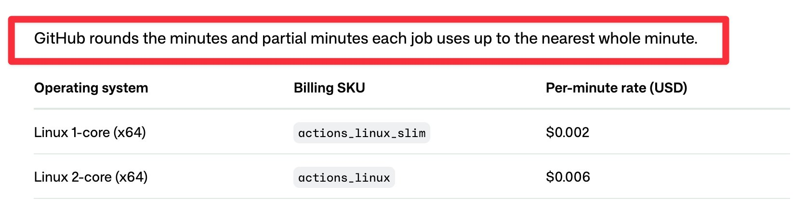

# GitHub Actions rounds every job up to a whole minute (@DanielLockyer)

Source: [@DanielLockyer on X, 2 Nov 2026](https://x.com/DanielLockyer/status/2117279086875701528), plus [his follow-up](https://x.com/DanielLockyer/status/2117279733545107588).



## The claim

GitHub Actions (and some third-party runners such as Blacksmith, per the post) bill each job rounded up to the nearest whole minute. A 10 second job costs a full minute. Three 10 second jobs in series (30 seconds of work) are billed as 3 minutes, six times the real usage. His advice: if you have lots of short jobs, combine them into one job and parallelise inside it. He adds that this is also faster, because each extra job pays its own scheduling and setup time.

## Checked against primary sources

- Verified. GitHub's [Actions runner pricing reference](https://docs.github.com/en/billing/reference/actions-runner-pricing) says: "GitHub rounds the minutes and partial minutes each job uses up to the nearest whole minute." This is the line in his screenshot.
- Standard GitHub-hosted runners are free in public repos, so this only costs money on private and internal repos (and on larger runners, which are billed even for public repos). See [Actions billing](https://docs.github.com/en/billing/concepts/product-billing/github-actions).
- The "parallelise within a job" part is now native: [Actions steps can now be run in parallel](https://github.blog/changelog/2026-06-25-actions-steps-can-now-be-run-in-parallel/) (25 Jun 2026) added `parallel`, `background: true`, `wait` / `wait-all` and `cancel`. Up to 10 background steps run at once in a job, logs stay separate, and they can't be used inside composite actions ([workflow syntax](https://docs.github.com/en/actions/reference/workflows-and-actions/workflow-syntax)).

```yaml
steps:
  - uses: actions/checkout@v5
  - run: npm ci
  - parallel:
      - name: Lint
        run: npm run lint
      - name: Typecheck
        run: npm run typecheck
```

## Useful points from the replies

- @lokidotdev: lint plus typecheck is the classic case, one job running both instead of two jobs each paying for setup and a full minute.
- @_monzim and @karanjagtiani04: merging trades away retry granularity. A rerun of the merged job repeats every step that already passed, so batch the cheap, reliable checks and leave flaky ones as their own jobs.
- @javimosch: matrix jobs make it worse, since every leg rounds up separately.
- @bradvin: caching the install step helps short jobs too.
- Several replies plug per-second billed runners (Depot and others). Vendor claims, not checked.

## For the software factory (GHCP)

- Sam's work repos sit under Microsoft enterprise billing, so the money is unlikely to be his problem. The speed side still matters.
- The Copilot coding agent and Agentic Workflows run on Actions. A factory that fires many small agent-triggered jobs (lint, typecheck, format, label, triage) pays the rounding and the queue and setup cost on each one. Agents feel that as a slower feedback loop.
- Design rule worth adopting: one "fast checks" job per PR that runs the quick, deterministic verifiers with `parallel`, kept separate from slow or flaky suites so the agent can rerun those on their own. That keeps the verifier loop tight, which ties in with [the Ray Amjad verifiers note](2026-11-01-ray-amjad-claude-code-verifiers.md).
- For Agentic Workflows, prefer fewer, fatter scheduled runs over many tiny ones where the work allows.
