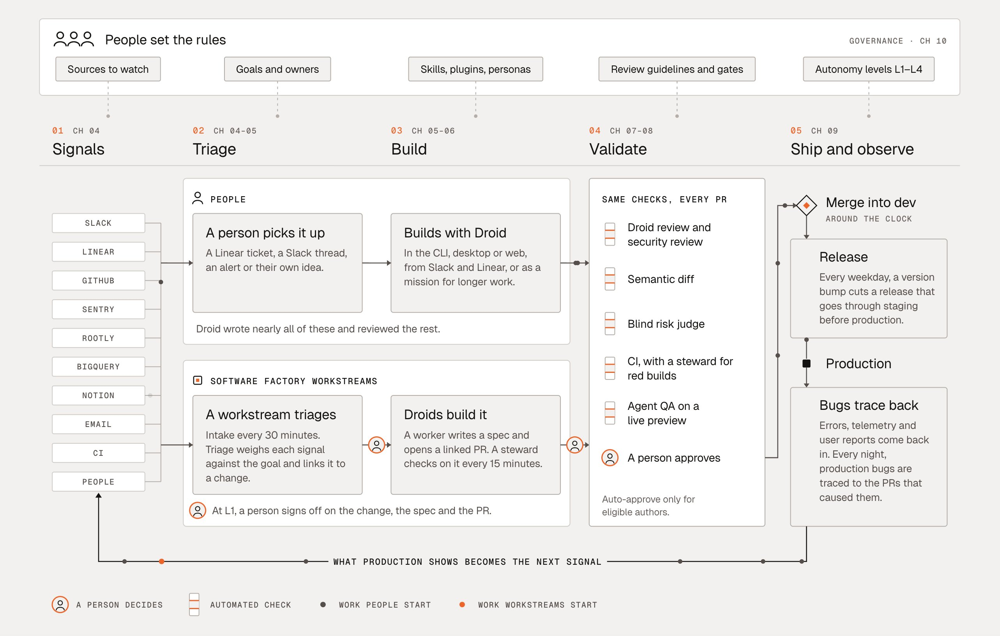

# Software factory as signal-to-ship control loop (@EnoReyes)

Source: [@EnoReyes on X, 6 Nov 2026 18:08 UTC](https://x.com/EnoReyes/status/2118767454721851680) (CTO at [Factory](https://factory.com/); bio: "Building software that builds software"). **Vendor content:** the diagram names Factory product pieces (Droid, longer "mission" work, stewardship). Quotes [@poteto](https://x.com/poteto/status/2118613050462728659); our save of that post and pyramid: [deterministic engineering](../poteto-advice/2026-11-06-poteto-deterministic-engineering.md). Related: [@zachlloydtweets](2026-11-04-zachlloydtweets-dont-vibe-code-your-factory.md), [@zachlloydtweets and @swyx](2026-11-05-zachlloydtweets-swyx-factory-stack.md).

> I actually agree with a lot of what @poteto is saying except for the central point. IMO most people don't have actual software factory systems. They've just made it much easier for people to ship with AI, so they assume the category doesn't exist. That's more a lack of vision than anything else.

The rest of the post is the model behind the drawing. A factory, in this account, puts every piece of work through the same stages "to standardize the process not the work output." A signal is anything that says how the software should evolve: a Slack thread, a Linear ticket, a Sentry alert, a failing CI job, a tweet, an idea. Two ways in: a person picks it up and builds with Droid, or a workstream triages it against a goal and has droids write the spec and open the PR. The same checks apply either way, including "a risk judge that can't see who wrote it", CI, and an agent that QAs a live preview. The stated aim is to hillclimb a "regret-free merge rate" until most changes can merge on their own. Production breaks are traced to the PR that caused them; that trace is the next signal and, on this account, how a bad judge call shows up. Most changes still get a human stamp. People step off the line and set the rules ("They're the regulators."). The self-driving comparison (let AI merge once it breaks production less often than humans, and you can measure that) is an analogy in the post, not a result.

Saved file: `2026-11-06-EnoReyes-software-factory-diagram.jpg`, 2566x1634 JPEG, 303,363 bytes, SHA256 `d4a95ae3bdeb5ff879b8a7bfb8b44b515014ca9b3ecd138ca1e9915b73f0a8fb`.

## Diagram breakdown

Left to right under a governance strip, with a feedback line along the bottom. Chapter tags sit on the stage titles (CH 04 through CH 10, with Build marked CH 05-06). The post does not explain the tags.

**Governance, "People set the rules" / "GOVERNANCE · CH 10".** Five chips, left to right: Sources to watch; Goals and owners; Skills, plugins, personas; Review guidelines and gates; Autonomy levels L1-L4. A dashed line drops from each chip into the stage below.

**Five stages:**

1. **01 Signals (CH 04).** Sources, top to bottom: Slack, Linear, GitHub, Sentry, Rootly, BigQuery, Notion, Email, CI, People.

2. **02 Triage (CH 04-05).** Two rails. **People:** "A person picks it up" ("A Linear ticket, a Slack thread, an alert or their own idea."). **Software factory workstreams:** "A workstream triages" ("Intake every 30 minutes. Triage weighs each signal against the goal and links it to a change."). Orange person icon: "At L1, a person signs off on the change, the spec and the PR."

3. **03 Build (CH 05-06).** People rail: "Builds with Droid" ("In the CLI, desktop or web, from Slack and Linear, or as a mission for longer work."). Footnote under the people cards: "Droid wrote nearly all of these and reviewed the rest." Workstreams rail: "Droids build it" ("A worker writes a spec and opens a linked PR. A steward checks on it every 15 minutes.").

4. **04 Validate (CH 07-08).** "SAME CHECKS, EVERY PR." Checklist, each with the automated-check mark: "Droid review and security review"; "Semantic diff"; "Blind risk judge"; "CI, with a steward for red builds"; "Agent QA on a live preview". Then a person icon: "A person approves", with "Auto-approve only for eligible authors."

5. **05 Ship and observe (CH 09).** "Merge into dev" ("AROUND THE CLOCK"). "Release": "Every weekday, a version bump cuts a release that goes through staging before production." Then "Production". "Bugs trace back": "Errors, telemetry and user reports come back in. Every night, production bugs are traced to the PRs that caused them."

**Feedback.** A line from Bugs trace back, under the pipeline, into Signals. Caption: "WHAT PRODUCTION SHOWS BECOMES THE NEXT SIGNAL."

**Legend.** Orange person: "A PERSON DECIDES". Two orange bars: "AUTOMATED CHECK". Black dot: "WORK PEOPLE START". Orange dot: "WORK WORKSTREAMS START".

The drawing does not define L2 to L4, "semantic diff", "blind risk judge", or "eligible authors". The post says the risk judge cannot see who wrote the change, and that a later production break is how a wrong approval shows up. It does not show that the judge is calibrated, or independent of the builder, in any way this note can check. Cadences printed on the drawing (intake every 30 minutes, steward every 15 minutes, nightly bug-to-PR trace, weekday release) are diagram claims.

Not on the drawing, and not specified in this post: durable checkpoints on long missions, secret and permission boundaries, token or cost budgets, how L2 to L4 differ from L1, hermetic replay of the factory (see the [@zachlloydtweets](2026-11-04-zachlloydtweets-dont-vibe-code-your-factory.md) and [@zachlloydtweets and @swyx](2026-11-05-zachlloydtweets-swyx-factory-stack.md) notes). Those omissions are about this picture and this post. They are not evidence that Factory lacks those controls elsewhere.

## vs @poteto

The [@poteto](https://x.com/poteto/status/2118613050462728659) post this one quotes says you do not need a software factory, that the term is marketing, and that what you need is good software engineering and tokens spent in the right places, with more deterministic being better and more token-efficient. The pyramid ranks codebase, then static analysis, then verification (formal, empirical), then prose, then human review. That order, and the claim that the category is empty, are @poteto's opinion. See the [poteto note](../poteto-advice/2026-11-06-poteto-deterministic-engineering.md).

@EnoReyes writes that a lot of what @poteto is saying is right, except the central point (the category is not real). Treat that as broad agreement with @poteto's engineering priorities. It is not an endorsement of every pyramid band. Formal verification and empirical verification are not all deterministic. A model reviewer (the diagram's blind risk judge and agent QA, or a Copilot review) is not a deterministic check either. @EnoReyes's category claim, that most people lack a real factory and are short of vision, is opinion as well.

For Sam: keep cheap deterministic gates (tests, types, lints, CI) ahead of prose and model review inside Validate. Use this diagram for intake, shared gates, an autonomy policy, and production feeding the next signal.

Factory's own [Factory 2.0 post](https://factory.com/news/software-factory) (15 Jun 2026) tells the same loop in prose: signals, triage, build, test and review, ship, monitor, more signals, Droids, and a spectrum of autonomy. That supports the positioning. It is not independent proof of the diagram's cadences or of every label.

## Useful replies

- [@dexhorthy](https://x.com/dexhorthy/status/2118773274481979687): prefer forward pressure (what starts work) and backpressure (linters, tests, AI review or a risk judge, canaries, feature flags) over vague loop talk. [@EnoReyes](https://x.com/EnoReyes/status/2118785282480939281) answers that the flow of data, backpressure and forward pressure, is now the better model.
- [@curious_vii](https://x.com/curious_vii/status/2118797684849197220): this converges on CI, a documented repo, and crons or webhooks.
- [@IgorZIJ](https://x.com/IgorZIJ/status/2118796626948919478): a lot of it is good old devops, with principles that go back to lean manufacturing.
- [@isbkch](https://x.com/isbkch/status/2118789383411368071): tracing production breaks to the PR is the part most teams skip, and "breaks less than humans" needs a measured human baseline.
- [@wizplum](https://x.com/wizplum/status/2118785550916407556): an actual factory maximises output of a rigid template; software has no such template, and more output is not always good. @EnoReyes answers on that thread that the point is process standardisation, not output standardisation.
- [@TinyRouterHQ](https://x.com/TinyRouterHQ/status/2118808994613780828): does a factory have to fail its own patch, or is faster shipping with a human gate still the category?

## Critique

Strong as a mental model: signals in, the same gates whoever started the change, production out as the next signal, people setting the rules. Weak as evidence that most people lack vision. That claim is opinion. Droid, steward, and missions are Factory branding. The 30 minute intake, 15 minute steward, nightly trace, and weekday release are diagram claims, not measurements checked here.

## GHCP mapping

Map the diagram onto GitHub without treating Factory autonomy as something Copilot already ships. Docs opened for the native column:

- [Copilot cloud agent on GitHub](https://docs.github.com/en/copilot/how-tos/use-copilot-agents/cloud-agent/use-cloud-agent-on-github): a GitHub-hosted cloud sandbox or an Actions-based environment, and it can open a pull request. The [remote GitHub MCP server](https://docs.github.com/en/copilot/how-tos/use-copilot-agents/cloud-agent/use-cloud-agent-with-mcp) can start that session.
- Customisation: [custom agents](https://docs.github.com/en/copilot/how-tos/copilot-on-github/customize-copilot/customize-cloud-agent/create-custom-agents), [custom instructions](https://docs.github.com/en/copilot/concepts/prompting-and-context/custom-instructions), [agent skills](https://docs.github.com/en/copilot/concepts/agents/about-agent-skills).
- [Repository rulesets](https://docs.github.com/en/repositories/configuring-branches-and-merges-in-your-repository/managing-rulesets/available-rules-for-rulesets): required status checks, required reviews (including code owners), and a rule that changes deploy to an environment before merge.
- [GitHub Agentic Workflows](https://github.github.com/gh-aw/) compile Markdown workflows to Actions, including [schedules](https://github.github.com/gh-aw/reference/schedule-syntax/).

| Diagram piece | Native GitHub / Copilot | Still to build |
|---|---|---|
| Signals | Issues, pull requests, Actions events | Adapters from Slack, Sentry, email and the other sources into those events |
| Rules people set | Rulesets and custom instructions, linked above | A written autonomy policy. L1 to L4 is not a Copilot product |
| Triage on a timer | Scheduled Agentic Workflows, which compile to Actions | A job that weighs each signal against a goal |
| Build | Copilot cloud agent, custom agents, skills, custom instructions | A steward that watches a pull request on a timer |
| Same checks on every PR | Required status checks and required reviews | Semantic-diff review, a separate risk judge, live-preview QA. The platform does not calibrate a judge or make it independent of the builder |
| Ship and observe | Environment deployment rules, Actions | Weekday release orchestration, and a nightly trace from production bugs to pull requests |
| Production becomes the next signal | No closed loop in the product | An attribution store from incident to pull request |

**Native:** GitHub as the forge and signal bus, Actions and Agentic Workflows for schedules and gates, the cloud agent for the build, human review and rulesets for the merge. **Still to build:** multi-source intake, the autonomy policy, the steward, judge calibration, and incident attribution. Put deterministic gates (tests, types, lints, CI) in front of long agent runs, as in the @poteto note.
