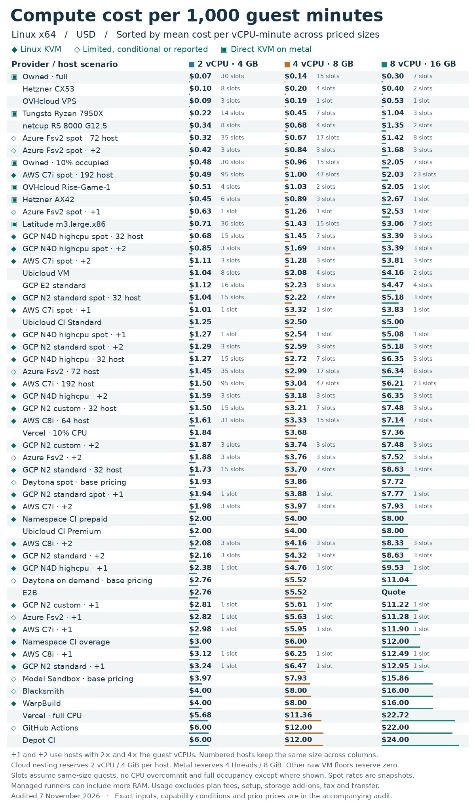

# CI and sandbox costs: cheaper minutes are not cheaper verification (@CalvinGrunewald)

## Source and argument

[@CalvinGrunewald, 7 Nov 2026 20:04 GMT](https://x.com/CalvinGrunewald/status/2119159153209778632). Bio says founder, building agentic platforms. Full `note_tweet` recovered, not inferred from the truncated preview. He reports a tenfold CI bill increase over a month while speeding up many PRs. He argues runner vendors stack margins on commodity compute, claims productised runners can cost two orders of magnitude more than DIY, and advocates building single-tenant orchestration in your own VPC or using owned hardware. His suggestion to stop doing CI is rhetoric, not a safe engineering recommendation.

**Evidence boundary:** the bill increase is self-reported, without invoices, workload counts or before/after configuration. He says the comparison data was prepared by **astra** (AI-prepared analysis, not an independent audit). The accompanying audit mentioned in the image was not supplied in the post or recovered thread. The assertion that nearly all providers use Firecracker or containerd, and that their differentiation is worthless, is opinion and speculation here, not verified infrastructure research.

Related: [Warp factory stack and sandbox/cost discussion](2026-11-05-zachlloydtweets-swyx-factory-stack.md), [Warp factory infrastructure article](2026-11-04-zachlloydtweets-dont-vibe-code-your-factory.md), [StarSling CI playbooks](2026-10-30-starsling-ci-playbooks.md), [Actions job rounding](2026-11-02-daniellockyer-actions-minute-rounding.md). Paths verified against the remote reading-notes index; the Warp stack note was also read remotely. Its $80 to $15-20 per PR is a different, self-reported whole-factory metric, not comparable to this chart's compute rate.

## What the image actually shows

Original [media](https://pbs.twimg.com/media/HWjD_njXAAERvtk.jpg?format=jpg&name=orig), preserved without re-encoding: 1200x2036 JPEG, 419,735 bytes. SHA256 `5039e3a52f2d7a6b18f4ded05b833acd9cf6f62f71a74e3cc18f0d3562819d08`.

Title: **Compute cost per 1,000 guest minutes**. Subtitle: **Linux x64 / USD / Sorted by mean cost per vCPU-minute across priced sizes**. This is a long ranked rate table with small coloured bars, not a breakdown of his actual bill. Columns are provider/host scenario, **2 vCPU · 4 GB**, **4 vCPU · 8 GB**, **8 vCPU · 16 GB**. Legend distinguishes Linux KVM, limited/conditional/reported support, and direct KVM on metal. Small slot counts describe same-size guest capacity, not measured throughput.

Selected rows transcribed below; all figures are USD per 1,000 guest minutes, **chart claims**, not separately verified vendor quotes. The image retains the remaining cloud-family and packing variants.

| Provider / host scenario | 2 vCPU | 4 vCPU | 8 vCPU |
| --- | ---: | ---: | ---: |
| Owned · full | 0.07 | 0.14 | 0.30 |
| Hetzner CX53 | 0.10 | 0.20 | 0.40 |
| OVHcloud VPS | 0.09 | 0.19 | 0.53 |
| Tungsto Ryzen 7950X | 0.22 | 0.45 | 1.04 |
| netcup RS 8000 G12.5 | 0.34 | 0.68 | 1.35 |
| Azure Fsv2 spot · 72 host | 0.32 | 0.67 | 1.42 |
| Owned · 10% occupied | 0.48 | 0.96 | 2.05 |
| AWS C7i spot · 192 host | 0.49 | 1.00 | 2.03 |
| Hetzner AX42 | 0.45 | 0.89 | 2.67 |
| Latitude m3.large.x86 | 0.71 | 1.43 | 3.06 |
| Ubicloud VM | 1.04 | 2.08 | 4.16 |
| Ubicloud CI Standard | 1.25 | 2.50 | 5.00 |
| Vercel · 10% CPU | 1.84 | 3.68 | 7.36 |
| Daytona spot · base pricing | 1.93 | 3.86 | 7.72 |
| Namespace CI prepaid | 2.00 | 4.00 | 8.00 |
| Ubicloud CI Premium | 2.00 | 4.00 | 8.00 |
| Daytona on demand · base pricing | 2.76 | 5.52 | 11.04 |
| E2B | 2.76 | 5.52 | Quote |
| Namespace CI overage | 3.00 | 6.00 | 12.00 |
| Modal Sandbox · base pricing | 3.97 | 7.93 | 15.86 |
| Blacksmith | 4.00 | 8.00 | 16.00 |
| WarpBuild | 4.00 | 8.00 | 16.00 |
| Vercel · full CPU | 5.68 | 11.36 | 22.72 |
| GitHub Actions | 6.00 | 12.00 | 22.00 |
| Depot CI | 6.00 | 12.00 | 24.00 |

Footer assumptions, read at enlarged resolution: `+1` and `+2` use hosts with 2x and 4x guest vCPUs; numbered hosts keep the same size across columns. Cloud nesting reserves 2 vCPU / 4 GiB per host; metal reserves 4 threads / 8 GiB; other raw VM floors reserve zero. Slots assume same-size guests, no CPU overcommit and **full occupancy except where shown**. Spot rates are snapshots. Managed runners can include more RAM. Usage **excludes plan fees, setup, storage add-ons, tax and transfer**. Dated 7 November 2026. Labels and selected prices above were readable; capability conditions and rate provenance are not recoverable from this image alone.

**Interpretation:** at 2 vCPU, the chart's GitHub/owned-full ratio is about 86x, versus 12.5x at owned 10% occupancy; Blacksmith/owned-full is about 57x. These are arithmetic on assumed rates, not demonstrated savings. The headline 50x or 100x is not universal. A guest minute on different CPUs, RAM allocations and oversubscription policies is not a unit of identical completed work. Procurement, idle capacity, spot interruptions, queueing, isolation, patching and engineering/on-call time matter. A single tenant reduces orchestration complexity but does not remove hostile-code or secret-isolation risks.

## What checks out

- [Official Actions runner pricing](https://docs.github.com/en/billing/reference/actions-runner-pricing) matches the GitHub row: Linux x64 2-core $0.006/min, 4-core $0.012/min, 8-core $0.022/min. Each job is rounded up to a whole minute. Larger runners bill execution time, not idle provisioned capacity, and require Team or Enterprise Cloud organisations. This is not a blanket 50x margin measurement.
- [Actions billing](https://docs.github.com/en/billing/concepts/product-billing/github-actions) distinguishes free standard runners for public repositories, included compute for private repositories, and paid overage. Self-hosted runners have no GitHub runner usage fee, but their infrastructure still costs money. Storage/cache charges are separate. The chart's paid-rate comparison is therefore not Sam's automatic marginal bill.
- **Billing correction to the brief:** [current Copilot environment docs](https://docs.github.com/en/copilot/concepts/agents/coding-agent/about-coding-agent) describe Actions-based sessions and cloud sandboxes with compute separate from AI credits. Actions compute **plus premium requests** remains documented for [legacy annual Pro/Pro+ billing](https://docs.github.com/en/copilot/reference/copilot-billing/request-based-billing-legacy/github-copilot-premium-requests), not all current subscriptions. Check Sam's actual plan and execution environment rather than assume legacy requests apply. Ordinary PR CI, the agent's own environment and AI usage are distinct cost lines.
- Nothing here independently validates the other provider rows, his invoice, achieved speed, universal rank of sandbox spending, or claimed net DIY savings. Keep the table as a lead for measurement, not a purchasing specification.

## Useful replies and author's clarification

Read 25 replies/follow-ups plus the root across three search pages, to an empty final page. Search returned no quote posts by source URL despite the root reporting one quote; that quote's contents remain unverified.

- [@ArturSkowronski](https://x.com/ArturSkowronski/status/2119165211143712970): cheaper runners and less verification are different decisions; measure cost per verified change and identify more runs versus longer jobs versus idle capacity. Also suggests Bazel remote caching in a follow-up.
- [@CalvinGrunewald](https://x.com/CalvinGrunewald/status/2119167077865111859), full long reply recovered: total Actions minutes drive his bill, after utilisation and instance-size work; caching is a small fraction for him. He already has a raw-VM Firecracker orchestrator for another reason and is **considering testing it in CI**, not reporting a completed migration with measured savings.
- [@johnroodepic](https://x.com/johnroodepic/status/2119174583014379910): self-reported 40-second lint and diff-test gate before the full suite. [Author's response](https://x.com/CalvinGrunewald/status/2119177786132984295): include dependants or main will break; still run the full suite, ideally batched across PRs.
- [@0xdoppo](https://x.com/0xdoppo/status/2119160446888591368): include maintenance and incidents. [@asmirkn](https://x.com/asmirkn/status/2119186427774996673) asks whether repeated CI after rebases drove the increase; no quantified answer recovered.
- [@kunchenguid](https://x.com/kunchenguid/status/2119171239797506144) reports saving thousands monthly on owned hardware and links his runner project later. [@HotAisle](https://x.com/HotAisle/status/2119187591698501797) reports runner-update maintenance; the returned reply ends mid-sentence, so do not infer the remainder.
- [@dbworku](https://x.com/dbworku/status/2119188205568467017) argues wasted compute comes first and plugs a CI skill. [@crohr](https://x.com/crohr/status/2119179621312971103) pitches orchestration at EUR 300/year; [@mattgapp](https://x.com/mattgapp/status/2119174044608241911) pitches Jog on idle/queue economics. These are vendor/interested-party claims, not independently checked savings.

## GHCP mapping for Sam's pstack factory

Keep Python backend and TypeScript frontend verification. First remove repeated work, then benchmark runner changes on the same verified changes. Do not let agent skills negotiate away hard gates.

| Control | Native GitHub feature | Factory logic Sam owns |
| --- | --- | --- |
| Superseded PR runs | [Concurrency groups and cancel-in-progress](https://docs.github.com/en/actions/how-tos/write-workflows/choose-when-workflows-run/control-workflow-concurrency) | Key by workflow and PR/ref; cancel stale PR CI, not unrelated PRs or production deployments. This config does not automatically govern a separate Copilot session |
| Avoid irrelevant work | [Path filters, job conditions and dependencies](https://docs.github.com/en/actions/reference/workflows-and-actions/workflow-syntax) | Route Python/TS/docs changes, include shared schemas, lockfiles and CI config. Keep an always-reporting required gate: skipping a required workflow with path filters leaves checks pending |
| Cache setup/build work | [Dependency caching](https://docs.github.com/en/actions/using-workflows/caching-dependencies-to-speed-up-workflows), setup-python/setup-node | Key by OS, toolchain and lockfile; measure restore overhead/hit rate; no secrets or untrusted cache writes. His caching result is not evidence yours cannot help |
| Shards versus fewer tests | Matrix jobs, max-parallel, fail-fast, timeouts and `needs` in [workflow syntax](https://docs.github.com/en/actions/reference/workflows-and-actions/workflow-syntax) | Sharding lowers wall time, not necessarily aggregate billed minutes; repeated setup and job rounding can increase cost. Affected-only selection needs a dependable dependency graph including dependants, with full integration validation as backstop |
| Avoid constant rebasing | [Merge queue](https://docs.github.com/en/repositories/configuring-branches-and-merges-in-your-repository/configuring-pull-request-merges/managing-a-merge-queue), where plan/repo supports it | Add `merge_group` checks and tune build concurrency. Do not promise cheaper CI: merge groups also run checks; merge limits do not combine builds, and queue jumping triggers rebuilds |
| Size runners | [Runner SKUs and rates](https://docs.github.com/en/billing/reference/actions-runner-pricing); Actions-based Copilot supports custom compute/self-hosting per [environment docs](https://docs.github.com/en/copilot/concepts/agents/coding-agent/about-coding-agent) | Compare total rounded minutes times SKU rate on representative tasks, memory failures, queue time and retries. Ordinary CI runner selection is separate from agent environment config; cloud sandboxes do not support self-hosted runners |
| Control spend | [Budgets with Stop usage when budget limit is reached](https://docs.github.com/en/billing/how-tos/set-up-budgets), alerts and usage reports | Set compute and applicable AI-credit or legacy-request limits separately. Alerts alone do not stop usage. Add per-task retry/attempt caps in dispatcher/Agentic Workflow logic, plus cost-per-accepted-PR accounting; a billing budget is not a task-level limiter |

**Next step:** instrument one representative week: runs per accepted PR, cancelled/repeated runs, setup versus tests, rounded runner cost, AI usage, failures and escaped regressions. Use pstack instructions/skills for the quick local lint/type/test gate, Actions for enforced checks, and bounded Agentic Workflows for dispatch. Only pilot DIY runners once those data show a real saving after idle capacity, security and maintenance. Cheaper verification, not no verification.
