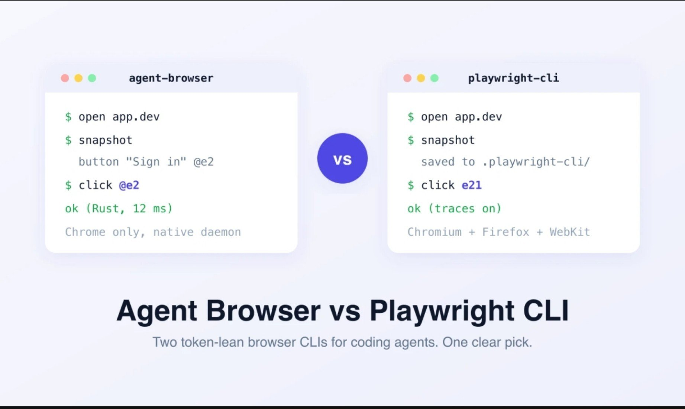

# agent-browser: compact browser commands, not a free reliability upgrade (@blob16exe)

## Source and what it is

[@blob16exe, 8 Nov 2026 13:34 GMT](https://x.com/blob16exe/status/2119423238359151092). A recommendation of [vercel-labs/agent-browser](https://github.com/vercel-labs/agent-browser), not a new browser engine: it drives a browser through a persistent daemon and short shell commands. The [README](https://github.com/vercel-labs/agent-browser/blob/main/README.md) confirms compact accessibility snapshots, element refs such as `@e1`, click/fill/screenshot commands and a browser that stays open between commands. Take a new snapshot after navigation or DOM changes; refs are not permanent selectors.

Remote duplicate search for agent-browser returned no matches, but GitHub flagged incomplete results. No repository was cloned. Verification below is a snapshot from 8 Nov 2026, about 16:20 GMT; no local performance test was run.

## What checks out, and qualifications

- **Popularity and licence:** GitHub reports **47,370 stars**, Rust as the primary language, and [Apache-2.0 licence text](https://github.com/vercel-labs/agent-browser/blob/main/LICENSE). Its `open_issues_count` is **512 including pull requests**; an issue-only open search returns **171**, not 512 unresolved bugs. Counts are volatile, not quality scores.
- **Native versus Node:** the current CLI/daemon is Rust, using CDP rather than a Playwright dependency. But [npm packaging](https://github.com/vercel-labs/agent-browser/blob/main/package.json) exposes a [Node launcher](https://github.com/vercel-labs/agent-browser/blob/main/bin/agent-browser.js) that selects and spawns the host binary. [Postinstall](https://github.com/vercel-labs/agent-browser/blob/main/scripts/postinstall.js) can patch global shims to run the binary directly. Thus "native Rust" is right; "no Node wrapper in every installation route" would be wrong. Package files include `bin`, and the release pipeline builds all platform binaries before publishing; runtime selection is host-specific. The actual npm tarball contents/size were not independently unpacked here.
- **Release and skills:** latest returned release is [v0.41.2](https://github.com/vercel-labs/agent-browser/releases/tag/v0.41.2), published 3 Nov 2026 23:46 GMT, with seven native platform assets. It fixes several session-relaunch/settings problems, but this does not establish that every state bug is fixed. The [discovery skill](https://github.com/vercel-labs/agent-browser/blob/main/skills/agent-browser/SKILL.md) loads `agent-browser skills get core` from the installed CLI; detailed references are loaded on demand. This does substantiate version-matched instructions.
- **Sessions:** [official session docs](https://agent-browser.dev/sessions) give each `--session` its own daemon/browser, cookies, storage and history when launching separate browsers. Pass the name on **every command**, or set `AGENT_BROWSER_SESSION`; otherwise the default session is shared. A session name alone does not enable persistence. Sharing one external Chrome via CDP is weaker isolation: `--pin-tab` prevents silently switching to another bound tab, but does not separate that browser's whole cookie/profile state. Named sessions are not a security sandbox between untrusted processes.

### The two cited failures

[#1118](https://github.com/vercel-labs/agent-browser/issues/1118) exists and describes stale sockets, orphan processes and overlapping startup, with manual process/socket cleanup. **Closed, reason completed, on 4 Apr 2026**, with no discussion establishing the exact fix. Crucially, the submitter says Codex prepared the report and they did not read it. Treat this as an AI-prepared historical report for macOS 0.23.4, not a verified current defect or a reason to kill every browser before every run.

[#2079](https://github.com/vercel-labs/agent-browser/issues/2079) is **open**. It reports silent replacement with `about:blank` and lost cookies after roughly 2-18 `press` commands on macOS 0.33.2/0.37.1. Its Linux 0.37.1 test did **not** reproduce after 40 presses. The report says 0.37.1 no longer overwrote saved restore state, but the live session still failed. This is a scoped report, not proof the latest Linux Actions runner has the same bug. Check URL and expected page state, not exit status alone.

### Context and speed claims

The **"up to 93% less context than Playwright MCP"** wording appears in the [maintainer's launch promotion](https://www.linkedin.com/posts/ctatedev_weekend-project-agent-browser-browser-automation-activity-7416494844195389441-CW2O). That establishes provenance, not a reproducible benchmark here. It is not a universal 93% reduction in total tokens, cost or time, and its named comparator is Playwright MCP, not necessarily a raw full-DOM dump. Interactive-only snapshots can omit prose needed for assertions: choose the smallest sufficient view, not the smallest possible output.

A concrete [HN thread](https://news.ycombinator.com/item?id=47499672) contains the ProofShot maker's claim that agent-browser is "far better and faster than Playwright MCP". That is an interested user's anecdote, not an independent controlled result or HN consensus. Replies challenge the purported advantages over Playwright CLI and point out its existing capture features. The blanket implication that other browser tools dump whole DOMs is misleading: accessibility snapshots and refs are not unique to agent-browser. MCP and CLI are interfaces, not inherently good/bad context budgets; this project now also exposes `agent-browser mcp`.

## Attached comparison image

[Original](https://pbs.twimg.com/media/HWm0MxzakAAPd5E.jpg?format=jpg&name=orig), preserved bytes: 1843x1100 JPEG, 96,423 bytes, SHA256 `e89322b302b9625ba890cc9fc93d072f90b3135d11e0743a38c633996d1f9822`.

It says **Agent Browser vs Playwright CLI**, not MCP. Left: snapshot returns a Sign in button ref, click by ref, "ok (Rust, 12 ms)", "Chrome only, native daemon". Right: snapshot saved to `.playwright-cli/`, click by ref, "ok (traces on)", "Chromium + Firefox + WebKit". Footer: "Two token-lean browser CLIs for coding agents. One clear pick." This is a schematic marketing card, not a captured benchmark; 12 ms has no methodology. Its Chrome-only line also omits the alternative engines/providers now listed in agent-browser's README. Useful as an interface contrast, not performance evidence.

## Replies

[@willleesi](https://x.com/willleesi/status/2119433242440876326) endorses compact trees/refs; [@CleanFix_Dev](https://x.com/CleanFix_Dev/status/2119440542052295167) stresses stale-socket cleanup. Both are low-weight comments, not reproductions. The latter's unconditional cleanup suggestion needs narrowing to the run's own dead session, especially with parallel agents.

## GHCP mapping for Sam's pstack factory

**Native baseline:** [GitHub documents Playwright MCP as enabled by default](https://docs.github.com/en/copilot/concepts/agents/cloud-agent/mcp-and-cloud-agent) for the coding/cloud agent, with localhost/127.0.0.1 access by default. It already reads, interacts and screenshots. Do not confuse those defaults with Copilot CLI or every client. Start with that supported path; only add agent-browser after measuring context, completed flows, retries and setup cost on Sam's Python backend and TypeScript frontend.

**Factory glue to build, not a stock GHCP integration:**

1. In [`.github/workflows/copilot-setup-steps.yml`](https://docs.github.com/en/copilot/how-tos/copilot-on-github/customize-copilot/customize-cloud-agent/customize-the-agent-environment), use the required `copilot-setup-steps` job to install a reviewed, pinned agent-browser version and `agent-browser install --with-deps` on Linux. Set up the Python and Node project dependencies too. This file applies to Actions-based sessions, not cloud sandboxes. Verify CLI/browser availability before claiming browser checks passed.
2. Ship a reviewed thin skill at [`.github/skills/agent-browser/SKILL.md`](https://docs.github.com/en/copilot/how-tos/copilot-on-github/customize-copilot/customize-cloud-agent/add-skills) that loads `agent-browser skills get core`. Instructions should start the local app, wait for readiness, snapshot, act by current ref, verify URL/content and re-snapshot. Do not copy upstream instructions that globally override Sam's tool/security policy. Keep pstack lint, type, unit and deterministic end-to-end gates; exploratory browser success is not a substitute.
3. Assign a unique session per run/worker, for example `pr-123-run-456-worker-1`, and pass `--session` consistently on open, snapshot, click and close. Use separate browser instances and, where appropriate, namespaces; do not share a persistent profile or CDP browser across workers. Close only that session in teardown.
4. Before browser work, run a bounded session-health check and attempt normal session-scoped close/restart if needed. Only after verifying a dead daemon should a wrapper remove **its own** stale socket or terminate **its own** recorded PIDs. Do not copy the historical report's broad kill/delete commands into shared-runner setup. Re-check URL/state after keyboard-heavy flows; fail visibly on an unexpected blank page.
5. Capture before/after screenshots, relevant console errors and the tested SHA/scenario as proof of work. Upload through a controlled Actions artifact step and link that run/artifact from the PR; setup installation alone does not publish later agent screenshots. Redact test data/secrets and keep auth state out of commits/artifacts. Screenshot evidence supports review, not automatic correctness.

**When MCP is better:** GitHub's already-configured local Playwright path, typed tool discovery and host-managed integration may beat maintaining another daemon. Keep Playwright test infrastructure for repeatable assertions and cross-browser coverage. A shell-first snapshot loop may complement it for exploratory UI checks, but do not let both tools drive the same browser simultaneously or assume tool switching preserves cookies and refs. Trial one representative flow before replacing the default.
