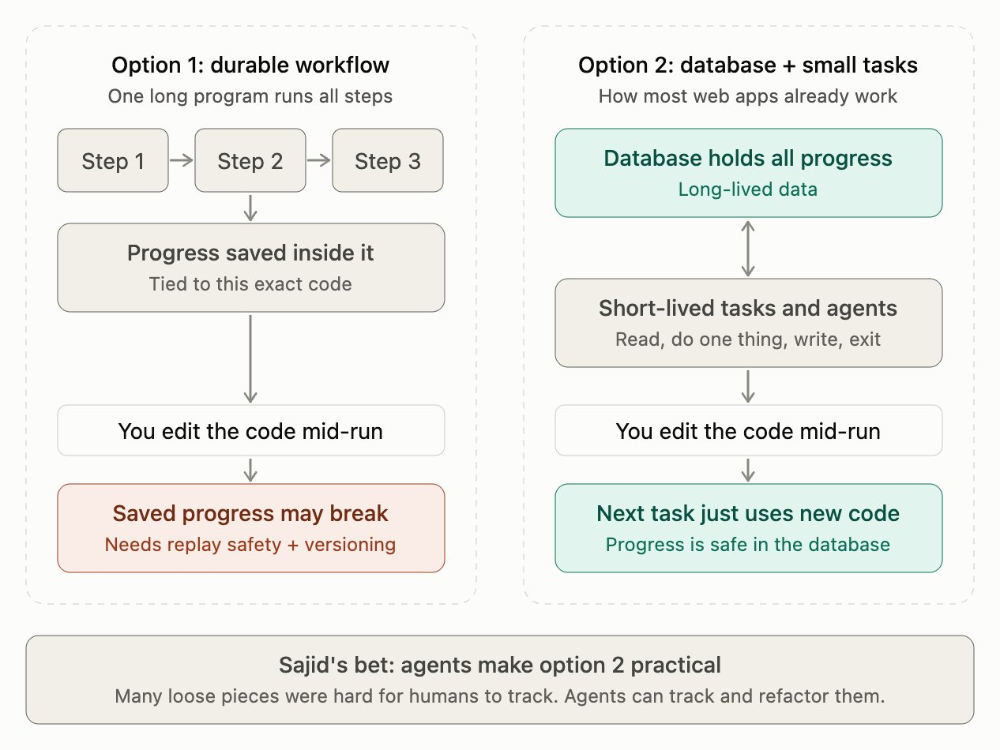

# Long-lived data, short-lived code (@smehmood)

## Source and take

[Root post](https://x.com/smehmood/status/2119128044195758491), 7 Nov 2026 18:01 GMT. Saved under 8 Nov as requested. Full `note_tweet` recovered through conversation search. **Interested parties:** @smehmood builds Niteshift, a cloud for coding agents; diagram contributor @_amankishore also builds Niteshift. This is a view after **24 hours of prototyping**, explicitly a "Strong opinion, weakly held", not production evidence.

**Hot take? A useful deployment boundary, an overreach as a rejection of durable workflows.** He finds replay safety and workflow versioning painful when frequently changing a long-running factory. Instead, keep progress in long-lived data and run short-lived handlers against it. He calls this choreography rather than orchestration, betting agents can keep the scattered pieces refactored and simulations can validate changes. Neither claim about agents is demonstrated here. A durable database does not automatically make new code compatible with old state.

The [quoted August post](https://x.com/smehmood/status/2092017846708814192), 24 Aug 2026 23:34 BST, advocated deterministic code mixed with agentic execution, long-lived code plus one-off dynamic scripts, and Temporal-style durable cloud execution. It already rejected spending agent tokens every five minutes to discover newly deployed PRs. November changes the persistence/deployment model, not that sensible division of labour.

## Reply diagram

[Diagram reply](https://x.com/_amankishore/status/2119138324145205471), endorsed by the author's ["yes!"](https://x.com/smehmood/status/2119138530891100436). [Original media](https://pbs.twimg.com/media/HWiw5NjWYAI6chn.jpg?format=jpg&name=orig), preserved without re-encoding: 1266x950 JPEG, 121,101 bytes, SHA256 `bdeea3ee491f3ecb79dfe294e9c5347b8b2774c059093e2a9d00966390f735d6`.

Two dashed panels compare options; all labels are readable:

- **Option 1: durable workflow**, "One long program runs all steps". Step 1 feeds Step 2, which feeds Step 3. A downward connector from Step 2 leads to "Progress saved inside it / Tied to this exact code", then "You edit the code mid-run", then a red box: "Saved progress may break / Needs replay safety + versioning".
- **Option 2: database + small tasks**, "How most web apps already work". A green box says "Database holds all progress / Long-lived data". A bidirectional vertical connector joins it to "Short-lived tasks and agents / Read, do one thing, write, exit". Downward flow continues through "You edit the code mid-run" to "Next task just uses new code / Progress is safe in the database".
- Bottom banner: "Sajid's bet: agents make option 2 practical" and "Many loose pieces were hard for humans to track. Agents can track and refactor them." The banner uses the author's name; that is image text, not independent evidence.

**What the drawing omits:** no event bus, event schema, acknowledgement, retry, deduplication or migration path is drawn. It illustrates state placement, not a complete choreography design. Database plus tasks can still be centrally orchestrated. The left panel is shorthand: Temporal persists history in its service, not literally inside one long-running process. The right panel's green safety claim requires compatible schemas and semantics, safe concurrent writes and recoverable side effects. Short-lived code shifts those obligations; it does not abolish them.

## What primary sources support

[Temporal workflow definitions](https://docs.temporal.io/workflow-definition) confirm that replay compares emitted commands with persisted history. Reordering activities/timers can break determinism. But "versioning any time you want to change the code" is too broad: the docs enumerate safe changes and put external APIs, database operations and LLM calls in Activities outside the replay path.

[Worker Versioning](https://docs.temporal.io/production-deployment/worker-deployments/worker-versioning) explicitly addresses deployment: pinned executions finish on their original deployment version; auto-upgrade executions need replay-safe changes/patching. Continue-as-New can provide upgrade boundaries. Keeping old versions running has a cost, but this is an engineering trade-off with supported tooling, not evidence Temporal cannot evolve.

[GitHub Actions events](https://docs.github.com/en/actions/reference/workflows-and-actions/events-that-trigger-workflows) support repository events, dispatch and scheduled runs. [gh-aw triggers](https://github.github.io/gh-aw/reference/triggers/) use standard Actions syntax, with deterministic pre-activation filters, role/bot checks and status comments. This supports event-driven, bounded jobs, not automatic Temporal-like recovery or exactly-once business effects. Actions also orchestrates steps/jobs inside a run; choreography between runs and orchestration within one run can coexist.

Simulation is a good proposal, not proof of safety: record event fixtures and expected transitions, test old-state/new-handler compatibility, and inject duplicate/out-of-order events and crashes between an external write and its acknowledgement. Keep deterministic invariants and independent verification; do not let an agent's successful self-refactor substitute for these tests.

## Replies and qualifications

Conversation search returned the root plus 13 replies/follow-ups; the next page was empty. No additional replies beyond the supplied threads were found at this check.

- [@kartikb753](https://x.com/kartikb753/status/2119136815663698154): choreography makes retrospective "why did this happen" hard; with agent refactoring, the event log becomes the only real spec. A log still needs recorded policy/code versions and explicit invariants to explain intent.
- [@joetossell](https://x.com/joetossell/status/2119203835612889228): human understandability remains an important metric, possibly affecting how well coding agents work too. His bio also describes an agentic-cloud business.
- [@lukerramsden](https://x.com/lukerramsden/status/2119166160457592853): build change-management tools for durable workflows instead. This names the alternative, though calling it trivial is unsupported.
- [@kamathematic's plug](https://x.com/kamathematic/status/2119148198707241069) resolves to [Tardigrade](https://tardigrade.sh). Its own site describes a TypeScript framework built on Effect: append-only events, pure state reduction, effect proposals, durable actors and behaviour checking. These are vendor descriptions, not a tested solution to every migration problem. [@smehmood replies](https://x.com/smehmood/status/2119148898195259682), "I take it back we should use Effect". Whether joking or a genuine reversal is ambiguous; do not report an architectural decision.
- Naming side thread: [@zachlloydtweets](https://x.com/zachlloydtweets/status/2119156845151441353) also dislikes "factory". [@smehmood suggests](https://x.com/smehmood/status/2119171505401757916) @charlieholtz's "software orchestras". His concern is the industrial-process framing, not opposition to automating engineering.

## Connections to Sam's notes

[@poteto's deterministic engineering](../poteto-advice/2026-11-06-poteto-deterministic-engineering.md) complements either topology: code, static checks and verification remain the backpressure. [Warp's infrastructure argument](2026-11-04-zachlloydtweets-dont-vibe-code-your-factory.md) and [stack walkthrough](2026-11-05-zachlloydtweets-swyx-factory-stack.md) emphasise factory-as-code, orchestration and evaluation; this post asks where to put durable progress, not whether to remove those responsibilities. [@EnoReyes's diagram](2026-11-06-EnoReyes-software-factory-diagram.md) describes the signal-to-ship control loop, which can use either implementation. [@CalvinGrunewald's CI-cost note](2026-11-07-CalvinGrunewald-ci-sandbox-costs.md) reinforces avoiding redundant runs, not dropping verification. These relative paths were checked against remote repository listings/indexes.

## GHCP mapping for Sam's factory

**Native:** use GitHub issues, PRs, labels, comments and check runs as persistent work records; Actions for deterministic event handlers and enforced Python/TypeScript checks; the coding agent for bounded implementation tasks; Agentic Workflows for agentic triage/review on selected events. Store custom agents, skills and instructions in version control. Do not make one agent session wait through the whole lifecycle.

**Glue Sam builds:**

| Concern | Native starting point | Required factory design |
| --- | --- | --- |
| Safe re-runs | Event payloads, run IDs and check/PR identifiers | Stable operation key such as repo/item/SHA/action/policy-version; durable result ledger, state preconditions and idempotent upserts. A crash after an API side effect but before recording success needs reconciliation, not blind repetition |
| Concurrent handlers | [Actions concurrency groups](https://docs.github.com/en/actions/how-tos/write-workflows/choose-when-workflows-run/control-workflow-concurrency) | Group by work item; cancel superseded read/test work, not irreversible writes mid-flight. Concurrency is not a transaction or exactly-once guarantee; use a proper store/atomic claim when comments and labels are insufficient |
| Why it happened | Run logs, PR/check links; [gh-aw status comments](https://github.github.io/gh-aw/reference/triggers/) | Append structured records linking cause/event ID, actor, input state/SHA, handler commit, policy/prompt/model version, decision and reason, approvals, attempts and effects. GitHub comments are editable and logs have retention limits: export to a retained audit store if needed. Surface this through the [activity log and undo reference](../ux/2026-11-02-iliasconfidency-agent-activity-undo.md), whose path was verified remotely |
| No agent polling loops | [Actions events](https://docs.github.com/en/actions/reference/workflows-and-actions/events-that-trigger-workflows), dispatch, gh-aw pre-activation filters | Trigger on PR/deployment/work completion; use cheap deterministic reconciliation for missed/stale state. Check trigger restrictions: Actions-origin check_run/check_suite events are suppressed; use workflow_run where appropriate, with conclusion and trust checks. GITHUB_TOKEN recursion restrictions also mean label/comment writes are not a guaranteed event bus |
| Safe evolution | Versioned workflow/skill files and CI | Version data/event schemas, define old-state migration, pin tested handler revisions and replay fixtures in an isolated simulator without real writes. Bound retries, permissions and cost; do not treat issue text or an authorised trigger as approval of arbitrary effects |

**Where a durable engine earns its place:** multi-system operations requiring reliable timers, retries, long human waits, cancellation and explicit compensating actions across outages. A stable outer Temporal workflow can coordinate short, evolving Activities, with deployment versioning, rather than persisting every factory decision in one mutable giant workflow. For Sam, begin with GitHub's existing event/state model; add a durable engine when measured recovery and coordination requirements justify it. Long-lived data is a sound default, not an exemption from distributed-systems engineering.
