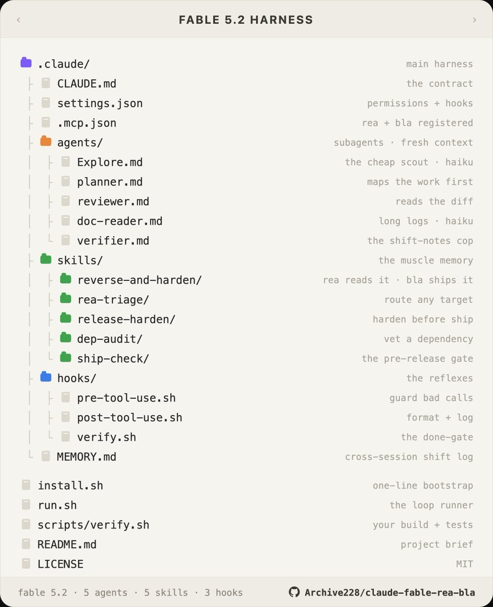

# Folder setup that is meant to stop lazy "fixed" claims (@bebuu_ai)

Source: [@bebuu_ai, 11 Nov 2026, 06:30 Europe/London](https://x.com/bebuu_ai/status/2120403652372488394). The post says a folder setup can stop Claude Code "lazily claiming a bug is fixed when it never ran the build." The API text was truncated in some clients; the full `note_tweet` was read, and the attached tree image was copied from `/workspace/img/bebuu.jpg` (not re-encoded). The repo in the image footer is [Archive228/claude-fable-rea-bla](https://github.com/Archive228/claude-fable-rea-bla), read remotely (no clone). This follows his earlier post ([10 Nov 2026, 09:04 Europe/London](https://x.com/bebuu_ai/status/2120080226801820156)) about a "you own the repo" prompt from a "Claude Fable 5.2 prompting guide."

**Original image:** `2026-11-11-bebuu_ai-claude-harness-tree.jpg` (975x1200 RGB JPEG, 95,405 bytes, SHA256 `ffd8a5d24dc2773a7a69ec3a8a2569ed90e616c5e23669e3da16fcc1620817bd`). Bytes copied from the local source file; not re-encoded.

## What the post claims

The image is titled "FABLE 5.2 HARNESS" and shows `.claude/` with `CLAUDE.md`, `settings.json`, `.mcp.json` ("rea + bla registered"), agents (Explore, planner, reviewer, doc-reader, verifier), skills (reverse-and-harden, rea-triage, release-harden, dep-audit, ship-check), hooks (`pre-tool-use.sh`, `post-tool-use.sh`, `verify.sh` as "the done-gate"), and `MEMORY.md` ("cross-session shift log"), plus `install.sh`, `run.sh` and `scripts/verify.sh` ("your build + tests").

The post itself lists "4 tiny files" and then five bullets: `CLAUDE.md` "under 60 lines"; `agents/Explore.md` pinned to Haiku; `hooks/verify.sh` running the actual build and test before exit; `agents/verifier.md` as a fresh-context subagent that reads the git diff and test output and rejects fake fixes; and `MEMORY.md` as a "20-line shift log so the next session knows what broke last time." The count and the line-length claims do not match the shipped files (see below).

## The earlier ownership prompt

[Anthropic's Prompting Claude Fable 5.2 guide](https://platform.claude.com/docs/en/build-with-claude/prompt-engineering/prompting-claude-fable-5-2) is real, and so is the Fable 5.2 model. The earlier post is not a faithful quote of the current guide.

The post's sentence, which is also the first line of the repo's `CLAUDE.md`, is: "This codebase is yours: what it's for and how it's built are your call, and you'll keep building on it." The current official "Say who owns the code" sentence is: "You are the owner and long-term maintainer of this codebase, and its design is up to you." The post says Anthropic's tests showed proactive merges in about 50% of runs with the sentence, and under 10% without it. The current guide says the model consolidated duplicated code in under 10% of runs without the sentence and in about 75% of runs with it, with output tokens up by about 70 to 80%, and with unrequested changes. Treat the 50% figure and that wording as @bebuu_ai's recap, not as the current primary text. The same official page also supplies the long "Finishing work" and "Communicating clearly" blocks that the repo's `CLAUDE.md` largely copies, and those already make the file longer than the "under 60 lines" claim.

## What the repo actually ships

The Stop hook structure is real. `.claude/settings.json` registers `.claude/hooks/verify.sh` on the `Stop` event. That script exits 2 if `scripts/verify.sh` is missing, not executable, or fails, and exits 0 otherwise. [Claude Code hooks docs](https://docs.claude.com/en/docs/claude-code/hooks) say exit 2 on `Stop` "Prevents Claude from stopping, continues the conversation." So the wiring matches the advertisement.

The payload does not. `scripts/verify.sh` is a stub. It prints "running build + tests...", leaves `npm run build && npm test` commented out, and always exits 0. The README even tells you to replace the body with your real build and tests. With the stub in place, the Stop hook never blocks, and the agent can still claim the work is done without running a build.

The Stop hook also never reads its JSON stdin, so it never inspects `stop_hook_active`. The same Claude Code docs say that field is true when Claude Code is already continuing because of a stop hook, and that you should check it (or the transcript) so you do not block on a condition that will never resolve. Claude Code also applies an 8-consecutive-continuation cap, then overrides the next block and ends the turn. The cap resets when Claude calls a tool. Ignoring the field is a real gap if you later put a failing check in `scripts/verify.sh`. With the shipped stub, the hook never continues the turn at all, so the cap is not the live problem.

`pre-tool-use.sh` is a regex blocklist on the Bash payload: `rm -rf` (with flexible spacing) and `git push --force`. It misses `git push -f` (and other force forms). `rm -rf` is already denied in `settings.json` as `Bash(rm -rf:*)`, so that half of the hook is redundant. Exit 2 on `PreToolUse` does block the tool call, per the same docs.

`post-tool-use.sh` (matched on `Edit|Write`) runs `scripts/format.sh` if it is executable, then appends a UTC timestamp plus the words "tool ran" to `.claude/activity.log`. `scripts/format.sh` is also a stub: the formatter command is commented out and the script always exits 0. The activity line has no tool name, path or diff.

`MEMORY.md` is five static bullets about the harness itself (effort level, Haiku for long reads, the REA/BLA loop, the Stop hook, and secrets). Nothing in the hook scripts, `run.sh` or `scripts/` writes to it. It is not a shift log, and it is not 20 lines. The post-tool hook writes only to `activity.log`.

`settings.json` denies `Edit(tests/**)`, which is a sound anti-cheat idea: the agent should not "fix" a failing test by editing the test. The deny is narrow. It does not cover `Write(tests/**)` or a Bash edit of the same files.

Two path mismatches are worth a flag. The image and README talk about `.claude/.mcp.json`; the file in the repo is `.mcp.json` at the root. `agents/verifier.md` is a fresh-context checker that must run `scripts/verify.sh`, read the diff, and give a PASS or FAIL with no softened unproven claims. It does not mention skipped or empty test collections. Because `scripts/verify.sh` always exits 0, the verifier's first gate always passes.

`rea-agents` and `bla-agents` are real npm packages, installed by `install.sh` via `npx` and registered in the root `.mcp.json`. REA is [morluto/rea](https://github.com/morluto/rea) (reverse-engineering). BLA is [qybaihe/bla](https://github.com/qybaihe/bla) (harden a release against that kind of analysis). The harness is built around those tools. I did not find evidence that @bebuu_ai or Archive228 authored them, but the repo is still a product-shaped plug for both packages.

## Useful replies

@prasanth_kuna restates the Stop hook idea: run the build and tests, and block when the exit is non-zero. That is the right shape, and it is what this repo advertises, but not what `scripts/verify.sh` currently does.

@RemoteBrewser would put the build and test command first in `CLAUDE.md` and require its output. That is a prompt rule, not a gate. It is weaker than a hook that can refuse, and it does not replace a real `scripts/verify.sh`.

@NeyronixAI calls `verifier.md` the strongest piece, and asks whether it fails when tests are skipped. The shipped prompt does not say that it should.

@mamama_ma3tawy gives a concrete zero-test guard: fail if `pytest --collect-only -q` collects nothing, and for Go require `go test -json` "run" events. That belongs in a real `scripts/verify.sh`, not only in the verifier's prose.

@liangzaicom's point is the one this folder is trying to make: a verifier that can refuse beats another paragraph in `CLAUDE.md`. The hook and the subagent are the right kind of mechanism. They only work once the verify script is a real check.

## GHCP mapping

This is a proposed port onto GitHub Copilot, not a feature of @bebuu_ai's post.

GitHub Copilot does support hooks, for both [Copilot CLI](https://docs.github.com/en/copilot/how-tos/copilot-cli/customize-copilot/use-hooks) and the [cloud coding agent](https://docs.github.com/en/copilot/how-tos/copilot-on-github/customize-copilot/customize-cloud-agent/use-hooks). The format is documented in the [hooks reference](https://docs.github.com/en/copilot/reference/hooks-reference) and the [concepts page](https://docs.github.com/en/copilot/concepts/customizations/hooks). Configuration lives in `.github/hooks/*.json` with `"version": 1`. The CLI can also load user-level hooks and can read a `hooks` block from `.claude/settings.json`. The cloud agent only loads `.github/hooks/*.json` from the cloned repository, runs them in the ephemeral Linux sandbox, and honours only `bash` or `command` entries.

The done-gate maps to `agentStop` (also spelled `Stop`). That event fires for the cloud agent as well as the CLI. A hook can force another turn by writing JSON to stdout: `{"decision": "block", "reason": "..."}`. Do not copy the Claude Code pattern of `exit 2` and expect it to block here. In Copilot, exit 2 is a warning for most events (it is a deny only for `preToolUse` and `permissionRequest`). The `agentStop` input includes `stop_hook_active`, which is true when a prior block already continued the turn. After eight consecutive blocks, the CLI (and the same cap is documented for this event) overrides the hook and ends the turn anyway. A blocked continuation still counts against the cloud-agent job timeout. `sessionEnd` fires once per job, but its output is not processed and cannot block.

`preToolUse` can allow or deny a tool. Under the cloud agent, a decision of `"ask"` is treated as `"deny"` because there is no user. Command `preToolUse` hooks are fail-closed on a crash or a non-zero exit, including exit 2. Timeouts are fail-open for every event, including `preToolUse`.

Even with a working `agentStop` hook, keep a required status check that runs the real build and tests, plus a zero-test guard of the sort @mamama_ma3tawy described. A hook is only as strong as the script it calls, the sandbox can discard hook logs, the 8-block cap can end a still-failing turn, and a timeout will not fail closed. Install the toolchain in [`.github/workflows/copilot-setup-steps.yml`](https://docs.github.com/en/copilot/how-tos/copilot-on-github/customize-copilot/customize-cloud-agent/customize-the-agent-environment), with the caveat already recorded in the [software factory lessons](2026-11-10-andrestaltz-software-factory-lessons.md): official docs say that if a setup step fails, Copilot still starts work in the broken environment, so setup is not fail-closed by itself.

Add a verifier [custom agent](https://docs.github.com/en/copilot/how-tos/copilot-on-github/customize-copilot/customize-cloud-agent/create-custom-agents) that reads the diff and the test output and is allowed to fail the review. Protect `tests/` the way `Edit(tests/**)` tries to: CODEOWNERS on that path, and a check that fails if the coding agent edited tests in the same change that is meant to make them pass (the cloud agent pre-grants tools, so a settings deny list alone is not enough).

Do not treat [Copilot Memory](https://docs.github.com/en/copilot/concepts/prompting-and-context/copilot-memory) as the real version of `MEMORY.md`. GitHub's own docs say a memory may not apply in every session. Keep a reviewed, committed decisions log, and tell agents to read it. That is the same lesson as the andrestaltz note, and it sits under the [deterministic engineering](../poteto-advice/2026-11-06-poteto-deterministic-engineering.md) preference for cheap, deterministic gates (here, a real verify script and required checks) over more prose.
