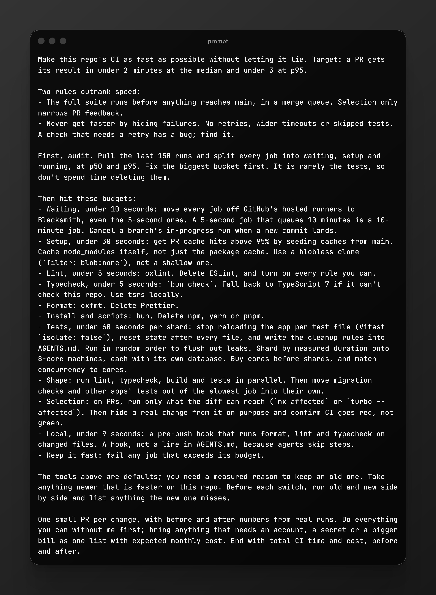

# A prompt to get CI under two minutes (@pontusab)

Source: [@pontusab, 15 Nov 2026, 15:34 Europe/London](https://x.com/pontusab/status/2121990184816484483), "Instructions to get your CI under 2 minutes", with the prompt image below. It quotes his earlier [results post](https://x.com/pontusab/status/2121982070193058191) (15:02 Europe/London the same day): "Our frontend CI is now under 2 minutes." What he says they did: tsc to bun check; oxlint with every rule they can turn on; shards filled by recorded test time; PRs run only the tests the diff can reach; lint, typecheck, build and tests in parallel. "Under 2 minutes" is his claim. He did not publish a cold-cache number on a fresh runner. He is building Glass at [@tryramp](https://x.com/tryramp).

The prompt is a reusable agent brief, not a unique invention. It follows the same checklist, budgets and tools as the Boardy article already covered in [CI 20x faster (@owengretzinger)](2026-10-31-owengretzinger-ci-20x.md), which [@voxyz](2026-10-31-voxyz-ci-audit-prompt.md) had also posted as a pasteable prompt. Treat this thread as his reported result plus a copy of that playbook, and keep the earlier cost warning: Boardy's bill rose sharply once agents pushed more work through faster runners.



Transcription of the image, read from the PNG:

```
Make this repo's CI as fast as possible without letting it lie. Target: a PR gets
its result in under 2 minutes at the median and under 3 at p95.

Two rules outrank speed:
- The full suite runs before anything reaches main, in a merge queue. Selection
  only narrows PR feedback.
- Never get faster by hiding failures. No retries, wider timeouts or skipped
  tests. A check that needs a retry has a bug; find it.

First, audit. Pull the last 150 runs and split every job into waiting, setup and
running, at p50 and p95. Fix the biggest bucket first. It is rarely the tests, so
don't spend time deleting them.

Then hit these budgets:
- Waiting, under 10 seconds: move every job off GitHub's hosted runners to
  Blacksmith, even the 5-second ones. A 5-second job that queues 10 minutes is a
  10-minute job. Cancel a branch's in-progress run when a new commit lands.
- Setup, under 30 seconds: get PR cache hits above 95% by seeding caches from
  main. Cache node_modules itself, not just the package cache. Use a blobless
  clone (`filter: blob:none`), not a shallow one.
- Lint, under 5 seconds: oxlint. Delete ESLint, and turn on every rule you can.
- Typecheck, under 5 seconds: `bun check`. Fall back to TypeScript 7 if it can't
  check this repo. Use tsrs locally.
- Format: oxfmt. Delete Prettier.
- Install and scripts: bun. Delete npm, yarn or pnpm.
- Tests, under 60 seconds per shard: stop reloading the app per test file (Vitest
  `isolate: false`), reset state after every file, and write the cleanup rules
  into AGENTS.md. Run in random order to flush out leaks. Shard by measured
  duration onto 8-core machines, each with its own database. Buy cores before
  shards, and match concurrency to cores.
- Shape: run lint, typecheck, build and tests in parallel. Then move migration
  checks and other apps' tests out of the slowest job into their own.
- Selection: on PRs, run only what the diff can reach (`nx affected` or `turbo
  --affected`). Then hide a real change from it on purpose and confirm CI goes
  red, not green.
- Local, under 9 seconds: a pre-push hook that runs format, lint and typecheck
  on changed files. A hook, not a line in AGENTS.md, because agents skip steps.
- Keep it fast: fail any job that exceeds its budget.

The tools above are defaults; you need a measured reason to keep an old one.
Take anything newer that is faster on this repo. Before each switch, run old and
new side by side and list anything the new one misses.

One small PR per change, with before and after numbers from real runs. Do
everything you can without me first; bring anything that needs an account, a
secret or a bigger bill as one list with expected monthly cost. End with total
CI time and cost, before and after.
```

## What he added in follow-ups

Asked how a diff "reaches" a test, he said they use [Vitest `--changed`](https://vitest.dev/config/changed.html) against the merge base: "a test runs if it imports a changed file." Non-imported inputs (lockfile, configs, a generated client) force a full run, and "merge queue + main always run everything." A lockfile bump therefore runs the full suite, because "a dep change can shift any test," but "full" is not forever: he cited "10 duration-balanced shards at ~150s each." He also said "the runtime map is the biggest win," because their heaviest tests "mount the real route tree so the import graph pulls them in on almost any change." So affected-only selection can shrink less than the headline suggests, once big tests import a wide tree.

He did not give a cold-cache figure, did not explain bun check versus tsrs, and did not describe an end-to-end suite.

## Useful replies

[@smallbotlabkn](https://x.com/smallbotlabkn/status/2122604815339643048) put the missing number cleanly: "'under 2 min' means nothing without the cold-cache run on a fresh runner. what's the number there." It was not answered.

[@alertactionkn](https://x.com/alertactionkn/status/2122608622362608031) said affected-only tests are "the whole win" and asked how stable duration-based shards stay "when timings drift after a few weeks." Also unanswered. You would need to refresh recorded durations, or shards slowly unbalance.

[@brincoveanuvlad](https://x.com/brincoveanuvlad/status/2122026578096128324) worried that with agents touching more files, the reachability graph will miss things, and asked whether a full suite still runs, "like nightly." The prompt already puts the full suite in a merge queue, which is stronger than a nightly if every merge goes through the queue. [@callmesaucey](https://x.com/callmesaucey/status/2122047159935627549) still wanted a belt-and-braces "every N PRs merged" if you are not running everything on the merge path. [@brincoveanuvlad](https://x.com/brincoveanuvlad/status/2122623174391243189) later called every-N "a good middle ground" only when a nightly would be too late.

[@frederic_ooo](https://x.com/frederic_ooo/status/2122611792761512243) wrote "defeats the purpose of tests," almost certainly about affected-only PR runs. [@russ1anbot](https://x.com/russ1anbot/status/2122554166598140220) said the same more rudely. The prompt's own answer is that selection only narrows PR feedback, and the merge queue must still run the lot.

[@SzymonRybczak](https://x.com/SzymonRybczak/status/2122618175665893755) and [@albertplaya](https://x.com/albertplaya/status/2122597014198476989) asked what happens to end-to-end tests. No answer in the thread. This write-up is about frontend unit and integration time, not a browser suite.

[@y0dah](https://x.com/y0dah/status/2122594517547192710) asked "why bun check over tsrs." No answer. The prompt itself splits them: bun check in CI, tsrs locally. [@aidansunbury](https://x.com/aidansunbury/status/2122565057347502116) just said to try tsrs. [@quantizor](https://x.com/quantizor/status/2122562477074379027) warned not to switch install and scripts to Bun "unless you run Bun everywhere," because "Bun and Node are not equivalent" and the skew can show up in production.

[@TheAlexLichter](https://x.com/TheAlexLichter/status/2122587109454180733) asked whether they had tried Vitest's `affected` or `stale` flags. Unanswered. [@benmac006](https://x.com/benmac006/status/2122511561088549287) backed "buy cores before shards" with a self-reported webpack job going from 27m 45s on a 4 vCPU GitHub runner to 2m 35s on one bigger box.

Someone noted a side effect of "CI cost $2k." His reply was "easy win." There is no bill breakdown, and no cold-cache figure to go with the speed claim. That is the same cost trap already flagged in the [@owengretzinger](2026-10-31-owengretzinger-ci-20x.md) and [CI and sandbox costs (@CalvinGrunewald)](2026-11-07-CalvinGrunewald-ci-sandbox-costs.md) notes.

Vendor plugs, flagged as such: [@Sandcovery](https://x.com/Sandcovery/status/2122602768062152847) offered "free CI" with "no strings attached." Ignore [@bot](https://x.com/bot) and other Grok Bot routing replies.

## What checks out

**`bun check` exists.** Official Bun docs describe it as a project typecheck that reads `tsconfig.json`, reports the same errors as `tsc` from TypeScript 7, uses every CPU core, writes no files, and exits 1 on error. It is a port of typescript-go. Keep `tsc` if you still need to emit `.d.ts` files. Docs: [Type checking](https://bun.com/docs/runtime/check), [Bun v1.4.3](https://bun.com/blog/bun-v1.4.3).

**TypeScript 7** is the native Go port, announced as 7.0: [Announcing TypeScript 7.0](https://devblogs.microsoft.com/typescript/announcing-typescript-7-0/). The prompt's "fall back to TypeScript 7 if bun check can't check this repo" is a real toolchain, not a rumour.

**tsrs** is a documented Rust drop-in for the TypeScript 7 compiler and language server (`tsrs --noEmit --fast`). From 0.23.0 it can also back Oxlint type-aware rules, and Oxlint 1.92+ will pick it up when `tsrs` is installed. Repo: [oxc-project/tsrs](https://github.com/oxc-project/tsrs/). Why CI should prefer bun check and leave tsrs for local use is not argued in the thread; measure both if you care.

**oxlint** is real, with a large published rule set and an official "turn on groups of rules" model: [Oxlint rules](https://oxc.rs/docs/guide/usage/linter/rules). "Every rule you can" will be noisy; the prompt already says to run old and new side by side.

**oxfmt** is the official Oxc formatter, with a Prettier-compatible workflow, `oxfmt` and `oxfmt --check`: [Oxfmt](https://oxc.rs/docs/guide/usage/formatter). Official docs present it as the dedicated formatter to choose. Still run it side by side before deleting Prettier, as the prompt says, because a formatter rewrites the tree.

**Vitest `isolate: false`** is a documented config (default is `true`). It can speed file startup if tests do not rely on a fresh environment, and it has no effect on `vmThreads` / `vmForks`. You must reset state, which is why the prompt writes cleanup rules down. Docs: [isolate](https://vitest.dev/config/isolate.html), [improving performance](https://vitest.dev/guide/improving-performance). Random order is a way to flush leaks, not a substitute for cleanup. His actual PR selection, in the follow-up, is **`vitest --changed`** against the merge base, which is also documented: [changed](https://vitest.dev/config/changed.html), [affected tests](https://vitest.dev/guide/recipes/affected-tests).

**`nx affected`** and **`turbo --affected`** are documented: [Nx affected](https://nx.dev/docs/features/ci-features/affected), [turbo run --affected](https://turborepo.dev/docs/reference/run). Shallow clones can make every package look changed, which is one reason the prompt wants a blobless clone rather than a shallow one. The "hide a real change and confirm CI goes red" canary is the right test of that skip path; Boardy already reported a green skip they had to fail closed.

**Blobless clone** is `git clone --filter=blob:none`: commits and trees come down, blobs are fetched on demand. It is not a shallow clone (`--depth=1`). Docs: [git-clone](https://git-scm.com/docs/git-clone.html), [GitHub on partial clone](https://github.blog/open-source/git/get-up-to-speed-with-partial-clone-and-shallow-clone/).

**GitHub merge queue** is a first-class feature. Workflows that report required checks must also listen for `merge_group`, or the queue will see no check and fail. Docs: [Managing a merge queue](https://docs.github.com/en/repositories/configuring-branches-and-merges-in-your-repository/configuring-pull-request-merges/managing-a-merge-queue).

**Cancel in-progress** is `concurrency` with `cancel-in-progress: true`, which is right for a PR branch when a new commit lands. Docs: [Control concurrency](https://docs.github.com/en/actions/how-tos/write-workflows/choose-when-workflows-run/control-workflow-concurrency). Do not use that same group to cancel `merge_group` runs: a cancelled merge-queue check can invalidate a required status. Keep PR cancellation and merge-queue runs apart.

**Blacksmith** is a third-party GitHub Actions runner vendor (drop-in `runs-on` labels): [blacksmith.sh](https://www.blacksmith.sh/), [docs](https://docs.blacksmith.sh/). Flag it as a vendor. The prompt itself says to bring anything that needs an account or a bigger bill as one list with monthly cost. Moving every job, including five-second ones, is only worth it after you measure queue time and the new invoice, as [Actions minute rounding (@DanielLockyer)](2026-11-02-daniellockyer-actions-minute-rounding.md) also reminds you that short jobs are not free.

## GHCP mapping

This is a proposed port onto Sam's factory (Python backend, TypeScript frontend, GitHub, Copilot coding agent on Actions, pstack), not a claim that GitHub ships this prompt. Feed the prompt itself to a Copilot coding agent or a [custom agent](https://docs.github.com/en/copilot/how-tos/copilot-on-github/customize-copilot/customize-cloud-agent/create-custom-agents) as one measured task, with the "one small PR per change" and "side by side before switching" rules left in.

**Start with an audit, not a tool swap.** Pull the last 150 runs, split waiting / setup / running at p50 and p95, and fix the biggest bucket first. Keep flake rate and monthly Actions plus runner spend next to the wall-clock, because a two-minute PR can still be an expensive PR.

**Frontend (TypeScript).** The prompt's tools are real: bun check, oxlint, oxfmt, Vitest with `isolate: false` plus cleanup, duration shards, and either `vitest --changed`, `nx affected` or `turbo --affected` on PRs. Run the full suite on `merge_group` and on `main`. After enabling selection, hide a real change on purpose and fail the workflow if CI stays green. Put format, lint and typecheck in a pre-push or pre-commit hook that finishes quickly, not only in `AGENTS.md`. Fail any job that exceeds its budget.

**Backend (Python).** The same shape, different tools, all documented:

- Lint and format: [Ruff](https://docs.astral.sh/ruff/linter/) (`ruff check`, [ruff format](https://docs.astral.sh/ruff/formatter/)).
- Installs: [uv](https://docs.astral.sh/uv/).
- Typecheck: [Pyright](https://microsoft.github.io/pyright/) is the established CLI. [ty](https://docs.astral.sh/ty/) is Astral's Rust type checker (`ty check`) and is documented; run it side by side with Pyright and list misses before it becomes the only gate.
- Parallel tests: [pytest-xdist](https://pytest-xdist.readthedocs.io/en/latest/) (`pytest -n` matched to cores).
- Duration shards: [pytest-split](https://jerry-git.github.io/pytest-split/) (`--store-durations`, then `--splits` / `--group`). Refresh the duration file, or shards drift, which is @alertactionkn's question.
- Diff selection: [pytest-testmon](https://github.com/tarpas/pytest-testmon) selects tests affected by changed files. It is [not compatible with pytest-split collection](https://github.com/jerry-git/pytest-split/issues/93), so do not enable both on the same invocation. Use split for CI shards and testmon, or an equivalent import-graph pass, for PR selection, and still run the full suite in the merge queue. The same "hide a change, confirm red" canary applies.

**Coding agent environment.** Cache and install in [`.github/workflows/copilot-setup-steps.yml`](https://docs.github.com/en/copilot/how-tos/copilot-on-github/customize-copilot/customize-cloud-agent/customize-the-agent-environment) so the agent's own Actions environment boots fast (`setup-node` / `setup-python` cache, `uv sync` or bun install). That is setup time for the agent, not a substitute for CI budgets.

**Canary and budgets.** A scheduled [Agentic Workflow](https://docs.github.com/en/copilot/how-tos/github-agentic-workflows/creating-github-agentic-workflows) can hide a known-breaking edit on a throwaway branch, or patch a fixture, and fail if the affected-only job stays green. Job budgets belong in the workflow as failing checks, not as a line of advice.

A practical order: measure the 150-run split; seed caches from `main`; add a short hook; swap lint and typecheck with a side-by-side PR; only then touch isolation, shards, affected-only, a merge queue, and any paid runner. pstack does not replace those gates.
