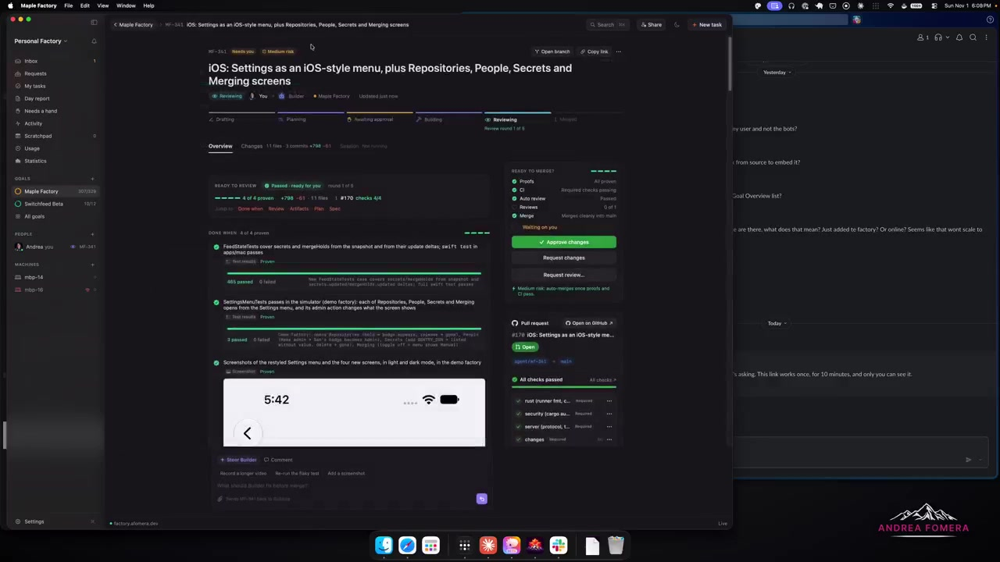
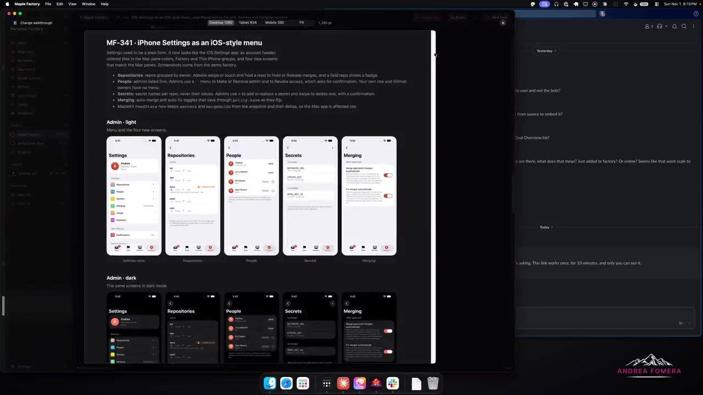
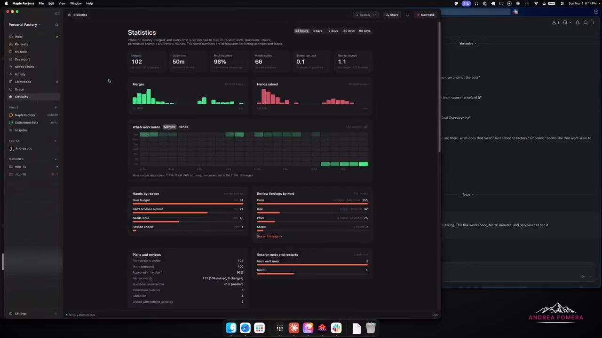

# @afomera Maple Factory: software-factory UI with proof-before-merge

- Source: https://x.com/afomera/status/2117064694888599772 (2 Nov 2026, 01:22 UTC / 01:22 Europe/London). ~11 min amplify video (`13_2117064044914135040`, ~670 s). Metrics at fetch: about 34 likes, 58 bookmarks, 2 reposts, 7 replies, ~3.6k impressions.
- Author: **@afomera**. Bio: "Senior Developer / I make things that sometimes feel good to use". Site linked from bio: https://afomera.dev/ (personal; fonts and indie apps; no Maple Factory marketing there).
- Folder: **ux/** (native factory chrome: inbox, proof artifacts, change walkthrough, machines, statistics, Slack bot).
- Video content in this note comes from a **video-model analysis** (`/workspace/videos/afomera-analysis.md`) plus **three ffmpeg stills** from the downscaled demo. The video file is not shipped with the note.
- Sam's project is on GitHub: GHCP mapping only (no ADO).

## Verdict (lead)

**Closest public cousin yet to Sam's builder-plus-reviewer factory, with a polished Mac inbox and explicit proof-of-work before merge.** @afomera shows Maple Factory v2: Goals/Kanban, an approve-and-merge inbox that demands tests/screenshots/videos, a Builder plus Sentinel reviewer chat, machines with CPU/slot caps, a Slack `@Maple` bot, Scout scheduled jobs, and a statistics dashboard (treat the numbers as **self-reported**). Marketing site, Mac download, Cloudflare deploy, and a public monorepo already exist; @afomera still told a reply thread it is **not ready** for others and needs friend testing. Steal the **proof checklist + change walkthrough artifact + separate reviewer agent** pattern for GHCP; do not treat the merge/cost charts as independent evidence.

## What the post says

Full text (X API):

Here is a tour of my Software Factory (v2) as it is tonight.

Lot to improve here but this is a start! There are native macOS, iOS, Android and Web clients for it.

also featuring name reveal: Maple Factory, inspired by all the work it is to make good syrup, boiling sap down

## Public site / repo / waitlist

Checked outside the video:

| Asset | Status |
|---|---|
| https://maplefactory.dev/ | **Live marketing site.** Tagline: "A software factory for teams" / "Ship only the good stuff." Four-step story (Tap plan, Boil build, Grade review, Bottle merge). Slack `@Maple` docs link. CTAs: Download Mac app, Deploy to Cloudflare, `npx maple-factory install`. |
| https://maplefactory.dev/download | Mac app for Apple silicon, macOS 15+. Connect to a factory address or demo workspace. |
| https://maplefactory.dev/deploy | Self-serve into the caller's Cloudflare account (Workers, Durable Objects, D1, R2). Deploy button points at the public GitHub tree under `server/`. |
| https://factory.afomera.dev/ | @afomera's own factory host (status bar in the stats still). Sign-in wall: "Sign in with GitHub". Footer: maple-server 0.102.0 linking back to maplefactory.dev. |
| https://github.com/Maple-Factory-Dev/maple-factory | **Public** monorepo (created 26 Oct 2026 UTC; 0 stars at fetch). Description matches the site. Layout: `apps/mac`, `apps/ios`, `apps/android`, `runner` (Rust), `server` (Cloudflare Worker), `installer` (`maple-factory` npm), `apps/site`, `protocol`. README: successor to a private `agent-orchestrator`; sessions in tmux; live Mac app when signed in, design mockup when signed out. |
| Waitlist form | **None found.** No separate waitlist page; onboarding is deploy/download. |
| Demo PR `afomera/factory-test#124` | **404** via GitHub API (private or removed). Analysis said the bot `maplefactory-development` opened and merged that PR live. |

Author stance in replies (important against the public CTAs): when asked "Is this public now or anytime soon?", @afomera said **not yet**, needs more cooking, many issues left, wants friend tests because what works for them may not work for others, travelling for work this week but hopes to get it out soon after.

## Video walkthrough (analysis + frames)

Times below follow the video-model notes. **Shown working** means visible UI behaviour in the recording. **Asserted only** means spoken or dashboard claims without independent verification here.

### Overview and Goals (~0:00 to 0:18)

Dark macOS app titled Maple Factory. Overview dashboard with Goals (example spoken: "iPhone: native session view"). Goals organise projects / Kanban-style initiatives. Frame sidebar also lists Goals such as Maple Factory and Switchfeed Beta.

### Review inbox with proof artifacts (~1:05)

Inbox item **MF-341**: "iOS: Settings as an iOS-style menu" (frame title adds Repositories, People, Secrets and Merging screens). Status "Needs you", medium risk, stage **Reviewing**. Green "Passed - ready for you" with "4 of 4 items proven" and diff summary on the still (~+798 / -61 across 11 files).

Speaker requires agents to **prove the ask** with test results, screenshots or videos. Still shows a **Done When** block: FeedStateTests (485 passed 0 failed), SettingsMenuTests (3 passed 0 failed), plus screenshot artifacts. Right rail: Ready to Merge checklist (Proofs, CI, Auto review checked; human Reviews 0 of 1), **Approve changes** / Request changes / Request review, and a GitHub PR open with checks listed.

**Shown working:** artifact rendering in the review pane; approve affordance. **Asserted only:** that those tests truly ran on this change (we only see the UI).

### Change walkthrough artifact (~2:10)

Auto-generated annotated walkthrough comparing Light / Dark (and related) variants to the original ask. Still: white modal "Change walkthrough" for MF-341 with copy describing the Settings redesign and rows of iPhone mockups (Admin light and Admin dark) for Settings, Repositories, People, Secrets, Merging. Device preview chips (Desktop / Tablet / Mobile) sit above.

**Shown working:** walkthrough document with mockups in-app.

### Builder and Sentinel (~2:52)

Chat log between a **Builder** agent and a **Sentinel** reviewer agent iterating before the human sees the result. **Shown working:** chat UI. **Asserted only:** that Sentinel is a fully independent model run rather than a prompt flavour.

### Approve and merge (~3:12)

Clicks Approve changes. Analysis: GitHub PR on `afomera/factory-test` opened by bot `maplefactory-development`, approval comment, automatic merge (shown live). That repo/PR is not public via API now. **Shown working (per analysis):** approve-to-merge GitHub sync in the recording. Treat the specific PR number as ephemeral.

### New task and Planning (~3:50)

Short prompt "iOS needs a UX improvement pass on the setup" goes to Planning. Marketing site matches this: plan approved before code.

### Machines (~4:25)

Machines tab (edge-04, edge-06 in analysis; frame sidebar shows mbp-14, mbp-16). Live shell inside the app. Settings limit CPU (example: leave 50% for the human) and concurrent slots. Hardware claimed: MacBook Pros, Mac mini, Mac Studio, Linux VM. **Shown working:** machine list and shell UI. **Asserted only:** simulator boot cost and full hardware fleet.

### Building artifact (~6:10)

Task Building; artifact showing a "Finish signing in on GitHub" device-code UI.

### Statistics (~6:37): self-reported

Dashboard for last 24 hours (range chips for 3 / 7 / 30 / 90 days). Still metrics: **Merged 102**, **Cycle time 50m**, **First try plans 98%**, **Hands raised 66**, **Steers per task 0.1**, **Review rounds 1.1**. Charts for merges and hands raised; "When work lands" heatmap (note about late-night merges). Hands by reason: Over budget, Can't produce a proof, Needs input, Session ended. Review findings by kind: Code, Risk, Proof, Scope. Session ends: tmux went away, Killed. Spoken extras in analysis: 86 of the merges auto-merged; cost about **$308.45** total; iOS/macOS work costs more because agents boot simulators; Usage claims ~200 hours compute saved; Day report 116 merged yesterday.

**Treat all of these as self-reported dashboard numbers from one operator's factory.** Not independently audited.

### Slack bot (~8:20)

Slack DM with `@Maple`: "mine" lists tickets; asks which platforms Maple Factory supports; bot answers macOS, iPhone, Android, web (shown live per analysis). Site docs: mention `@Maple` in a channel; one click can turn a proposed task into planned work.

### Settings, Scout, scratchpad (~9:25 to end)

Custom instructions/prompts; connectors Slack, Linear, GitHub. **Scout**: scheduled recurring agent tasks (example: weekly dependency updates preparing a PR). Trigger execution **not shown**. Scratchpad; Usage; Day report.

## Shown working vs asserted (summary)

| Kind | Items |
|---|---|
| **Shown working** | Artifact / proof rendering; change walkthrough modal; approve UI; GitHub sync behaviour in the recording (per analysis); Slack bot answer; machine shell; statistics page chrome |
| **Asserted only / self-reported** | Actual coding quality; simulator boots; Scout run; merge counts, cycle time, cost, hours saved; independence of Sentinel; public readiness of the product |

## Notable replies

| Handle | Point |
|---|---|
| **@AdrianNutiu** | Looks great; is it public now or soon? Later: UI more polished than most systems researched that week. |
| **@afomera** | **Not yet**; needs more cooking; many issues; wants friend tests; travelling this week, hopes to ship soon after. |
| **@cupseycode** | Name praise; native clients for everything is the ambitious bit. |
| **@liuzhao_666** | "Code review is the evaporation stage" (syrup joke). |
| **@Ahmdthahir** | Looks promising. |
| **@shreyas1009** | Shares own factory name "Kanaeru". |
| **@patroza** | Asks a bot to track it on a "factory pile". |
| **@MitchellKeller_** | Image reply (meme); @afomera: "lol indeed". |

## Claims check

| Claim | Verdict | Primary check |
|---|---|---|
| Product name Maple Factory; native macOS, iOS, Android, web clients | **Supported** by post, site, and public repo layout (`apps/mac`, `ios`, `android`; web companion planned). | Post + maplefactory.dev + GitHub README |
| Syrup / boil-down metaphor for agent waste vs shipped work | **Marketing framing** (site and post). Useful UX story, not a metric. | Site copy |
| Proof-of-work (tests, screenshots, videos) required before human approve | **Shown in UI** (Done When / proofs checklist). | Frame ~1:10 + analysis |
| Separate Builder and reviewer (Sentinel) agents | **Shown as chat roles** in the demo. Depth of isolation not verified. | Analysis ~2:52 |
| Approve in app merges GitHub PR via bot | **Shown in recording** per analysis; demo PR repo not public now. | Analysis; API 404 on factory-test |
| Machines with CPU/slot limits; live shell | **Shown** in Machines UI (analysis). | Analysis ~4:25 |
| 102 merges / ~50m cycle / $308 cost / etc. | **Self-reported** dashboard + speech only. | Stats still; analysis |
| Scout scheduled workflows | **UI present**; execution not shown. | Analysis ~10:07 |
| Product is public / ready for others | **Mixed.** Site, download, deploy, and public repo exist; author reply says **not ready yet**. | Site + reply thread |
| Demo PR afomera/factory-test#124 | **Not verifiable** publicly (404). | GitHub API |

## What to steal vs skip

**Steal**

- **Proof-before-merge inbox**: Done When items (tests, screenshots, recordings) as first-class PR/task attachments, not chat afterthoughts.
- **Change walkthrough artifact**: auto mockup / before-after for visual work so humans review intent, not only diffs.
- **Builder vs reviewer as separate custom agents** with a visible iteration log before the human inbox.
- **Approve-and-merge as the human job**; plan gate before build; merge gate after proofs + CI.
- **Machine/compute caps** (leave headroom for the owner; slot limits) and a live shell into the runner.
- **Slack/Teams bot** that lists "mine" and can promote a thread into a planned task.
- **Scout-style scheduled Agentic Workflows** (deps, hygiene) that prepare PRs without a human prompt each time.
- **Cost and cycle dashboards** as operator feedback (even if numbers stay private).

**Skip / caveats**

- Do not copy the syrup branding or assume Sam needs native iOS/Android factory clients first.
- Do not cite 102 merges / $308 / 200 hours saved as industry benchmarks.
- Do not assume Cloudflare-only hosting is required for GHCP (Maple's deploy model is their product choice).
- Do not treat "public repo + download page" as "stable product"; author still flags readiness.

## GHCP / pstack angle (GitHub only; skip ADO)

| Piece | Fit |
|---|---|
| **Custom agents** | Map Builder to the coding agent; map Sentinel to a **separate reviewer** custom agent that must not share the builder's write session. Keep approve-and-merge human (or a thin merge agent after green checks). |
| **Skills / instructions** | Standing "Done When" skill: every factory task declares proofs (tests, screenshots, recordings) and refuses Ready for review until they attach. Change-walkthrough skill for UI tasks. |
| **Coding agent** | Runs on enrolled machines/runners with CPU and concurrency caps; posts proof artifacts to the PR. |
| **Proof-of-work on PRs** | Attach analysis artifacts the way Maple attaches Done When: CI summary, screenshot set, optional short recording, walkthrough markdown/image. |
| **Approve-and-merge inbox** | Human surface lists only tasks that passed proofs + CI + auto-review; one Approve merges (GitHub merge queue / rulesets). Matches Sam's inbox idea more closely than a raw PR list. |
| **Agentic Workflows** | Scout analogues: scheduled workflows for dependency bumps, flaky-test quarantine, repo hygiene; open draft PRs with proofs. |
| **Actions** | CI gates on the Ready to Merge checklist; bot account for factory PRs if you want Maple-like auto-merge after human Approve. |
| **Machine / compute limits** | Document runner budgets (leave host headroom; max parallel sessions) in factory ops notes; surface in Usage. |
| **Slack / Teams bot** | `@Maple`-style: list my tickets; answer platform/status; promote a thread to a planned task. |
| **Cost tracking** | Usage + Statistics panels: spend, cycle time, hands-raised reasons (over budget, can't prove, needs input). |
| **Memory** | Day report / scratchpad patterns: durable summary of what merged and what blocked, not only chat. |
| **pstack** | Strong UX reference for the **human control plane** around an already-planned builder/reviewer split. Prioritise proof artifacts and inbox chrome over porting Maple's Cloudflare installer. |

## Frames

Extracted with ffmpeg from the downscaled demo (not the original 4K upload). Confirmed by eye:

1. `agent-components/2026-11-02-afomera-maple-review-inbox.jpg` (~1:10): review + Done When proofs.
2. `agent-components/2026-11-02-afomera-maple-change-walkthrough.jpg` (~2:15): change walkthrough mockups.
3. `agent-components/2026-11-02-afomera-maple-statistics.jpg` (~6:40): statistics dashboard.

Video file deliberately omitted from note output.
