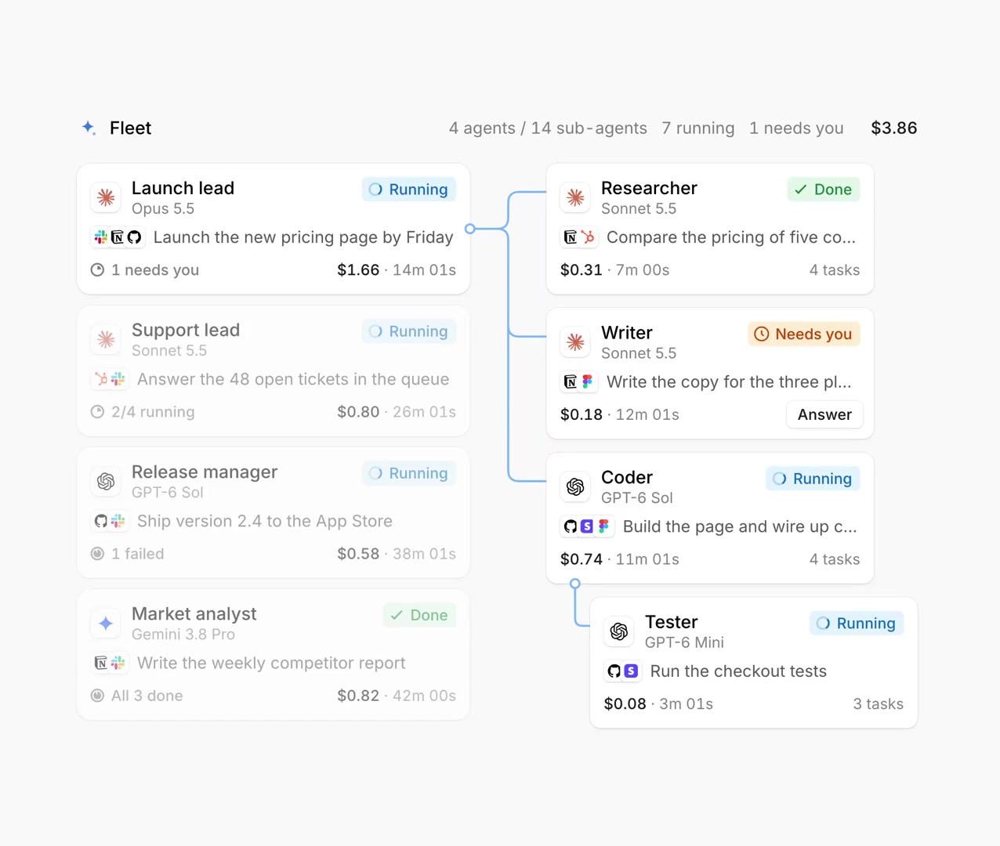
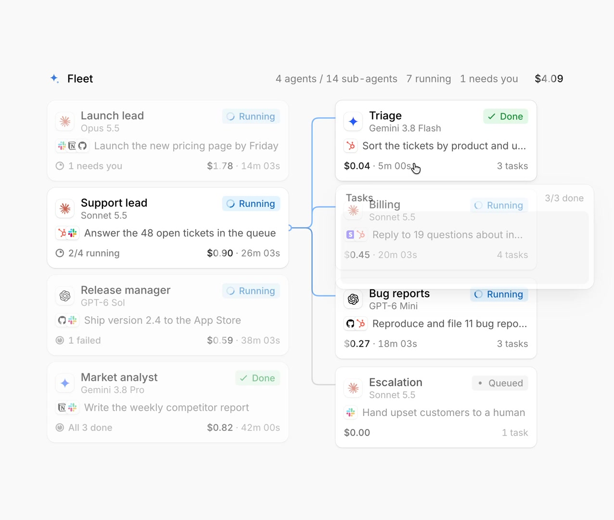
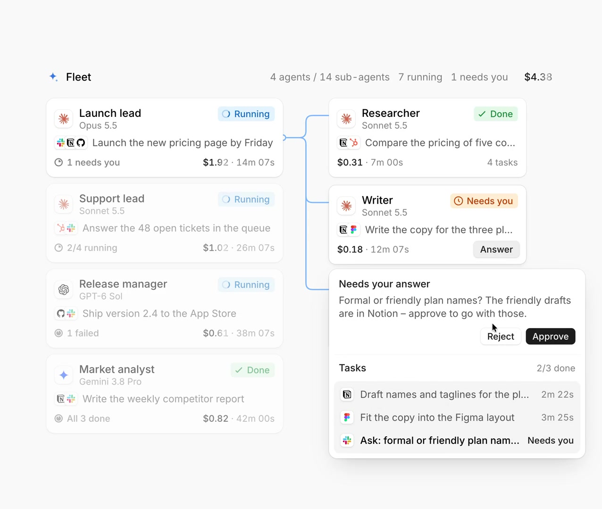
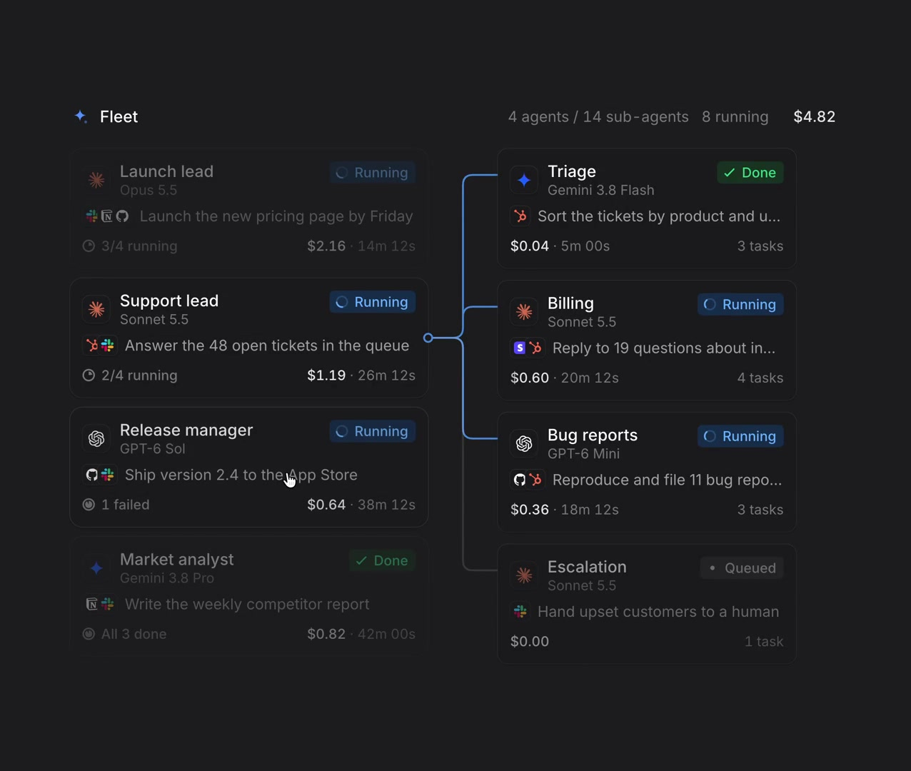

# @flohoeller Agent Fleet: every agent and its sub-agents in one view

- Source: https://x.com/flohoeller/status/2117239965352427754 (2 Nov 2026, 12:58 UTC / 12:58 Europe/London). ~15 s amplify video (`13_2117239753288351744`, ~15 s). Caption: "Agent Fleet component, every agent and its sub-agents in one view". Metrics at fetch: about 41 likes, 27 bookmarks, 2 reposts, 3 replies, ~850 impressions.
- Author: **@flohoeller** (display name Flo). Bio: "Building an agent-ready UI library @affectui". Bio URL: https://www.affectui.com/.
- Folder: **ux/** (AffectUI agent chrome; we already keep the agents-category OG cards under `agent-components/`).
- Video content in this note comes from a **video-model analysis** (`/workspace/videos/flohoeller-analysis.md`) plus **four ffmpeg stills** from `/workspace/videos/flohoeller-fleet.mp4`. The video file is not shipped with the note. Model names in the demo (Opus 5.5, Sonnet 5.5, GPT-6 Sol, Gemini 3.8 Pro, and so on) are **mock data**, not product claims.
- Sam's project is on GitHub: GHCP mapping only (no ADO).

## Verdict (lead)

**Clear two-level fleet overview with "Needs you" as the first-class interrupt.** The clip shows four lead agents, each with its own sub-agent tree, header aggregates (count, running, needs you, live cost), and inline Approve/Reject on a blocked Writer. Use it as the **ops map** beside Maple's proof-and-merge inbox: Fleet for "who is stuck across sessions", Maple-style review for "is this change proven". Closest shipped AffectUI cousin is **Agent Tree**; **Agent Fleet** is now a separate Pro page for several roots at once.

## What the post says

Full text (X API):

Agent Fleet component, every agent and its sub-agents in one view

## On affectui.com

https://www.affectui.com/components/agent-fleet is **live** (Pro). Docs: several agents at once, each with its own sub-agents; fold trees so only one is open; status `waiting` renders as **Needs you**; `ask` / `error` feed Answer or Resolve windows; `onResolve` for approve / reject / retry / dismiss. Prefer Agent Tree for a single orchestrator run, Agent Lanes for time order, Delegate Board for handing work out yourself. Earlier ux stills covered the agents category OG cards but did not include an Agent Fleet OG; this note fills that gap from the X demo.

## Video walkthrough (analysis + frames)

Layout: two columns. Header **Fleet** with aggregates such as "4 agents / 14 sub-agents · 7 running · 1 needs you" and a live cost counter (analysis: about $3.87 ticking toward $5.09). Left: four top-level agent cards. Right: sub-agents of the open lead, joined by a branching tree line (blue when active).

**Agent card:** icon, name, model subtitle (mock), status pill, current task line, tool marks (Slack, Notion, Linear, GitHub, Zendesk, and so on), footer with sub-task summary, cost and elapsed time.

**Leads in the demo:** Launch lead (Running, pricing page by Friday, "1 needs you"); Support lead (Running, 48 open tickets); Release manager (Running, "1 failed"); Market analyst (Done, weekly competitor report).

**Statuses:** blue Running with spinner, green Done with check, orange Needs you, red Failed with warning, grey Queued.

**Sub-agents (examples):** under Launch lead: Researcher Done, Writer Needs you with Answer, Coder Running, Tester Running under Coder. Under Release manager (analysis): Changelog Done, iOS build Failed with Resolve, Screenshots Running. Under Support lead (task-popover still): Triage Done, Billing Running, Bug reports Running, Escalation Queued.

**Interactions:** hover or open a sub-agent for a task-list popover (per-step times, "3/3 done"). Writer's Answer popover: "Needs your answer", the question about formal vs friendly plan names (friendly drafts in Notion), Reject and Approve, plus its task list. Approve (around 00:07) collapses the ask, flips Writer to Running, and lifts the header running count (dark still shows **8 running** and no "needs you"). Around 00:11 the UI switches to dark mode without a reload.

## Design patterns to keep

1. **Two-level fleet tree:** many lead agents as cards; only one lead's sub-tree open at a time so the screen stays calm.
2. **Status vocabulary:** Running, Done, Needs you, Failed, Queued, spelled out (not colour alone). Header rolls up "N needs you".
3. **Inline unblock:** Answer / Resolve on the blocked card; Approve and Reject (or Retry / Dismiss on failure) in a small dialog with the ask text and the agent's step list.
4. **Per-agent cost and time:** every card shows spend and elapsed; leads roll up the branch; header rolls up the fleet.
5. **Header aggregates:** agent / sub-agent counts, running, needs you, live cost. Replies on the post called out the Needs you badge as the most important chrome.

## Notable replies

| Handle | Point |
|---|---|
| **@AlpyMCP** | Likes Needs you with inline Answer; the waiting agent is impossible to miss. |
| **@progerallworld** | Same: seven running and one waiting; Needs you is the most important thing on the screen. |
| **@StudioGr8r50177** | "love this" plus a support ask (not useful for design). |

## Related ux notes

- [Maple Factory review inbox](2026-11-02-afomera-maple-factory.md): proof-before-merge, Done When artifacts, Builder/Sentinel. Pair Fleet (who is blocked across the factory) with that inbox (is this change proven).
- [Attention bottleneck + gen UI](2026-11-01-odysseus0z-attention-bottleneck-gen-ui.md): router-first, interrupt sparingly. Fleet's Needs you count is a concrete attention router surface.
- AffectUI agents OG set in `agent-components/` (Agent Tree, Agent Inbox, Approval Card, and so on): Fleet is the multi-root overview; Tree is the single-run deep view.

## GHCP / pstack angle (GitHub only; skip ADO)

| Piece | Fit |
|---|---|
| **Coding agent sessions** | Each lead card is a long-running factory job or coding-agent session (feature, support queue, release). |
| **Sub-agents / custom agents** | Children are custom agents or tool workers spun by that session (researcher, writer, coder, tester). Map Builder/reviewer roles as siblings or nested cards, not one blob. |
| **Surfacing blocked asks** | `waiting` / Needs you plus Answer is the human interrupt path: plan choice, merge policy, missing secret. Keep Approve/Reject next to the ask, not only in a separate PR thread. |
| **Agentic Workflows** | Scheduled runs (Scout-style) appear as leads or as Queued children; Failed + Resolve for flaky workflow steps. |
| **Cost tracking** | Per-card and header cost match factory Usage panels; useful beside Maple-style statistics. |
| **pstack** | Steal the fleet overview for the TypeScript control plane; keep Maple-like proof checklists on the merge path. Do not treat demo model names as a model roster. |

## Frames

Extracted with ffmpeg (max width 1600 px; source was already 1276 wide). Timestamps adjusted slightly when a cut looked soft:

1. `agent-components/2026-11-02-flohoeller-agent-fleet-light-default.jpg` (~00:00): Launch lead tree, Writer Needs you.
2. `agent-components/2026-11-02-flohoeller-agent-fleet-task-popover.jpg` (~00:03): Support lead tree, Billing task popover.
3. `agent-components/2026-11-02-flohoeller-agent-fleet-approve-popover.jpg` (~00:06.5): Writer answer dialog with Reject / Approve.
4. `agent-components/2026-11-02-flohoeller-agent-fleet-dark-mode.jpg` (~00:11.3): dark theme, eight running after approve, Support tree still open.

Video file deliberately omitted from note output.
