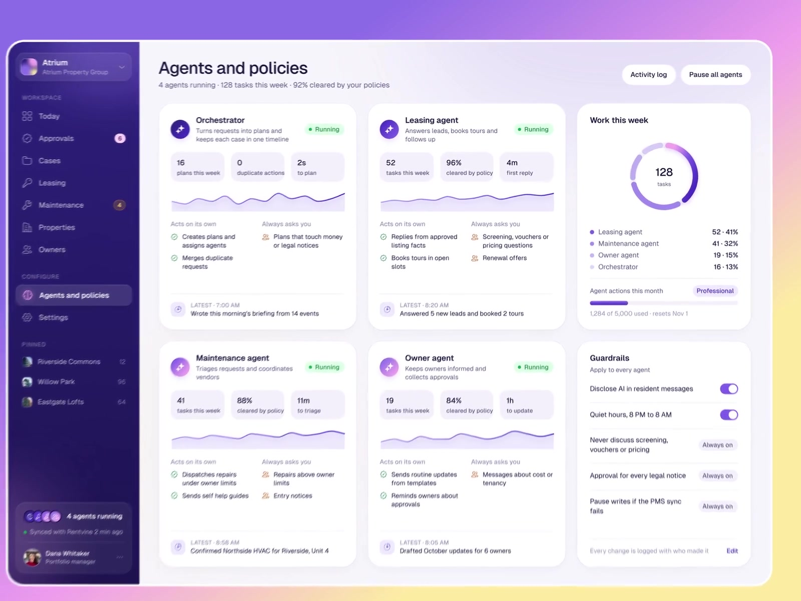
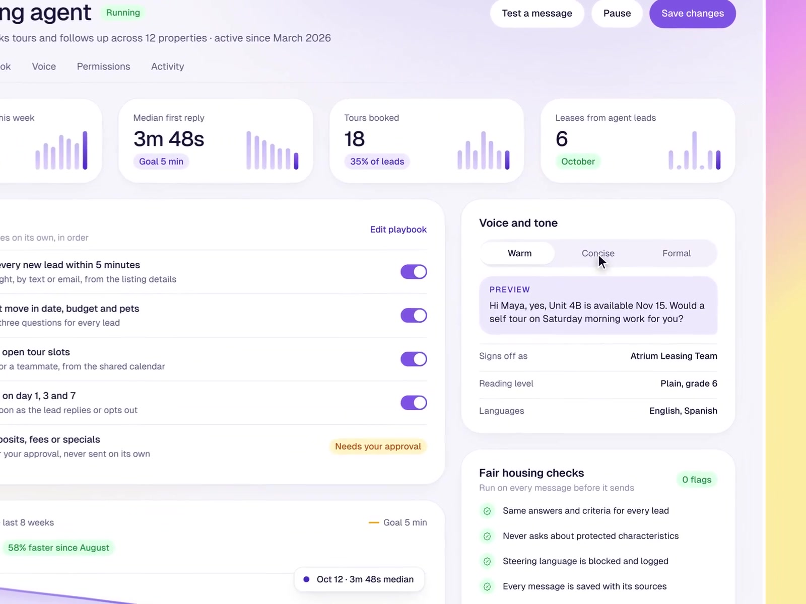
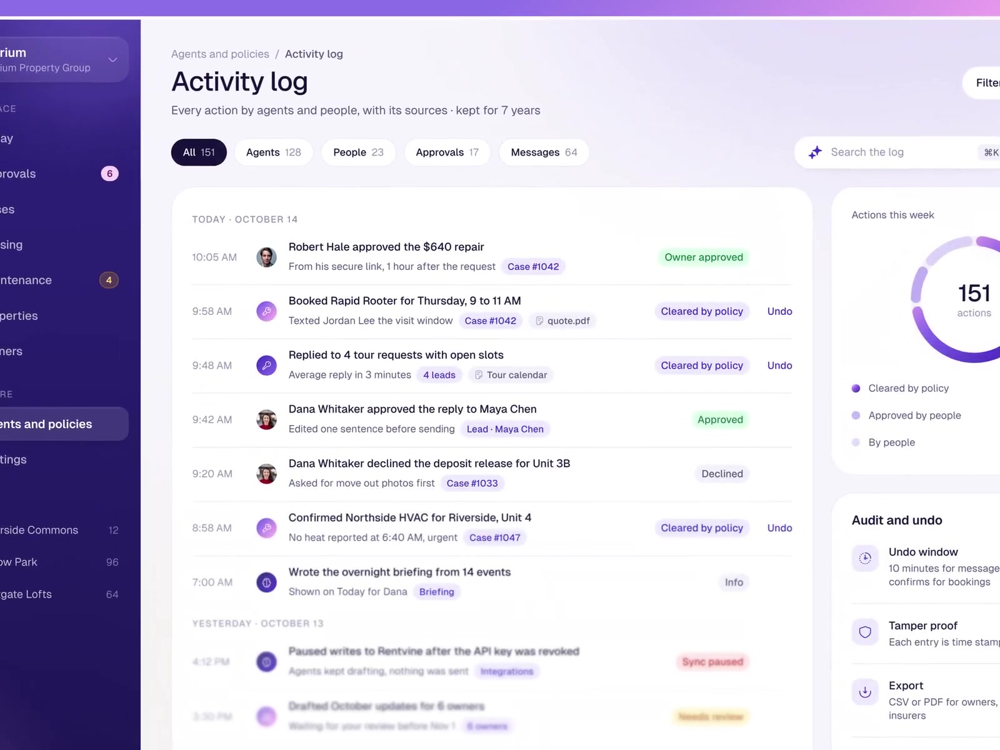

# @iliasconfidency: agents and policies, activity log with undo

- Source: https://x.com/iliasconfidency/status/2117134618545553854 (2 Nov 2026, 06:00 UTC / 06:00 Europe/London). ~18 s amplify video (`13_2116993094998740992`, ~18 s). Metrics at fetch: about 31 likes, 35 bookmarks, 1 repost, 0 replies, ~1.1k impressions.
- Author: **@iliasconfidency**. Bio: "Design the product. Build the site that sells it. Ship both."
- Same author: also the CarePath show-your-work note, [2026-11-02-iliasconfidency-carepath-show-your-work.md](2026-11-02-iliasconfidency-carepath-show-your-work.md).
- Folder: **ux/** (trust chrome for multi-agent products: autonomy split, kill switch, unified activity log, per-action undo).
- Video content in this note comes from a **video-model analysis** (`/workspace/videos/iliasconfidency-undo-analysis.md`) plus **three ffmpeg stills** from `/workspace/videos/iliasconfidency-undo.mp4`. The video file is not shipped with the note. This is a **design concept** with mock property-management data; mock people's names are not repeated below.
- Sam's project is on GitHub: GHCP mapping only (no ADO).

## Verdict (lead)

**Strong trust pattern: every agent and human action shares one log, each row carries its sources, and reversible rows advertise an Undo with an honest window.** Steal the per-agent **Acts on its own / Always asks you** split, the header **% cleared by your policies**, Pause all agents, and Cleared by policy vs human-approved status pills. Treat undo as typed (revert PR, close issue, re-run) and say which factory actions cannot be undone (merged deploys, sent messages).

## What the post says

Full text (X API):

If people can't see what an agent did, they won't trust it.

Here every action has its source and an undo.

I help founders design AI products people trust. DM me.

No replies on the post.

## Video walkthrough (analysis + frames)

Theme: light UI, lavender background, deep indigo sidebar. Sidebar groups Workspaces and Configure; **Agents and policies** is active; footer shows agents running.

### Agents and policies dashboard (~0:00 to 0:02)

Header aggregates: agents running, tasks this week, **92% cleared by your policies**. Buttons: **Activity log** and **Pause all agents**. Four agent cards (Orchestrator, Leasing, Maintenance, Owner in the demo), each with a sparkline, task stats, and a rules breakdown split into **Acts on its own** vs **Always asks you**. Right: Work this week donut and a Guardrails block (disclose AI, quiet hours, hard always-on constraints).

### Agent detail / playbook (~0:02 to 0:08)

User opens one agent. Tabs include Overview, Playbook, Voice, Permissions, Activity. Playbook is an editable numbered rule list (example: reply to every new lead within five minutes); some rules carry a **Needs your approval** tag. Voice and tone panel; Save changes arms after an edit. Still below shows playbook toggles, tone chips, and fair-housing style guardrail checks (domain-specific in the demo; the pattern is policy as editable config).

### Activity log (~0:08 to 0:13)

Subtitle: every action by agents and people, with its sources, kept for a long retention window (demo: 7 years). Filter pills: All, Agents, People, Approvals, Messages; date range, Filters, Export CSV, search. Timeline grouped by day. Each row: time, avatar (photo for people, sparkle for agents), bold action title, grey context line, **source pills** (case, agent, attachment), and a status pill such as Owner approved / Approved (green), **Cleared by policy** (purple), Declined, Sync paused, Info. Reversible rows show **Undo**. Analysis: at ~0:10 the user undoes their own voice change (people's actions are logged and undoable too); the spinner state was too brief for a clear still, so it is omitted.

Right panel: Actions this week donut (share by agents vs people; Cleared by policy vs Approved by people). **Audit and undo** block: Undo window that depends on action type (demo: about 10 minutes for messages, until vendor confirms for bookings); tamper-evident signed / time-stamped entries; Export CSV or PDF; Retention then scheduled delete.

~0:13 to 0:18 returns to the dashboard.

## Design patterns to keep

1. **Per-agent autonomy split:** Acts on its own vs Always asks you, visible on the fleet cards, not buried in a settings dump.
2. **Header aggregate "% cleared by your policies":** factory health: how much work never needed a human click.
3. **Pause all agents:** global kill switch next to the activity entry point.
4. **Playbook as editable config:** numbered rules with Save; some rules permanently ask.
5. **Unified activity log:** agents and people in one feed, filterable; source pills on every row.
6. **Status vocabulary:** Cleared by policy vs human Approved / Declined vs system Sync paused / Info.
7. **Per-action undo with typed windows:** say how long undo lasts and what it means for that action class.
8. **Tamper-evident audit:** signed time-stamped entries, export, retention schedule.

## Related ux notes

- [CarePath show-your-work](2026-11-02-iliasconfidency-carepath-show-your-work.md) (same author): evidence per claim before create. This note is the after-the-fact log and undo.
- [Agent Fleet Needs you](2026-11-02-flohoeller-agent-fleet.md): live interrupt surface; Cleared by policy is the opposite pole (no interrupt).
- [Maple Factory](2026-11-02-afomera-maple-factory.md): proof-before-merge inbox; activity log is the durable trail after Approve.
- [Attention bottleneck](2026-11-01-odysseus0z-attention-bottleneck-gen-ui.md): router-first; policy clearance ratio measures how often the router stayed silent.

## GHCP / pstack angle (GitHub only; skip ADO)

| Piece | Fit |
|---|---|
| **Custom agents / coding agent** | Per-agent permission tiers: auto (safe Actions, draft PRs) vs ask (merge, secrets, production). Same shape as Copilot coding agent and Agentic Workflows safe-outputs / required approvals. |
| **Agentic Workflows** | Playbook rules map to workflow inputs and approval gates; Pause all maps to disabling schedules. |
| **Activity log** | One feed keyed to sources: issue, PR, run, commit, comment. Status pills: Cleared by policy, Approved, Declined, Failed. |
| **Undo** | Typed undo: revert or close PR, reopen issue, re-run workflow, delete draft comment. Be honest: merged deploys, force-pushes already consumed, and sent Slack/email are often **not** undoable; show that in the row instead of a fake Undo. |
| **Cleared by policy ratio** | Factory health metric beside cost and cycle time (Maple statistics). Rising human Approvals may mean policies are too tight or agents are off-script. |
| **Skills / instructions** | Standing rule: every agent write attaches source links; every auto action records which policy cleared it. |
| **pstack** | Steal the log + autonomy split for the TypeScript control plane; keep Maple proofs on the merge path. |

## Frames

Extracted with ffmpeg (max width 1600 px). Checked visually. The ~0:11 undo spinner was not clearly visible in stills, so it was dropped.

1. `agent-components/2026-11-02-iliasconfidency-activity-dashboard.jpg` (~0:01): Agents and policies, Acts on its own / Always asks you, Pause all agents.
2. `agent-components/2026-11-02-iliasconfidency-activity-playbook.jpg` (~0:05): agent playbook and voice config.
3. `agent-components/2026-11-02-iliasconfidency-activity-log.jpg` (~0:10): activity log with source pills, Cleared by policy, Undo, audit panel.

Video file deliberately omitted from note output.
