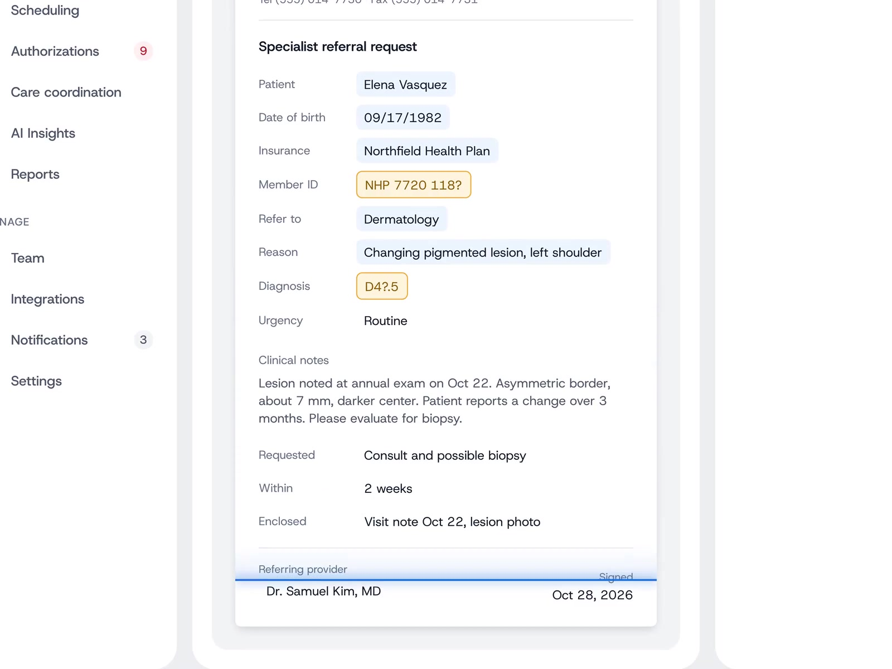
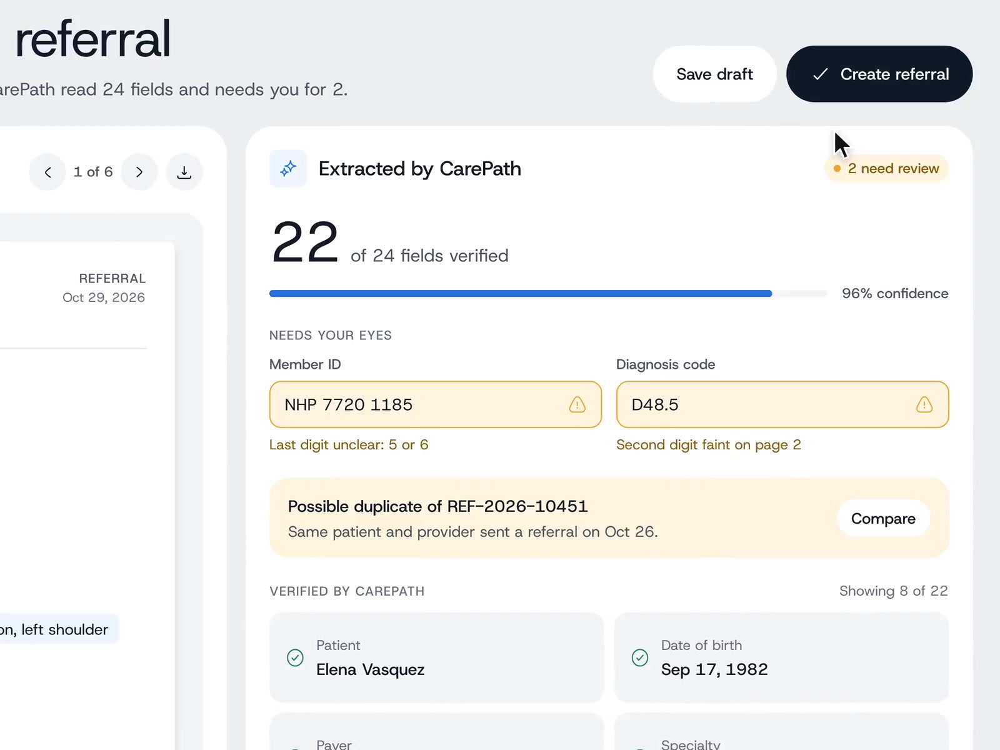
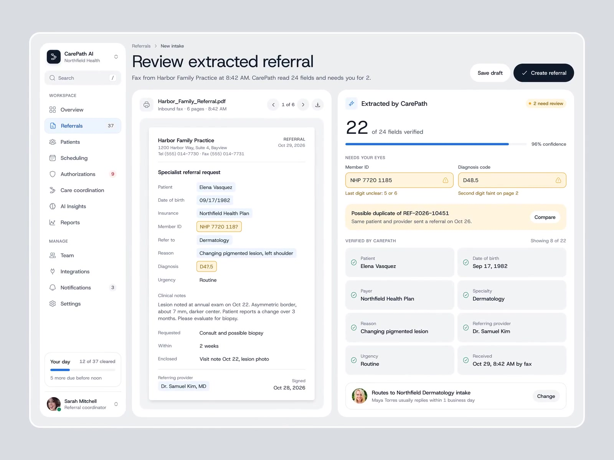

# @iliasconfidency CarePath: show your work on extracted fields

- Source: https://x.com/iliasconfidency/status/2117278058906263806 (2 Nov 2026, 15:30 UTC / 15:30 Europe/London). ~17 s amplify video (`13_2117208271618711552`, ~17 s). Metrics at fetch: about 11 likes, 9 bookmarks, 1 reply, ~480 impressions.
- Author: **@iliasconfidency**. Bio: "Design the product. Build the site that sells it. Ship both."
- Folder: **ux/** (human-review chrome for agent extraction: source grounding, verified vs needs-review, gated primary action).
- Video content in this note comes from a **video-model analysis** (`/workspace/videos/iliasconfidency-analysis.md`) plus **three ffmpeg stills** from `/workspace/videos/iliasconfidency-carepath.mp4`. The video file is not shipped with the note. CarePath here is a **design concept** with mock clinic/payer data; mock patient and staff names are not repeated in the prose below.
- Sam's project is on GitHub: GHCP mapping only (no ADO).

## Verdict (lead)

**Best compact example of "show your work" for agent output: each value lights up on the source, uncertain items come with a best guess and a reason, and the human still makes the call.** Steal the verified / needs-your-eyes split with a headline count, source-linked highlights, and a primary action that only makes sense after review. Pair it with Maple Factory's proof-of-work inbox (evidence attached to the task) and Agent Fleet's Needs you badge (attention on the blocked items).

## What the post says

Full text (X API):

AI that reads a fax should show its work.

Every value CarePath reads lights up on the page. 22 of 24 fields check out. The other 2 get a best guess and a reason, like last digit unclear: 5 or 6. A person decides.

Building software for healthcare teams? DM me.

The one reply (@rkwiatkowski) is praise only; nothing design-useful beyond that.

## Video walkthrough (analysis + frames)

Layout: left app nav (Referrals active with a queue badge). Header: breadcrumbs into New intake; title "Review extracted referral"; subtitle that a fax arrived and CarePath read 24 fields and needs the human for 2; ghost **Save draft** and primary **Create referral**. Two-pane body: left the source fax PDF (page controls), right **Extracted by CarePath**.

**~00:00 to 00:06:** a blue scan line sweeps the fax. Confident reads get faint blue boxes; the two unclear fields (Member ID, Diagnosis) get dashed amber boxes on the page itself.

**~00:07 to 00:12:** right pane fills. Big count-up **22 of 24 fields verified**, blue progress bar (~96% confidence), amber pill **+ 2 need review**. Sections:

1. **Needs your eyes:** two editable inputs with amber borders and warning icons, each prefilled with a best guess and a reason line (examples from the post and UI: last digit unclear 5 or 6; second digit faint on page 2).
2. **Duplicate warning:** possible duplicate of an earlier referral for the same patient and provider, with a **Compare** button.
3. **Verified by CarePath**, "Showing 8 of 22": read-only cards with green checks (demographics, payer, specialty, reason, referring provider, urgency, received time and channel).
4. **Routing preview:** which intake team the referral would go to, usual reply window, **Change** button.

**~00:13 to 00:16:** zoom out to the full split layout; cursor moves toward Create referral (not clicked in the clip).

Colour language in the demo: blue for confident machine reads on the source, amber for needs-review, green for verified cards.

## Design patterns to keep

1. **Source-grounded highlights:** every extracted value lights up where it came from on the page (file, fax, screenshot), so the human can check without hunting.
2. **Verified vs needs-review split:** headline count (N of M verified) plus a short amber list for the rest; do not bury uncertain items in the same flat list as confident ones.
3. **Best guess + stated reason:** uncertain fields stay editable, show the model's pick, and say why (unclear digit, faint character, low confidence region).
4. **Human makes the final call:** primary create/merge action is present but the story is review-first; draft save is the safe exit.
5. **Duplicate detection:** surface a possible clash with an earlier artefact and offer Compare before create.
6. **Routing preview:** show where the work will land next, with a Change escape, so review is not only field-level.
7. **Primary action gated after review:** Create referral sits in the header once the needs-review set is visible; the demo stops before click, which keeps the human in the loop.

## Related ux notes

- [Maple Factory proof-of-work inbox](2026-11-02-afomera-maple-factory.md): Done When proofs before Approve. CarePath is the same idea for structured extraction: evidence and uncertain items before create.
- [Agent Fleet Needs you](2026-11-02-flohoeller-agent-fleet.md): attention badge and inline Answer. CarePath's "needs you for 2" subtitle and Needs your eyes block are the same interrupt pattern on a form.

## GHCP / pstack angle (GitHub only; skip ADO)

| Piece | Fit |
|---|---|
| **PR / task summaries** | Agent output should cite evidence per claim: file and line, test run id, screenshot or recording. Mirror CarePath's source highlight with a link or anchor per field. |
| **Verified vs needs your eyes** | Split the summary: green "verified" claims the factory already proved; amber list with best guess and reason for anything the agent is unsure about (flaky assertion, ambiguous requirement, missing screenshot). |
| **Human final call** | Approve-and-merge / Create stays human; do not auto-merge while any Needs your eyes item remains open. |
| **Duplicate / routing** | Duplicate of an open PR or prior task; routing preview equals which custom agent, reviewer, or Agentic Workflow picks it up next. |
| **Skills / instructions** | Standing "show your work" skill: every factory claim attaches evidence; uncertain claims must include a reason string the UI can show. |
| **pstack** | Steal this for the TypeScript review surface beside Maple-style proofs and Fleet-style Needs you, not as a healthcare product clone. |

## Frames

Extracted with ffmpeg (max width 1600 px). Checked visually; timestamps kept near the analysis picks:

1. `agent-components/2026-11-02-iliasconfidency-carepath-source-highlights.jpg` (~00:06): blue vs amber highlights on the fax.
2. `agent-components/2026-11-02-iliasconfidency-carepath-extraction-panel.jpg` (~00:12): verified count, Needs your eyes, duplicate banner.
3. `agent-components/2026-11-02-iliasconfidency-carepath-full-layout.jpg` (~00:16): full split layout with routing preview.

Video file deliberately omitted from note output.
