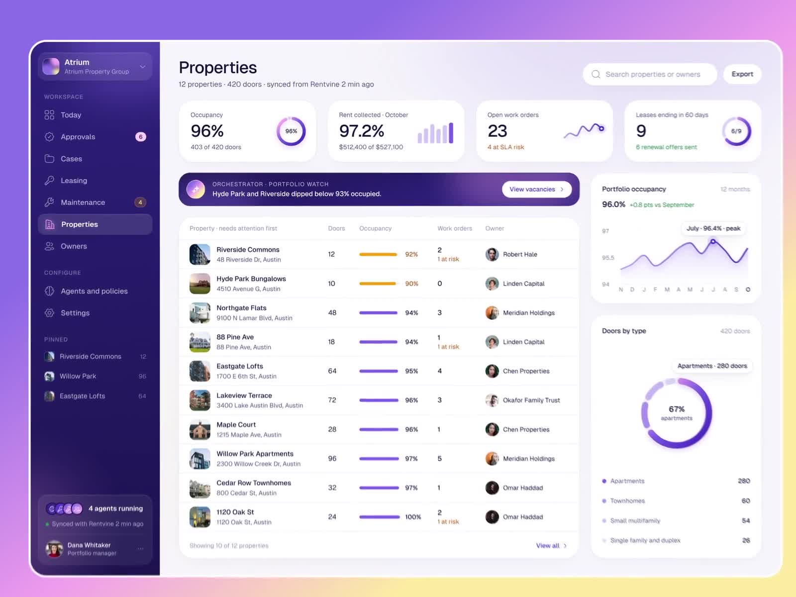
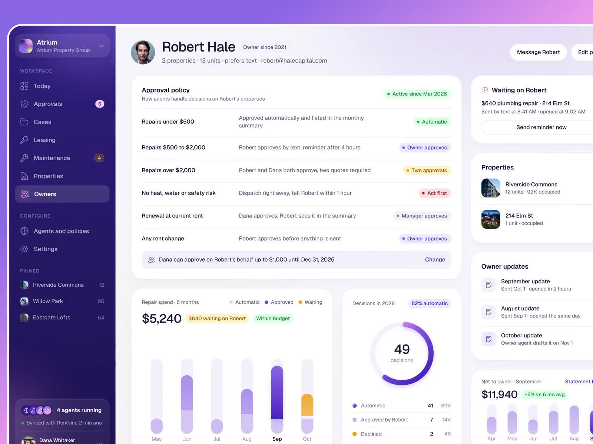
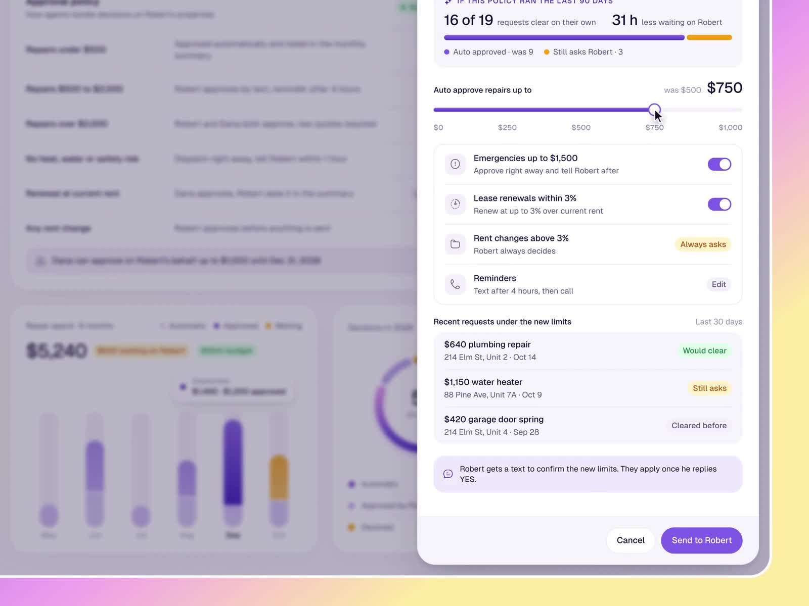
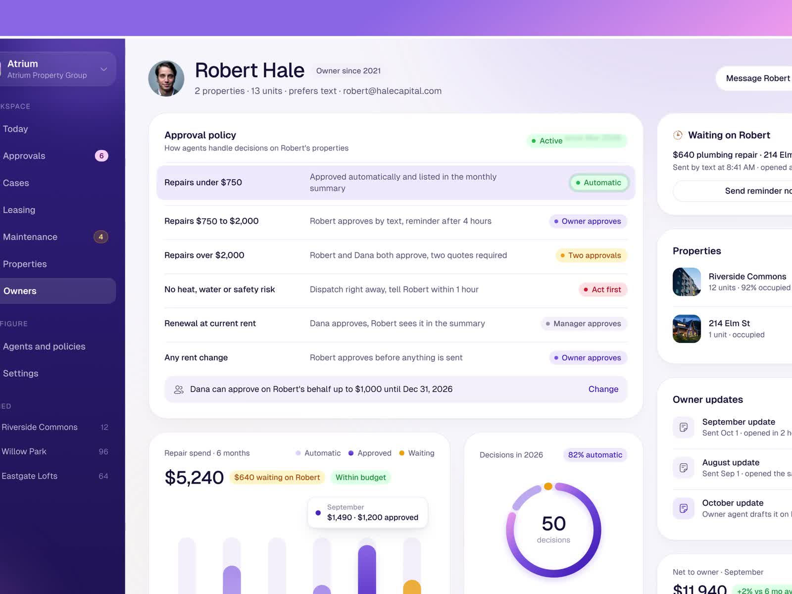

# @iliasconfidency: replay the last 90 days before a limit change

- Source: https://x.com/iliasconfidency/status/2117104415438168563 (2 Nov 2026). ~19 s amplify video (1600x1200). Metrics at fetch: thin engagement; one reply is generic praise only.
- Author: **@iliasconfidency**. Bio: "Design the product. Build the site that sells it. Ship both." Same author as [CarePath](2026-11-02-iliasconfidency-carepath-show-your-work.md) and the [agent activity log and undo](2026-11-02-iliasconfidency-agent-activity-undo.md) notes.
- Folder: **ux/** (trust chrome for policy edits: historical backtest, itemised impact, owner confirm before apply).
- Video content in this note comes from a **video-model analysis** (`/workspace/videos/iliasconfidency-replay-analysis.md`) plus **four ffmpeg stills** from `/workspace/videos/iliasconfidency-2117104415438168563.mp4`. The video file is not shipped with the note. This is a **designer mock / sales pitch** ("Want that in your product? DM me") with mock property-management data; mock people's names are not repeated below. Treat every number as illustrative.
- Sam's project is on GitHub: GHCP mapping only (no ADO).

## Verdict (lead)

**Best reference yet for "show the blast radius before you widen autonomy."** Before a limit change sticks, the product replays the last 90 days against the proposed rule, updates a live stacked bar (how many requests would clear on their own, hours of waiting saved), and flips each recent request between Still asks and Would clear as the slider moves. The change is proposed, not enforced, until the accountable human confirms out of band. Steal that for any factory policy that widens auto-approve, auto-merge, or safe-output limits.

## What the post says

Full text (X API):

Trust in AI is a UI problem. Before an owner's limit changes, the product replays the last 90 days so everyone sees the impact first. Want that in your product? DM me.

The only reply is generic praise. Nothing design-useful beyond the video itself.

## Video walkthrough (analysis + frames)

Theme: light UI, purple accent for AI and primary actions, deep indigo sidebar. Sidebar groups Workspace and Configure; footer shows agents running. Property-management shell (Atrium-style mock). Numbers below are mock.

### Properties list (~0:00 to 0:02)

Portfolio dashboard: occupancy, rent collected, open work orders, leases ending. Purple **Orchestrator** portfolio-watch banner. Table of properties needing attention. Click into an owner row.

### Owner approval policy (~0:02 to 0:05)

Owner profile with an **Approval policy** table: cost bands map to Automatic / Owner approves / Two approvals / Act first / Manager approves. Delegated authority note. Repair spend chart and decisions donut. **Edit policy** opens a side panel.

### Replay panel while editing (~0:05 to 0:11)

Side panel: drag **Auto approve repairs up to** from the old limit to a higher one. Purple banner **IF THIS POLICY RAN THE LAST 90 DAYS** updates live: requests that would clear on their own rise; owner waiting time saved rises. Stacked bar splits Auto approved vs Still asks. Below, **Recent requests under the new limits** lists past work orders with pills that flip from yellow Still asks to green Would clear (or stay Cleared before) as the slider crosses each amount. Toggle rows for emergencies, renewals, rent changes. Helper text: the owner gets a text to confirm; limits apply once they reply YES. Buttons: Cancel, Send to owner.

### Pending until owner confirms (~0:11 to 0:14)

Panel closes. Policy table shows the new auto-approve band. Pending / active-once-confirmed state until the out-of-band YES. Clip returns to Properties.

## Design patterns to keep

1. **Historical replay / backtest before apply:** proposed policy is scored against the last N days of real requests before anyone commits.
2. **Live aggregate impact:** clear-on-their-own count and waiting-time saved update as the control moves.
3. **Itemised per-request impact:** each past request shows Would clear / Still asks / Cleared before so the human can spot edge cases the aggregate hides.
4. **Propose, then out-of-band confirm:** Send to owner; limits apply only after the accountable human replies YES. No silent widen.
5. **Pending badge on the live policy:** the UI keeps the old world until confirm, and labels the proposed band as not yet active.
6. **Ambient agents-running indicator:** same chrome as the activity-log note; policy edits sit in a multi-agent product, not a settings dump.

## Caveats

Designer pitch with a DM ask. Mock data and mock portfolio. Video-model analysis, not a human watch of every frame. One reply, no substantive critique. Do not copy the property-management domain; steal the backtest pattern.

## Related ux notes

- [Agent activity log and undo](2026-11-02-iliasconfidency-agent-activity-undo.md) (same author): Acts on its own vs Always asks you, % cleared by policy, unified log. This note is the *before* for a policy widen; that one is the *after*.
- [CarePath show-your-work](2026-11-02-iliasconfidency-carepath-show-your-work.md) (same author): evidence per claim before create. Replay is evidence per policy change before apply.
- [Agent Fleet](2026-11-02-flohoeller-agent-fleet.md): Needs you interrupts. Replay aims to raise clearance ratio so fewer interrupts fire after the change.
- [Maple Factory](2026-11-02-afomera-maple-factory.md): proof before merge. Replay is proof before widening autonomy.
- [Attention bottleneck](2026-11-01-odysseus0z-attention-bottleneck-gen-ui.md): interrupt sparingly; backtesting a wider auto-approve is how you argue the router can stay quieter.

## GHCP mapping

| Piece | Fit |
|---|---|
| **Widen auto-merge / auto-approve** | Before raising a coding-agent or custom-agent auto-approve band (draft PR only vs merge, which labels skip review, which paths are protected), replay the last 90 days of PRs and runs against the proposed rule. Show how many would have cleared, how many would still interrupt, and list the near-misses. Docs: [About GitHub Copilot agents](https://docs.github.com/en/copilot/concepts/agent-capabilities/about-agents/about-github-copilot-agents), [Custom agents](https://docs.github.com/en/copilot/concepts/customizations/custom-agents). |
| **Agentic Workflows safe-outputs limits** | Same pattern when raising `safe-outputs` max counts or attaching a less strict environment. Backtest against recent workflow runs before editing frontmatter. Docs: [About GitHub Agentic Workflows](https://docs.github.com/en/copilot/concepts/agent-capabilities/agent-powered-workflows-and-operations/about-github-agentic-workflows), [Rate limiting controls](https://github.github.com/gh-aw/reference/rate-limiting-controls/). |
| **Human owner confirm** | After the backtest, require an accountable human (repo admin / environment reviewer) to confirm. Do not apply the wider rule from the slider alone. Environments with required reviewers are the existing primitive: [Using environments for deployment](https://docs.github.com/en/actions/deployment/targeting-different-environments/using-environments-for-deployment). |
| **Pending until confirm** | Keep the old limits live; mark the new band pending until the confirm lands (issue comment, environment approval, or out-of-band YES). |
| **Skills / instructions** | Standing rule: any change that widens agent autonomy must attach a 90-day (or configurable) impact summary before merge of the policy diff. |
| **pstack** | Steal the replay panel for the TypeScript control plane beside the activity log; keep Maple-style proofs on the merge path. |

## Frames

Extracted with ffmpeg (max width 1600 px). Checked visually; timestamps kept near the analysis picks (no soft transition frames):

1. `agent-components/iliasconfidency-replay-properties.jpg` (~0:01): Properties dashboard, Orchestrator banner.
2. `agent-components/iliasconfidency-replay-policy.jpg` (~0:04): Owner approval policy table before edit.
3. `agent-components/iliasconfidency-replay-backtest.jpg` (~0:09): IF THIS POLICY RAN THE LAST 90 DAYS panel, slider, Would clear pills.
4. `agent-components/iliasconfidency-replay-pending.jpg` (~0:13): Policy after edit, waiting on owner confirm.

Video file deliberately omitted from note output.
