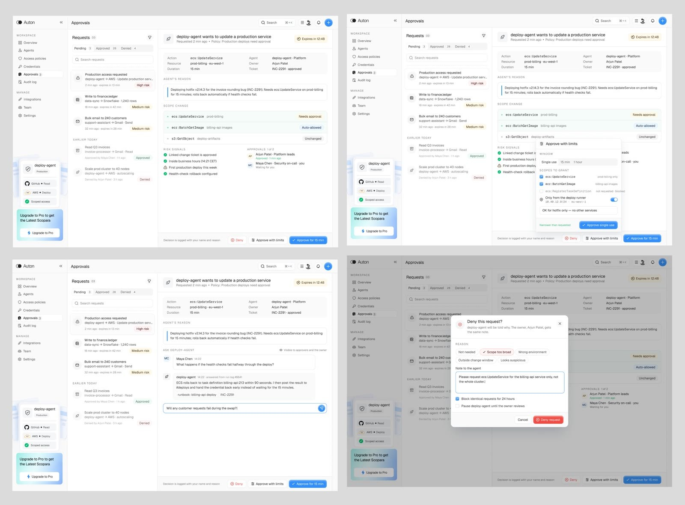
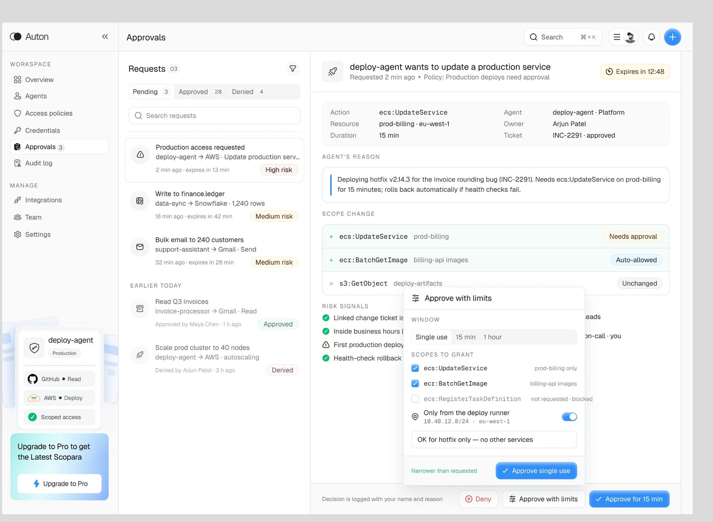
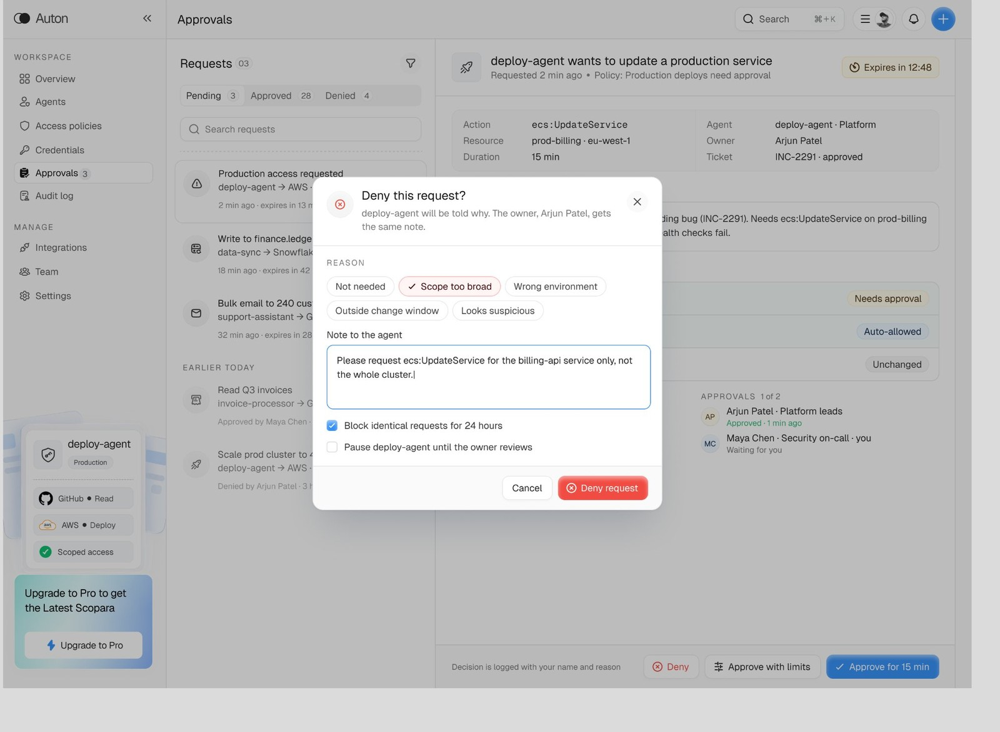

# @jubayer6910: Auton agent approvals flow

- Source: https://x.com/jubayer6910/status/2117217662703190032 (2 Nov 2026). Static four-panel mock (image post). Replies are all generic praise; nothing substantive.
- Author: **@jubayer6910**. Post text: "aproovals flow of auton."
- Folder: **ux/** (approvals queue for agent permission escalations: scope diff, approve-with-limits, deny-with-reason, ask-the-agent).
- Stills: 1600 px overview plus two quadrant crops from `/workspace/videos/jubayer6910-approvals.jpg` (4096x3022). This is a **static product mock**, not a shipping product tour. Mock people's names are not repeated below. Treat risk pills, timers, and ticket ids as illustrative.
- Sam's project is on GitHub: GHCP mapping only (no ADO).

## Verdict (lead)

**Strongest single-screen reference for agent permission escalations.** An Approvals queue lists pending asks with risk pills; the detail pane shows the agent's reason, a scope diff (Needs approval / Auto-allowed / Unchanged), risk signals, and a multi-person approval chain. Approvers can Approve with limits (time window, narrower scopes, runner constraint), Ask the agent in a thread visible to owner and approvers, or Deny with reason chips that feed back to the agent, optionally blocking identical requests and pausing the agent. Steal this shape for Copilot coding agent and custom-agent escalations; use Actions environments with required reviewers as the existing gate primitive underneath.

## What the post says

Full text:

aproovals flow of auton.

Replies are praise only. No design critique.

## Mock walkthrough (four panels)

App shell: **Auton**. Left nav: Overview, Agents, Access policies, Credentials, Approvals, Audit log; Manage: Integrations, Team, Settings. Bottom card shows the selected agent's identity and scoped access (example: GitHub read, AWS deploy).

### Panel 1: Approvals queue and request detail

Tabs: Pending / Approved / Denied. Request list with risk pills (High risk, Medium risk) and expiry timers. Selected row: an agent wants to update a production service. Policy line: Production deploys need approval. Expires-in countdown.

Fields: Action, Resource, Duration, Agent, Owner, Ticket. **Agent's reason** box (why this change, how long, rollback story). **Scope change** diff listing permissions as Needs approval / Auto-allowed / Unchanged. **Risk signals** checklist (linked change ticket approved, inside business hours, first production deploy this week, health-check rollback configured). **Approvals** chain: 1 of 2, prior approver done, current reviewer waiting. Footer actions: Deny, Approve with limits, Approve for N min. Decision logged with the reviewer's name and reason.

### Panel 2: Approve with limits

Popover over the same request. Window chips: Single use / 15 min / 1 hour. **Scopes to grant** checkboxes (requested scopes checked; unrequested scope shown blocked). Toggle: only from the deploy runner (CIDR / region). Note field (example sense: hotfix only, no other services). Primary: Approve single use. Pattern: grant less than asked, time-box it, constrain where it may run.

### Panel 3: Ask the agent (visible in overview)

Inline Q&A thread labelled Ask deploy-agent, visible to approvers and owner. Human asks what happens if health checks fail; agent answers with rollback target, channel notify, and early credential return. Input stays open for a follow-up. Pattern: clarify before approve, keep the thread on the request not in a side DM.

### Panel 4: Deny this request?

Dialog: agent and owner both see the reason. Reason chips: Not needed, Scope too broad, Wrong environment, Outside change window, Looks suspicious. Note to the agent (narrow the ask). Checkboxes: Block identical requests for 24 hours; Pause the agent until the owner reviews. Deny request. Pattern: structured deny feeds the agent, with optional cool-down and pause.

## Design patterns to keep

1. **Approvals as a first-class queue:** Pending / Approved / Denied with risk pills and expiry, not buried in chat.
2. **Agent reason on the card:** why, how long, rollback story, linked ticket.
3. **Scope change diff:** Needs approval vs Auto-allowed vs Unchanged, so the human sees the delta not the whole ACL.
4. **Risk signals checklist:** positive and warning signals beside the ask (ticket, hours, novelty, rollback).
5. **Multi-person approval chain:** N of M with roles; current reviewer highlighted.
6. **Approve with limits:** time-boxed, single-use, narrower scopes, runner / network constraint, note.
7. **Ask the agent inline:** Q&A on the request, visible to approvers and owner.
8. **Deny with reason chips + feedback:** structured reason, free-text note to the agent, block identical asks, pause agent.
9. **Agent identity card:** who is asking and what scoped access they already hold.
10. **Audit footer:** decision logged with reviewer and reason.

## Caveats

Static four-panel mock, not a live product. Spelling in the post ("aproovals") and the sales-adjacent framing mean treat as inspiration, not a shipped reference. Mock names and tickets omitted from prose. No substantive replies.

## Related ux notes

- [Agent activity log and undo](2026-11-02-iliasconfidency-agent-activity-undo.md): Cleared by policy vs human Approved; this note is the interrupt surface when policy does not clear.
- [Limit-change replay](2026-11-02-iliasconfidency-limit-change-replay.md): backtest before widening auto-approve; Auton is the queue when something still needs a human.
- [Agent Fleet](2026-11-02-flohoeller-agent-fleet.md): Needs you + inline Approve/Reject; Auton is a deeper approvals desk for high-risk escalations.
- [Maple Factory](2026-11-02-afomera-maple-factory.md): proof-before-merge inbox; Auton is permission-before-act.
- [CarePath show-your-work](2026-11-02-iliasconfidency-carepath-show-your-work.md): evidence before create; here the evidence is reason + scope diff + risk signals.
- [Attention bottleneck](2026-11-01-odysseus0z-attention-bottleneck-gen-ui.md): router-first; Auton is what the interrupt looks like when the router must ask.
- AffectUI [Permission Request](https://www.affectui.com/components/permission-request) and [Approval Card](https://www.affectui.com/components/approval-card) OGs in `agent-components/`: smaller cousins of Approve with limits / Deny.

## GHCP mapping

| Piece | Fit |
|---|---|
| **Coding agent / custom agent escalations** | When a session needs a tool, secret, or write beyond its profile, open an Approvals-style card: reason, scope diff against the agent profile `tools` allowlist, risk signals, Approve / Approve with limits / Deny. Docs: [About GitHub Copilot agents](https://docs.github.com/en/copilot/concepts/agent-capabilities/about-agents/about-github-copilot-agents), [Custom agents](https://docs.github.com/en/copilot/concepts/customizations/custom-agents), [Allowing and denying tool use (CLI)](https://docs.github.com/en/copilot/how-tos/copilot-cli/use-copilot-cli/allowing-tools). |
| **Approve with limits** | Map to one-shot or time-boxed grants (session-only allow, narrower path, no network), then revoke. Closest built-in product language today is CLI allow-once / remainder-of-session; the factory UI can present the richer Auton shape on top. |
| **Deny with reason fed back** | On deny, write a structured note the agent (and owner) can read: chip + free text. Optionally block identical tool asks for a cool-down and pause the session until the owner reviews. |
| **Actions environments** | Existing primitive for human gates: required reviewers, wait timers, prevent self-review, deployment branch rules. Wire high-risk safe-output jobs to an environment so the pause is enforced by GitHub, not by UI hope. Docs: [Using environments for deployment](https://docs.github.com/en/actions/deployment/targeting-different-environments/using-environments-for-deployment), [gh-aw manual review gates](https://github.github.com/gh-aw/reference/rate-limiting-controls/). |
| **Agentic Workflows safe-outputs** | Declared writes only; attach `environment:` on sensitive outputs so Approvals-like review happens before the write job runs. Docs: [About GitHub Agentic Workflows](https://docs.github.com/en/copilot/concepts/agent-capabilities/agent-powered-workflows-and-operations/about-github-agentic-workflows). |
| **Ask the agent** | Keep a request-scoped thread (issue comment thread or session chat) visible to approvers and owner, not a private DM. |
| **Skills / instructions** | Standing rule: every escalation card must include reason, scope delta, and linked ticket or PR; every deny must include a reason string the agent can act on. |
| **pstack** | Steal the Approvals desk for the TypeScript control plane; keep environment-required reviewers as the hard gate for production writes. |

## Frames

Cropped from the 4096x3022 source; overview is the existing 1600 w copy. Max width 1600 px.

1. `agent-components/jubayer6910-auton-overview.jpg`: full four-panel mock.
2. `agent-components/jubayer6910-auton-approve-limits.jpg`: top-right quadrant, Approve with limits popover.
3. `agent-components/jubayer6910-auton-deny.jpg`: bottom-right quadrant, Deny dialog with reason chips.

Source image deliberately omitted from note output beyond these stills.
