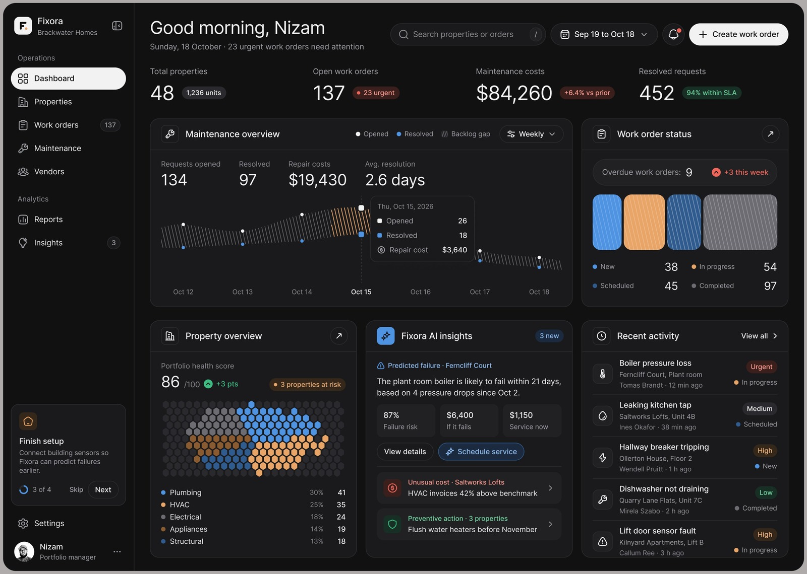
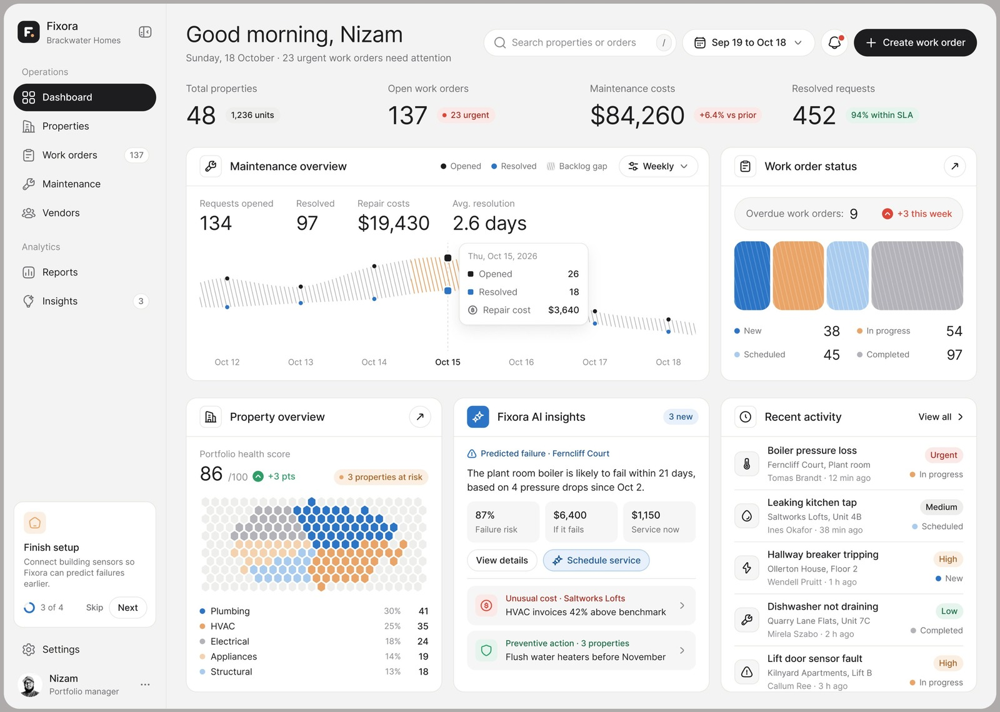

# @nizamdesign: Fixora maintenance ops dashboard (dark and light)

- Source: https://x.com/nizamdesign/status/2117102302704312780 (fetched around 3 Nov 2026). Two static mocks of the same dashboard in dark and light. Metrics at fetch: about 311 bookmarks; replies are mostly dark vs light votes ("Both", one Light, one Dark) plus generic praise. Nothing design-substantive in the thread.
- Author: **@nizamdesign**. Bio: "Building - Next-Gen Agentic Design Studio".
- Folder: **ux/** (factory home dashboard patterns: needs-attention header, AI insight card with evidence and cost of acting vs not, backlog gap chart, health heatmap, onboarding nudge).
- Stills: grey surround cropped from `/workspace/videos/nizamdesign-fixora-1.jpg` (dark) and `-2.jpg` (light), saved at max 1600 px wide. This is a **designer mock** with property-maintenance data; mock people's names (including the greeting name) are not repeated below. Treat every number as illustrative.
- Sam's project is on GitHub: GHCP mapping only (no ADO).

## Verdict (lead)

**Clean home-dashboard reference for a software factory control plane.** One "needs attention" count in the header, KPI cards with deltas, a backlog gap between opened and resolved, a portfolio health heatmap, and an AI insights card that shows evidence, quantified risk, cost if it fails vs service now, then a single primary action the human accepts. Steal that insight card shape for Agentic Workflow proposals (flaky test, failing area, overdue PR) and keep dark and light as shared tokens, not two products.

## What the post says

Full text:

Dark mode or Light mode? Which one wins for Fixora?

Replies are theme votes and praise. No useful critique of the layout.

## Mock walkthrough

Same layout in both themes. Left nav under Operations: Dashboard, Properties, Work orders (137), Maintenance, Vendors. Analytics: Reports, Insights (3). Bottom: **Finish setup 3 of 4** onboarding card (connect building sensors so predictions improve). Header: greeting, date, line that **23 urgent work orders need attention**, search, date range, Create work order.

Four KPI cards with delta pills (vs prior period, within-SLA %): total properties, open work orders (urgent badge), maintenance costs, resolved requests.

**Maintenance overview:** opened vs resolved over the week; hatched band between the lines reads as backlog gap; hover tooltip with day counts and repair cost.

**Work order status:** hatched blocks for New / Scheduled / In progress / Completed, overdue count, "+3 this week".

**Property overview:** hex-grid heatmap, portfolio health score, "3 properties at risk", category legend (plumbing, HVAC, electrical, and so on).

**Fixora AI insights (3 new):** lead card is a predicted failure with evidence (example sense: based on several pressure drops since a dated sensor window), failure risk %, cost if it fails vs service now, View details and primary **Schedule service**. Below: unusual-cost and preventive-action rows.

**Recent activity:** feed with severity and status pills.

Dark vs light is a minor point for the factory: both themes share the same structure and semantic colours; ship one token set, two skins.

## Design patterns to keep

1. **Greeting header with one needs-attention count:** a single interrupt number next to the greeting, not a wall of badges.
2. **KPI row with deltas:** absolute value plus vs-prior / within-SLA pill so trend is visible without opening a report.
3. **Backlog gap as chart band:** opened vs resolved with the space between hatched; the gap is the story.
4. **Health score + heatmap:** portfolio (or repo-area) health with at-risk callouts.
5. **AI insight card with evidence and cost of acting vs not:** predicted failure, risk %, dollar (or time) if ignored vs if fixed now, then one primary accept action.
6. **Secondary insight rows:** unusual cost, preventive action; keep the lead insight dominant.
7. **Onboarding nudge tied to better predictions:** Finish setup 3 of 4 sells more data as better agent foresight, not as busywork.
8. **Activity feed with severity and status pills:** recent human and agent events in one list.
9. **Shared tokens across themes:** dark and light are skins; do not fork layout per theme.

## Caveats

Designer mock, not a shipping product tour. Theme poll framing. Mock names and org labels omitted from prose. Numbers are illustrative. Bookmark count is engagement, not proof the patterns work in production.

## Related ux notes

- [Agent activity log and undo](2026-11-02-iliasconfidency-agent-activity-undo.md): % cleared by policy and a unified log; Fixora is the home surface that would link into that log.
- [Limit-change replay](2026-11-02-iliasconfidency-limit-change-replay.md): evidence before widening autonomy; Fixora's insight card is evidence before accepting a proposed action.
- [CarePath show-your-work](2026-11-02-iliasconfidency-carepath-show-your-work.md): evidence per claim; here the claim is a predicted failure with sensor history and cost trade-off.
- [Agent Fleet](2026-11-02-flohoeller-agent-fleet.md): Needs you across agents; Fixora's header count is the same interrupt idea at portfolio scale.
- [Maple Factory](2026-11-02-afomera-maple-factory.md): proof-before-merge inbox and statistics; Fixora is the ops home that would sit above that inbox.
- [Auton approvals](2026-11-02-jubayer6910-auton-approvals.md): permission escalations; Fixora's Schedule service is a softer proposal (accept a suggested work order), not a scope gate.
- [Attention bottleneck](2026-11-01-odysseus0z-attention-bottleneck-gen-ui.md): interrupt sparingly; one urgent count plus a ranked insights card is the router surface.

## GHCP mapping

| Piece | Fit |
|---|---|
| **Factory home dashboard** | Over GitHub data: issues opened vs PRs merged by Copilot coding agent, backlog gap, CI health per repo area as a heatmap, flaky-test and failing-check counts. Docs: [About GitHub Copilot agents](https://docs.github.com/en/copilot/concepts/agent-capabilities/about-agents/about-github-copilot-agents). |
| **Insights card from an Agentic Workflow** | Scheduled or event-driven workflow proposes e.g. "flaky test likely to block merges; open a fix issue and assign to Copilot" with evidence (recent failure rate, last green SHA) and one primary button. Docs: [About GitHub Agentic Workflows](https://docs.github.com/en/copilot/concepts/agent-capabilities/agent-powered-workflows-and-operations/about-github-agentic-workflows). |
| **Cost of acting vs not** | Map dollars to cycle time or blocked merges: cost if ignored (hours of red main) vs cost to fix now (one coding-agent session). |
| **Needs-attention header** | Single count: PRs waiting on human, failed required checks, environment approvals pending. Pair with [Actions environments](https://docs.github.com/en/actions/deployment/targeting-different-environments/using-environments-for-deployment) and review queues. |
| **Heatmap / health score** | Per-path or per-package CI pass rate, flaky rate, open Dependabot / code scanning alerts. |
| **Onboarding nudge** | Finish setup: connect Copilot Memory, enable Agentic Workflows, add required reviewers; framed as better predictions, not checklist theatre. |
| **Skills / instructions** | Standing rule: every factory insight must attach evidence links (run, issue, commit) and an explicit primary action. |
| **pstack** | Steal the home layout for the TypeScript control plane; keep Maple-style proofs on the merge path and Auton-style gates for escalations. |

## Frames

Grey surround cropped; max width 1600 px. Checked visually.

1. `agent-components/nizamdesign-fixora-dark.jpg`: full dashboard, dark theme.
2. `agent-components/nizamdesign-fixora-light.jpg`: same layout, light theme.

Source full-bleed images deliberately omitted from note output beyond these stills.
