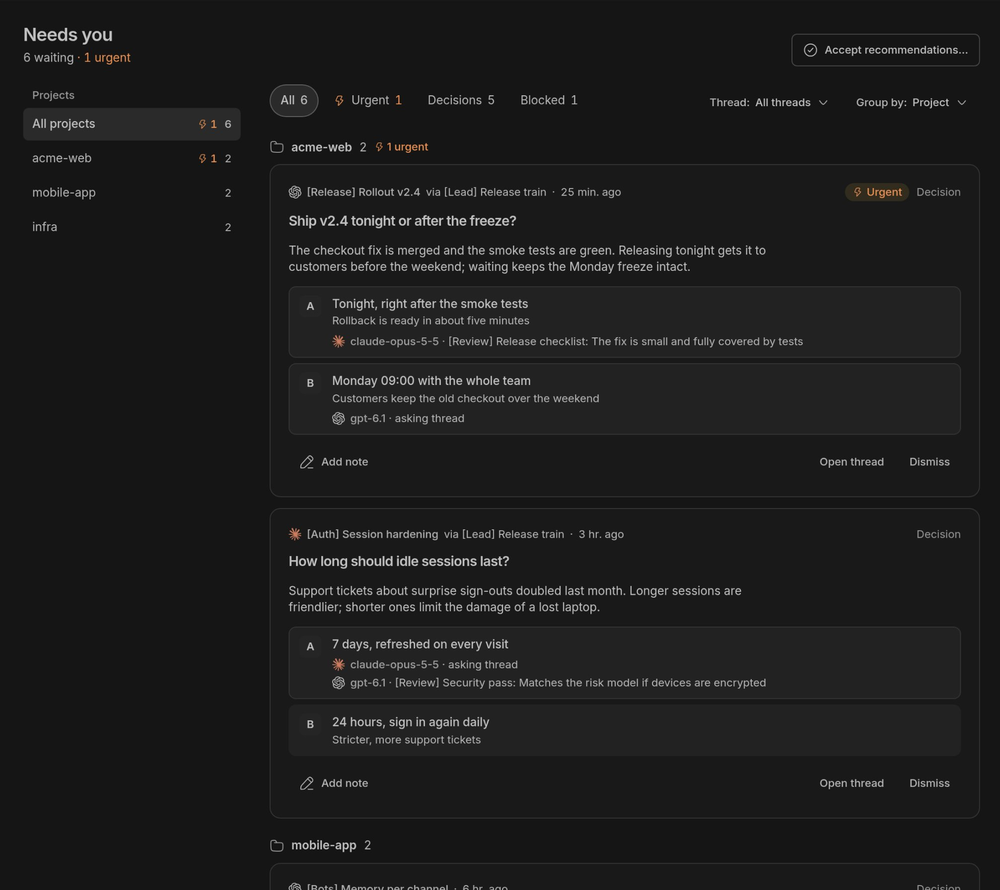
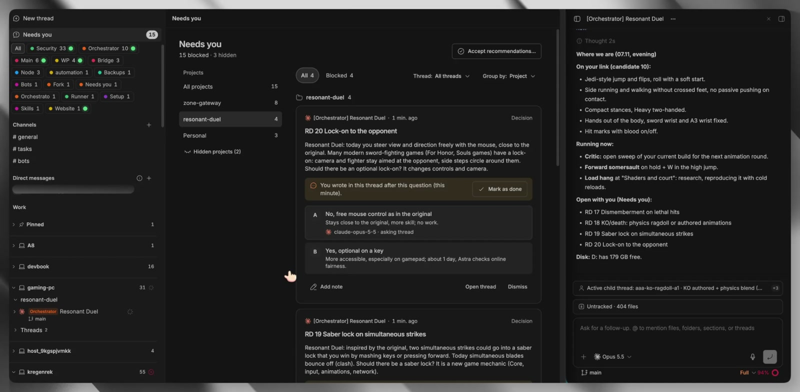
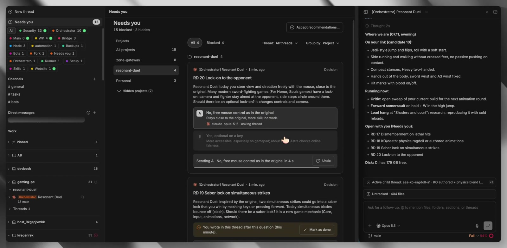
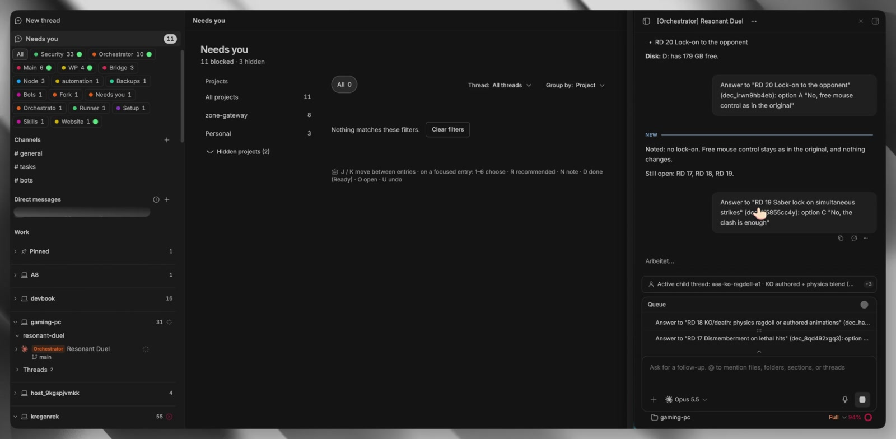

# Needs-you decision inbox (@kevinkern)

## Sources and evidence

[Video post](https://x.com/kevinkern/status/2119134370158284875), 7 Nov 2026 18:26 GMT; [quoted screenshot post](https://x.com/kevinkern/status/2118477900899082416), 5 Nov 2026 22:57 GMT. Bio: building AI apps, still human in the loop. Saved under 8 Nov as requested. The author says 80% of traces are useless **to him** and aggregates decisions across projects and machines. Treat that percentage as personal judgement, not a measured universal finding.

This reference comes partly from a **video-model analysis checked against stills** from the best supplied 2204x1080 MP4, plus direct inspection of the original quoted screenshot and both reply threads. All displayed data are treated as mock/demo data. Neither cross-machine synchronisation nor backend reliability is proven by these captures. No definitive app name or public implementation link from the author was recovered in these threads; do not assign another product's name to it.

## What to steal

**An inbox of decisions, not a dashboard of agent motion.** A useful card prepares a choice rather than making the human reconstruct a trace. Cross-project aggregation saves navigation, but grouping, priority, context and consequences are what make the choice legible.

### Quoted screenshot: the decision contract

Header: **Needs you**, **6 waiting · 1 urgent**, and **Accept recommendations...**. Left project list has pending counts; top filters are All, Urgent, Decisions and Blocked. Thread: All threads and Group by: Project control scope. These counts need not be mutually exclusive.

Each card contains a thread header, via-lead attribution and age; an Urgent or Decision tag; a question and context; options A/B with a one-line consequence; asking-model attribution or a second-model **[Review]** note. Footer actions are **Add note**, **Open thread**, **Dismiss**. The screenshot literally labels the models `claude-opus-5-5` and `gpt-6.1`; these are displayed attributions, not independently verified execution records. Do not copy the mock project names or treat favourable review text as a correctness guarantee.

### Video: routing and answering without losing place

Four visual regions: global navigation/machine tree; project counts; decision cards; active thread and work context. The opening selected project has four decisions, while the overall header says **15 blocked · 3 hidden**. The video filters are **All** and **Blocked**, not the screenshot's full filter set. Some cards have **three options**, not just A/B. A warning says the human wrote in the thread after the question, with **Mark as done**: a useful stale-request cue, not proof of automatic resolution.

At about two seconds the chosen option remains visible with a compact **Sending A ... in 4 s** row and **Undo**. This is a cancellation window before dispatch, not demonstrated rollback of an agent's later actions. The five-second candidate was already a less useful **Sending...** transition, so the clear two-second still replaces it. The supplied video analysis reports subsequent answers being queued as more cards are cleared.

At eighteen seconds the selected view says **Nothing matches these filters. Clear filters**. Overall work remains: **11 blocked · 3 hidden**, so this is not an all-projects-complete state. The right thread shows submitted answers and a **Queue** of pending ones, not a generic Activity queue. Footer shows the machine **gaming-pc** and active model **Opus 5.5**. Visible card attribution is `claude-opus-5-5`; option prose mentions Astra. The author's replies, rather than the video alone, establish his claimed model mix.

**Correction to the supplied video analysis:** the bottom legend is keyboard help, not hidden/recommended/done statistics: **J / K move between entries; on a focused entry: 1-6 choose; R recommended; N note; D done (Ready); O open; U undo**. Counts of hidden items belong in the header. Three retained frames are at 0, 2 and 18 seconds, each scaled to 1600px wide; the original quoted screenshot is preserved separately.

## Useful replies and limits

Both conversations were searched together: 23 results including two roots, then an empty next page. Long replies were recovered through note_tweet lookup/search where the initial response truncated them.

- [@MrClicker_1](https://x.com/MrClicker_1/status/2119157611186504144) asks where the interrupt boundary lies. [Author's full answer](https://x.com/kevinkern/status/2119162607819010484): initially he defines schemas, architecture, stack and boundaries; **all merges and deploys require his approval**. Later he reviews decisions and grants more permissions. He names Opus 5.5, Astra and Sol as his team. This is his account, not something the UI enforces by itself.
- [Who defines the choices?](https://x.com/emilecairncross/status/2118478472645403044) [@kevinkern replies](https://x.com/kevinkern/status/2118480983708016971): agents.md and skills define autonomous scope, options mostly come from different models; he pairs Opus with a more restrictive Astra and escalates conflict. Model diversity is not proof of independence or calibrated review.
- [@codeanand](https://x.com/codeanand/status/2118485820286107763) distinguishes **stuck** from **done, what next?**. [Author proposes separate filters](https://x.com/kevinkern/status/2118487412472963253) for next-step review/deploy versus blocked choices; a planned refinement, not fully established by the shown UI.
- [@isbkch](https://x.com/isbkch/status/2119156084694770034): surface plan changes but retain raw traces for postmortems. [@p_wilfried_](https://x.com/p_wilfried_/status/2119180664863961159) warns human context degrades across many projects and hours. Aggregation does not remove attention limits.
- [@kai_on_call](https://x.com/kai_on_call/status/2119141582071074967) wants an exact question and what happens without an answer. [@DanielLenton1](https://x.com/DanielLenton1/status/2118506952745754740) asks about accepting all six recommendations; no author answer recovered. A visible bulk button is not evidence that bulk approval is safe.

Keep defer/reject/ask-for-more-context alongside predefined options: framing the choices is itself a source of bias. Make stale SHA/context, risk and model disagreement visible. A priority label should explain urgency rather than reward agents for interrupting more loudly.

## Related UX references

Verified paths: [activity log and undo](2026-11-02-iliasconfidency-agent-activity-undo.md), [attention bottleneck and generated UI](2026-11-01-odysseus0z-attention-bottleneck-gen-ui.md), [Maple Factory review inbox](2026-11-02-afomera-maple-factory.md), [Agent Fleet needs-you tree](2026-11-02-flohoeller-agent-fleet.md), [CarePath evidence and uncertainty](2026-11-02-iliasconfidency-carepath-show-your-work.md), [Auton scoped approvals](2026-11-02-jubayer6910-auton-approvals.md). The existing [component index](agent-components/README.md) also has Agent Inbox and Review Center patterns. Pair this inbox with the [long-lived state and causal log argument](../reading-notes/2026-11-08-smehmood-choreography-over-durable-workflows.md), rather than throwing away the history it hides.

## GHCP mapping for Sam's factory

| Pattern | Native GitHub/GHCP starting point | Glue Sam builds |
| --- | --- | --- |
| Structured question | Issue/PR comments, labels, custom agent instructions and skills | Agent ends a bounded task with question, 2-3 options/consequences, recommendation, evidence/SHA, deadline/default-to-wait and separate-model review. Use `needs-decision`; distinguish stuck, review-ready and permission escalation. Instructions encourage this format, a schema validator enforces it |
| Cross-repo inbox | GitHub search, saved views, Projects; [Agentic Workflow event/dispatch triggers](https://github.github.io/gh-aw/reference/triggers/) | Aggregate labelled items into a dashboard or digest, with project/machine filters, age, risk and unresolved disagreements. Deduplicate by decision ID; a digest alone is not an interactive inbox |
| Answer resumes work | Comments, coding-agent follow-up interactions and event-triggered Actions | Authorised reply selects decision ID/option against the exact current SHA. Route to the coding agent's supported follow-up path, or start a new bounded task with persisted context if its session ended. A generic comment/label does not automatically resume an agent. Log who authorised which effect; never parse arbitrary issue text as approval |
| Batch accept and Undo | No stock transaction spanning arbitrary agent decisions | Preview exact eligible decisions, exclude high-risk/expired/conflicting ones, then delay dispatch for an Undo window. Cancel unsent work; after dispatch use explicit compensating actions where possible. Never promise that merge, deploy or external effects are universally reversible |
| Hide traces by default | PR/check/run links and workflow logs | Decision-focused default with evidence and trace drill-down. Retain causal events, policy/model versions and approval history; redaction and retention are distinct from UI hiding |

Keep pstack's deterministic checks as hard gates. Choosing an option is not approving a merge or deployment. The valuable feature is compressing the human's decision context while preserving proof and scope, not making a wall of traces disappear.
